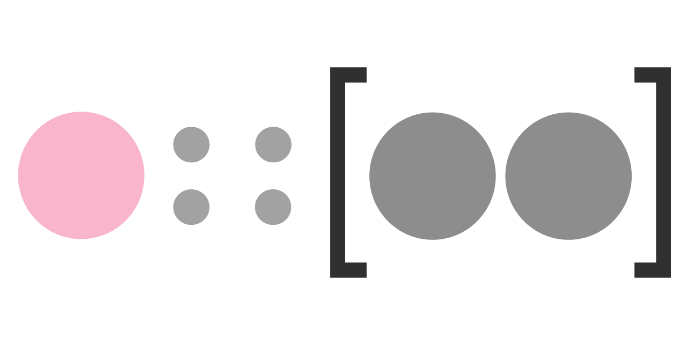

# 🌐 Headscale

{ width="64" height="64" }

<small>Logo: © 2020 Juan Font, <code>BSD-3-Clause</code>, <a href="https://github.com/juanfont/headscale/blob/f00c412cde4a000cc091037f926519b99ceb7626/docs/assets/logo/headscale3-dots.svg" target="_blank" rel="noopener noreferrer nofollow">source</a>. Shown only to identify the app; any trademark stays its owner's.</small>

> Self-hosted Tailscale control server with Headplane admin UI

**Category:** vpn  
**Tags:** `vpn`, `wireguard`, `mesh`, `tailscale`  
**Website:** <https://headscale.net/>  
**Source:** <https://github.com/juanfont/headscale>

## About

Headscale is an open-source implementation of the Tailscale control server. Tailscale clients register with it to join a private WireGuard mesh network that you run yourself. The bundled Headplane gives it a web admin interface.

People register their devices by signing in through OpenID Connect, limited to the access group.

Headscale can also be this server's Portcullis VPN provider, so apps can be reachable only from the VPN.

## Authentication

| Property | Value |
|----------|-------|
| **Method** | `native-oidc` |
| **SSO** | :white_check_mark: Yes |
| **Group Access** | :white_check_mark: |
| **Group Admin** | :x: |
| **Access Group** | `users_headscale` |
| **Admin Group** | `admin_headscale` |
| **Subdomain** | `vpn-admin`, `vpn` |

Auth Notes

Headscale, a Tailscale control server: people register nodes by signing in with OIDC, and the Headplane admin UI has its own OIDC client. It can also be this server's Portcullis VPN provider.

<strong>Identity:</strong> users are keyed on the OIDC subject (<code>iss</code> + <code>sub</code>) and named after <code>preferred_username</code> (the immutable LLDAP username); <code>email_verified_required</code> stays true, so the user-editable, unverified LLDAP email is never synced. Write ACL policy users as <code>&quot;&lt;username&gt;@&quot;</code>, never by email.

<strong>Headplane:</strong> the admin UI has its own OIDC client; it keys its users on <code>sub</code> and links them to the Headscale user with the same <code>sub</code> (its email fallback finds nothing because Headscale stores no unverified email). The first Headplane user becomes owner, later ones get the member role.

No group-based access restriction — all OIDC users can register nodes.

<strong>Post-start step for Headplane:</strong> create an API key with <code>docker exec portcullis-&lt;instance&gt;-headscale-1 headscale apikeys create --expiration 365d</code> (<code>portcullis-headscale-headscale-1</code> for the default instance), paste it into the <strong>Headscale API key</strong> setting, then restart the app. Renew it before it expires.

<code>config.yaml</code> is regenerated from the template on every start (so hostname and client changes apply), which means manual edits to it in the <code>headscale-config</code> volume are lost; change the template instead.

<strong>Portcullis VPN provider</strong> (<code>vpn:</code> below): once wired on this instance's VPN tab (<strong>Settings → Network → VPN</strong> lists the providers and links there), the tailnet can carry VPN-only access to this server's apps.

<ul>
<li>A gateway node (tailscale/tailscale in userspace mode, no TUN or capabilities, tagged <code>tag:portcullis-gateway</code>, registered by the <code>gateway-key</code> start hook with a single-use pre-auth key) forwards tailnet connections to Portcullis with PROXY v2.</li>
<li>The <code>vpn-devices</code> hook tells Portcullis who owns each node: only nodes of Headscale users who signed in through Portcullis count (keyed on the OIDC subject), local Headscale users' nodes never do.</li>
<li>The hooks use the <strong>Headscale API key</strong> setting: without it the gateway doesn't register and the device list goes stale (VPN-only apps are then denied), and when the key expires (365 days with the command above) the same happens until a new one is set.</li>
<li>A removed node is reflected within the refresh interval (60 s).</li>
<li>The <code>vpn-dns</code> hook writes the Portcullis hostnames into Headscale's extra DNS records (MagicDNS), so tailnet clients reach this server through the gateway.</li>
<li>In whole-server VPN mode only the <code>headscale</code> router (coordination and DERP, which clients need to connect) stays on the internet; Headplane, an admin UI, becomes VPN-only.</li>
<li>The gateway reaches headscale's control and DERP server at its public hostname through Traefik's published port on this host (stable across headscale restarts), trusting the Hub's CA bundle that <code>headscale-init</code> hands over through a read-only volume.</li>
<li>The template adds no Headscale ACL policy (every node reaches every node, Headscale's default); an admin who adds one must let the VPN's people reach <code>tag:portcullis-gateway:443</code>, or the gateway is unreachable.</li>
</ul>

<strong>Upgrades:</strong> Headscale is pinned; upgrade one minor release at a time (its database migrations do not support skipping) and pick the Headplane release that supports that Headscale version.

## Routing

Traefik routers from `compose.yml`. The Hub replaces the TLS tier with the one derived from the app's [access policy](../operations/auth-policies.md#traefik-tls-tier).

| Router | Host | Paths | TLS tier | Forward-auth + group-gate |
|--------|------|-------|----------|---------------------------|
| `headplane` | `vpn-admin.<domain>` | all | `default` | :x: |
| `headscale` | `vpn.<domain>` | all | `public@file` | :x: |

## AI support

**No AI support:** No official MCP server; network control planes stay out of AI reach until one exists.

## Images

Pinned by version tag and digest; Dependabot proposes updates.

| Service | Image | Digest |
|---------|-------|--------|
| `gateway` | `docker.io/tailscale/tailscale:v1.104.7` | `sha256:72c1e19e0aed…` |
| `headplane` | `ghcr.io/tale/headplane:0.8.2` | `sha256:b053a0a6699d…` |
| `headscale` | `headscale/headscale:0.29.7` | `sha256:11f81665e842…` |
| `headscale-init` | `alpine:3.24.4` | `sha256:f59abe656b69…` |
| `vpn-glue` | `docker.io/library/python:3.15.2-alpine` | `sha256:a0f2e268f2ce…` |

## Settings

Options an admin sets in the Hub's [settings panel](../operations/hub.md#app-settings) (person-entered ones: each person, on [My apps](../operations/hub.md#my-apps)). **Scope** and **Applies** are explained in the [Manifest Reference](../guides/manifest-reference.md#settings).

| Setting | Type | Scope | Applies | Description |
|---------|------|-------|---------|-------------|
| **Headscale API key** | `secret` | instance | `restart` | API key Headplane uses to talk to Headscale. Create it after the first start with `headscale apikeys create` inside the headscale container. |

## Environment Variables

Per-app variables in the generated `.env`; `random` ones are generated by the Hub on first enable:

| Variable | Description | Generation |
|----------|-------------|------------|
| `HEADSCALE_OIDC_CLIENT_SECRET` | OIDC client secret for Headscale | `random` |
| `HEADPLANE_OIDC_CLIENT_SECRET` | OIDC client secret for Headplane admin UI | `random` |
| `HEADPLANE_COOKIE_SECRET` | Headplane session cookie secret (must be exactly 32 characters) | `random` |

## Keycloak Clients

**Headscale VPN** (`headscale`)

Redirect URI: `https://{{HOST_HEADSCALE}}/oidc/callback`

**Headplane Admin UI** (`headplane`)

Redirect URI: `https://{{HOST_HEADPLANE}}/*`

## Access URLs

- **VPN Control Server**: `https://{{HOST_HEADSCALE}}`
- **Admin UI**: `https://{{HOST_HEADPLANE}}`
