# Architecture

Portcullis is a collection of services that work together to provide unified authentication for self-hosted applications. This page describes how the components connect and how authentication flows work.

## Component Overview

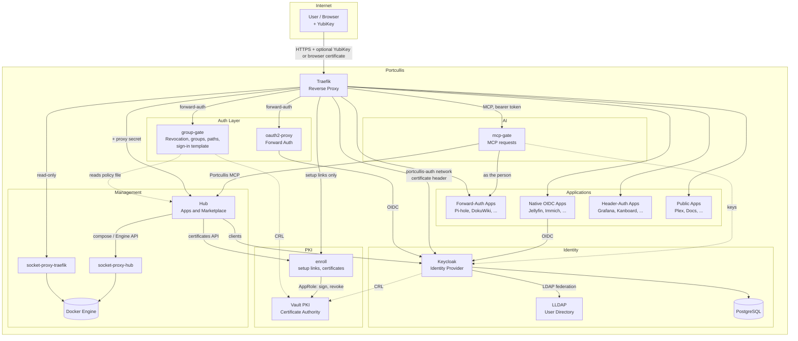

### Component Roles

| Component | Role |
|-----------|------|
| **Traefik** | Reverse proxy. Terminates TLS (one ACME wildcard cert), routes requests by subdomain, applies middleware chains, optionally requests a YubiKey or browser certificate. Reads Docker labels through its read-only socket proxy. |
| **oauth2-proxy** | Forward authentication. Redirects unauthenticated users to Keycloak (with a per-request `pc_method` for a one-method step-up), and returns identity headers and the access token on success. Sessions live in the session store; the browser's cookie is only a ticket. |
| **Session store** (`sessions`) | Valkey, memory only, reachable only by the two oauth2-proxies (internal network `portcullis-sessions`, one ACL user each). Holds the forward-auth sessions, so a session never outgrows its cookie and signing out ends it server-side. See [Security & Hardening](operations/hardening.md#session-store-sessions). |
| **group-gate** | Per-request authorization (forward-auth). Checks certificate revocation (both certificate authorities), the subdomain's required group and `path_groups`, then the app's sign-in template (the session's `amr` methods, certificate binding by issuer). Returns 403 or a step-up page. Logs the first request of each session to each app (`group_gate_data`, for sign-in history). |
| **Keycloak** | Identity provider, Portcullis's own image `ghcr.io/porelli/portcullis-keycloak` (`KEYCLOAK_IMAGE`: the official Keycloak plus the sign-in extension). Passkeys of three kinds, YubiKey and browser certificate login (each against its own CA and CRLs), password, one-method step-up (`pc_method`) and the per-app [sign-in template](operations/auth-policies.md#sign-in-flows-in-keycloak) check, from the Hub's `signin-keycloak.json` (`hub_data`, read-only); OIDC/SAML for apps. Federates users from LLDAP. |
| **LLDAP** | Lightweight LDAP directory. Stores users and groups (custom user fields are LLDAP attributes). They are managed in the Hub; `directory.<domain>` redirects to `people.<domain>` (LLDAP's own UI has no SSO and is reachable only from the server: `portcullis lldap-ui`). |
| **PostgreSQL** | Database backend for Keycloak. |
| **Vault PKI** | The internal certificate authority, in server mode (raft, auto-unseal): a root and two intermediates, `pki_int` for YubiKey certificates (PIV slots) and `pki_file` for browser certificates, each with its CRL. Default lifetime 30 days. |
| **enroll** | Serves setup links at `enroll.<domain>/invite/…` (the only route on that host), and the Hub's internal API (`:8444`): invites, and issuing, renewing, listing and revoking YubiKey and browser certificates through a least-privilege Vault AppRole. It generates browser certificates' keys and never keeps them. |
| **Hub** | Two listeners: `hub.<domain>` (admins only): app catalog, runs each enabled app instance as its own compose project, registers Keycloak clients, writes the policy file v6 (sign-in methods and templates, keyed by full hostname), `signin-keycloak.json` and `user-attributes.json`, delivers app settings ([Settings Delivery](#settings-delivery)), reports drift, manages added domains. `people.<domain>` (any signed-in user): Users & Groups (People, Groups, Org chart, Import) with per-request permission checks (admins, or delegated `edit_details` / `invite` / `remove` / `sign_in_help` permissions), My apps (each person's own app settings) and the Sign-in page (`/signin`: each person's sign-in methods, certificates and sign-in history). |
| **Domains service** | Manages added extra domains: creates DNS records, obtains wildcard certificates via ACME DNS-01, serves them to Traefik over its HTTP provider. Credentials stored encrypted at rest (age). See [Security & Hardening](operations/hardening.md#domains-service). |
| **forward-auth-ext** | Second oauth2-proxy for extra-domain hosts. Relative callback `/oauth2/callback`, host-only cookie `__Host-portcullis_ext`. Shares the Keycloak client with `forward-auth`. See [Hub Management](operations/hub.md#cross-domain-sign-in). |
| **Monitoring** (optional) | Compose profile `monitoring`: Prometheus, Alertmanager, Grafana at `metrics.<domain>` (`lldap_admin`), blackbox and textfile exporters. See [Monitoring](operations/monitoring.md). |
| **mcp-gate** | Terminates every MCP request of people's AI clients (`mcp.<domain>`, each app's `/mcp` endpoint, `hub.<domain>/mcp`, `people.<domain>/mcp`): checks the Keycloak token for exactly that resource, the person's population on every request, tool policy, limits and confirmations, logs every call, and forwards it to the app's companion as the person, never with their token. See [AI support](operations/ai.md#how-it-fits-together) and [AI support flow](#ai-support-flow). |
| **Socket proxies** | `socket-proxy-traefik` (read-only) and `socket-proxy-hub` (what compose needs): the only containers that mount the Docker socket. See [Security & Hardening](operations/hardening.md#docker-socket-proxies). |

## Repository Structure

Portcullis is organized as four separate repositories, each with a distinct responsibility. Their interfaces are defined in [Integration Contracts](guides/integration-contracts.md).

- **Core repo** ([porelli/portcullis](https://github.com/porelli/portcullis)) -- `docker-compose.yml` for all core services, the `./portcullis` admin CLI (libraries in `scripts/lib/`), group-gate (`group-gate/`), enroll (`enroll/`), Traefik dynamic configuration (`traefik/`), Vault configuration (`vault/`) and the Keycloak realm export. This is the only repo you need to clone to deploy Portcullis.

- **Hub repo** ([porelli/portcullis-hub](https://github.com/porelli/portcullis-hub)) -- The management web UI, published as a signed container image at `ghcr.io/porelli/portcullis-hub` (selected with `HUB_IMAGE`).

- **Templates repo** ([porelli/portcullis-templates](https://github.com/porelli/portcullis-templates)) -- The app templates (`<app-id>/manifest.yaml` + `compose.yml`), the manifest JSON Schema and the template validator. The Hub clones it on first startup as the default template source. Accepts outside contributions.

- **Docs repo** ([porelli/portcullis-docs](https://github.com/porelli/portcullis-docs)) -- This documentation site, built with [Zensical](https://zensical.org). App catalog pages are generated from the template manifests.

## Authentication Flows

Portcullis supports four authentication methods. Each app declares its method in its `manifest.yaml`.

### Forward Auth (oauth2-proxy + group-gate)

Used by apps that have no native SSO support (Pi-hole, DokuWiki, Scrutiny, etc.). Traefik delegates authentication to oauth2-proxy and authorization to group-gate before the request reaches the app. The router's middleware chain is `client-headers@file,portcullis-auth@docker,portcullis-groups@docker,security-headers@file`; `client-headers@file` (or `client-cert-pem@file`) must come first so group-gate sees the certificate (for revocation and the certificate binding).

If the session does not meet the app's [sign-in template](operations/auth-policies.md), group-gate answers with a 403 page: a step-up page whose **Continue** opens `https://auth.<domain>/oauth2/start?pc_method=<method>&rd=https://<app>/` (Keycloak then asks for that one method only), a "present your YubiKey certificate" page, or a needs-stronger page. (oauth2-proxy only serves `/oauth2/*` on `auth.<domain>`: a host-less router would get Traefik's default TLS options and be refused with 421 on every app host.)

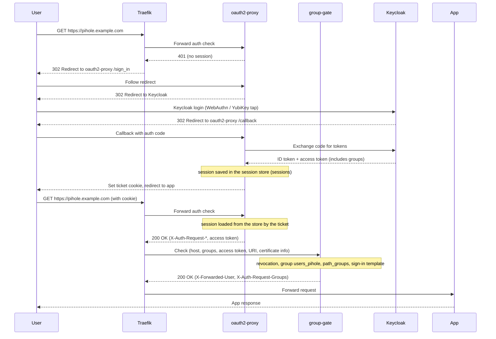

### Native OIDC

Used by apps with built-in OpenID Connect support (Jellyfin, Immich, Vaultwarden, Nextcloud, etc.). The app redirects to Keycloak directly, without oauth2-proxy.

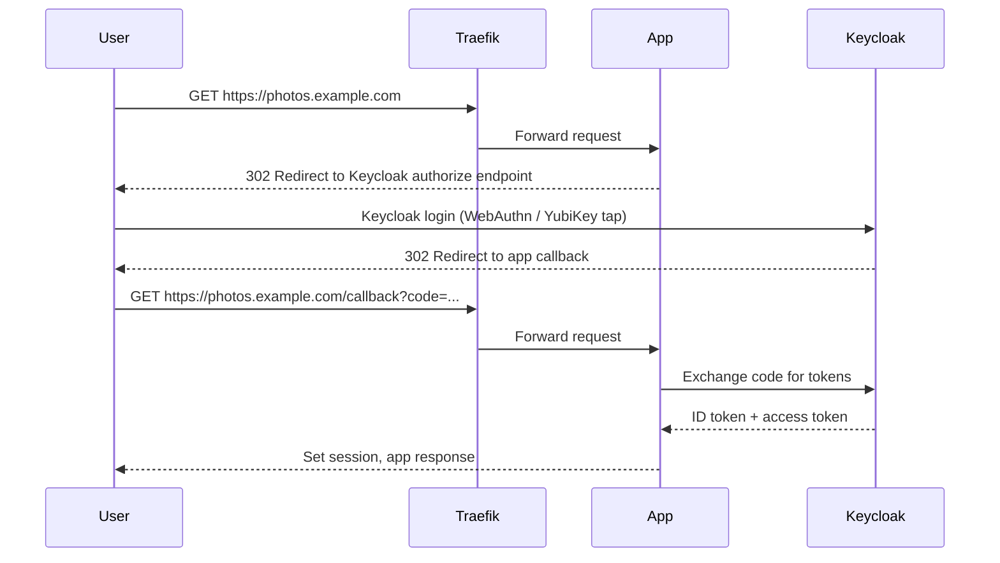

### Header Auth

Used by apps that accept a trusted identity header from the reverse proxy (Grafana, Kanboard, Firefly III, Guacamole, CloudBeaver). The user authenticates via forward auth, and the app reads `X-Forwarded-User` (the LLDAP username, set by group-gate; the email travels separately in `X-Forwarded-Email`). The app accepts that header only from Traefik's fixed IP, so other containers on `portcullis-proxy` cannot impersonate users.

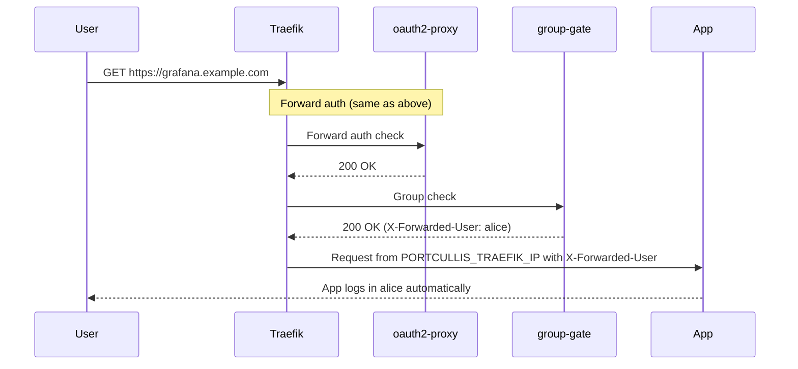

### YubiKey and browser certificates

When the YubiKey certificate method is on, the browser presents the certificate stored in the YubiKey's PIV slot during the TLS handshake; when the browser certificate method is on, it can present a browser certificate (a `.p12` the person created on the [Sign-in page](operations/auth-policies.md#the-sign-in-page)) the same way. Traefik verifies it against the chain of the host's TLS option (`protected`: root + the YubiKey CA only, so a browser certificate never passes; `protected-any` and `authaware`: root + both intermediates), but **does not check revocation**; that happens in group-gate and Keycloak. Both tell the two kinds apart by the issuing CA: `pki_int` (YubiKey) or `pki_file` (browser).

```mermaid
sequenceDiagram
    participant U as User + YubiKey or browser certificate
    participant T as Traefik
    participant K as Keycloak
    participant G as group-gate
    participant A as App

    U->>T: TLS handshake (certificate)
    T->>T: Verify chain against certs/ca-chain.crt
    U->>T: GET https://auth.example.com/... (login)
    T->>K: via portcullis-auth, X-Forwarded-Tls-Client-Cert (PEM)
    Note over K: trusts the header only from Traefik's IP;<br/>the step whose CA issued the leaf runs:<br/>re-validates chain + EKU, checks that CA's CRLs (fail closed)
    K-->>U: Session with amr=mtls (YubiKey) or amr=file (browser)
    U->>T: GET https://app.example.com (cookie + certificate)
    T->>G: forward-auth with X-Forwarded-Tls-Client-Cert (PEM) and -Info
    Note over G: serial not revoked (both CAs)?<br/>leaf signed by the CA of the counted method?<br/>then CN must equal preferred_username
    G-->>T: 200 OK
    T->>A: Forward request
```

Routers on the `protected` tier without forward-auth (`mtls`-method apps) rely on the TLS handshake alone: there only a YubiKey certificate gets in, and it works until it expires. See [Certificates](setup/certificates.md#revocation).

### Signing in as someone else

An administrator can [sign in as another person](operations/auth-policies.md#signing-in-as-someone-else) after a fresh YubiKey touch and a typed reason. The Hub checks the rules, records the impersonation and publishes it in `impersonation.json` on the `hub_data` volume; the administrator's browser then opens a one-time link to the Keycloak extension's own start (Keycloak's stock impersonation is switched off), which replaces the administrator's session with one for the person carrying the administrator's sign-in methods. Tokens of that session carry `act` (the administrator) and `pc_imp` (the impersonation's id and end). group-gate checks both against the file on every request, binds certificates to the administrator, never steps up, adds `X-Forwarded-Impersonator` / `X-Forwarded-Impersonation` and shows the banner; the Hub's pages turn read-only; mcp-gate refuses such tokens. Stop, 30 minutes or the Settings switch end it: the Hub rewrites the file (group-gate denies at once), Keycloak logs the session out within 15 seconds, and the person's history and next sign-in show who, when, why and the apps opened ([contract §8.1](guides/integration-contracts.md#impersonation-new-sign-in-part-3)).

## TLS Tiers

Traefik's static `traefik/dynamic/tls.yml` defines four TLS option sets. The Hub picks each app's tier from its sign-in template and the certificate methods that are switched on.

| Tier | Traefik TLS Option | Certificate Behavior | Use Case |
|------|-------------------|---------------------|----------|
| **protected** | `RequireAndVerifyClientCert`, `certs/ca-chain-yubikey.crt` (the YubiKey CA alone, no root) | A YubiKey certificate required -- the TLS handshake fails without one (a browser certificate never passes) | `mtls`-method apps; templates where every alternative needs the YubiKey certificate |
| **protected-any** | `RequireAndVerifyClientCert`, `certs/ca-chain.crt` | A YubiKey or browser certificate required | Templates where every alternative needs a certificate and at least one accepts the browser certificate |
| **authaware** | `VerifyClientCertIfGiven`, `certs/ca-chain.crt` | Optional -- verified if present, passkeys otherwise | Apps whose template has a certificate in some alternative (Standard, Strong); every core page |
| **public** | no `clientAuth` | Not requested | Templates with no certificate method on, apps that manage their own auth |

With both certificate methods off, no app asks for a certificate (except `mtls`-method apps, whose certificate is their sign-in); core pages always offer an optional one. See [Sign-in Methods and Templates](operations/auth-policies.md#traefik-tls-tier).

## Network Topology

Traefik is the only service exposed to the internet (ports 80 and 443). It is attached to every network it has to reach; nothing else bridges them.

- **`portcullis`** -- Core services: Keycloak, LLDAP, Vault, PostgreSQL, oauth2-proxy, group-gate, Hub, enroll. Apps are not on it and cannot reach these services directly.
- **`portcullis-proxy`** -- Traefik and app frontend services; Traefik's docker provider routes over it. Fixed subnet (`PORTCULLIS_PROXY_SUBNET`, default `172.31.250.0/24`), Traefik always at `PORTCULLIS_TRAEFIK_IP` (default `172.31.250.2`), other containers from `PORTCULLIS_PROXY_IP_RANGE` (which excludes Traefik's IP). Header-auth apps trust identity headers only from Traefik's address.
- **`portcullis-auth`** -- Internal network with only Traefik (fixed `PORTCULLIS_AUTH_TRAEFIK_IP`, default `172.31.251.2`) and Keycloak. Keycloak accepts proxy headers -- including the forwarded certificate for YubiKey and browser certificate login -- only from that address.
- **`portcullis-sessions`** -- Internal network with only the session store `sessions` and the two oauth2-proxies (`forward-auth`, `forward-auth-ext`).
- **`portcullis-mcp`** -- Internal network with only `mcp-gate`, Keycloak and the Hub (fixed addresses): the gate fetches Keycloak's keys and calls the Hub's MCP listener here. The gate also sits on `portcullis-proxy` at `PORTCULLIS_MCP_GATE_IP` (default `172.31.250.3`), where Traefik routes MCP requests to it and it reaches the app companions.
- **`socket-proxy-traefik`, `socket-proxy-hub`** -- Internal networks, each shared by one client and its Docker socket proxy.
- **Per-app networks** -- Each app's compose project (`portcullis-<app-id>`) has its own `default` network. Internal services (databases, caches, workers) live only there, isolated from all other apps.

Frontend services join both `default` and `portcullis-proxy`; internal services only `default`.

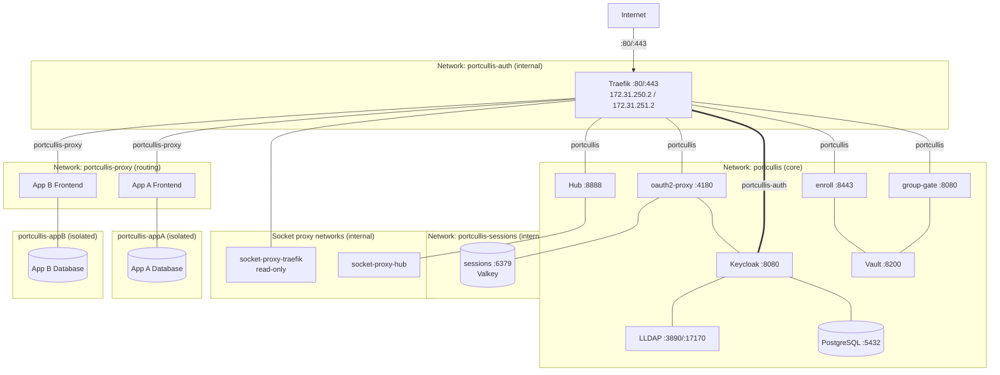

[Security & Hardening](operations/hardening.md#networks) lists every network's members and addressing rules.

Native OIDC apps that need to reach Keycloak do so over HTTPS via the public URL (`https://auth.<domain>`), not via the internal network.

DNS is configured as a wildcard record (`*.portcullis.example.com`), so all subdomains resolve to the same server IP. Traefik routes each subdomain to the correct container based on Docker labels.

## Custom Attributes Flow

Custom user fields (department, office, manager, etc.) defined in the Hub flow to apps in two ways:

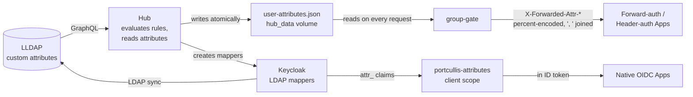

### For Forward-Auth and Header-Auth Apps

1. **LLDAP**: stores users and custom attributes (created by the Hub as non-user-editable LLDAP user attributes).
2. **Hub**: reads field values via GraphQL, evaluates rules, writes `user-attributes.json` (only fields with `share_with_apps: true`) atomically with the policy file.
3. **group-gate**: reads `user-attributes.json` on every request. On allow, returns `X-Forwarded-Attr-<Header-Name>` headers. Values are percent-encoded (`%` → `%25`, `,` → `%2C`), joined with `, `, limited to 1 KB per value (before encoding).
4. **Traefik**: forwards these headers to the app (the `portcullis-groups` middleware uses `authResponseHeadersRegex: ^X-Forwarded-Attr-`). Client copies are stripped by the forwardAuth regex.
5. **App**: receives the headers. **Apps must percent-decode each value after splitting on `, `**.

### For Native OIDC Apps

1. **LLDAP**: stores users and custom attributes.
2. **Hub**: on every field change (create, update, delete, or `share_with_apps` toggle), syncs Keycloak LDAP attribute mappers on the `portcullis-attributes` client scope via the Keycloak admin API. Each shared field gets:
    - an LDAP attribute mapper: `portcullis-attr-<field>` (reads `<field>` from LDAP)
    - a protocol mapper: `attr_<field>` claim (user attribute `<field>` → claim `attr_<field>` in ID token, access token, userinfo)
3. **Keycloak**: syncs users from LLDAP via LDAP federation (periodic and manual sync). The mappers read field values from LDAP.
4. **App**: receives `attr_<field>` claims in the ID token (no percent-encoding; multi-valued fields are JSON arrays).

The Hub attaches the `portcullis-attributes` client scope as a default scope to every client it creates. On reconcile, it re-attaches missing mappers.

## Settings Delivery

App settings ([Hub → App settings](operations/hub.md#app-settings),
[contracts §13](guides/integration-contracts.md#13-settings)) are declared by
the template and delivered by the Hub. The Hub stores canonical values
(bytes, seconds, typed JSON) in `state.yaml` and secrets in a separate
0600 store, then works out what each app should see and hands it over in
the form the template asked for.

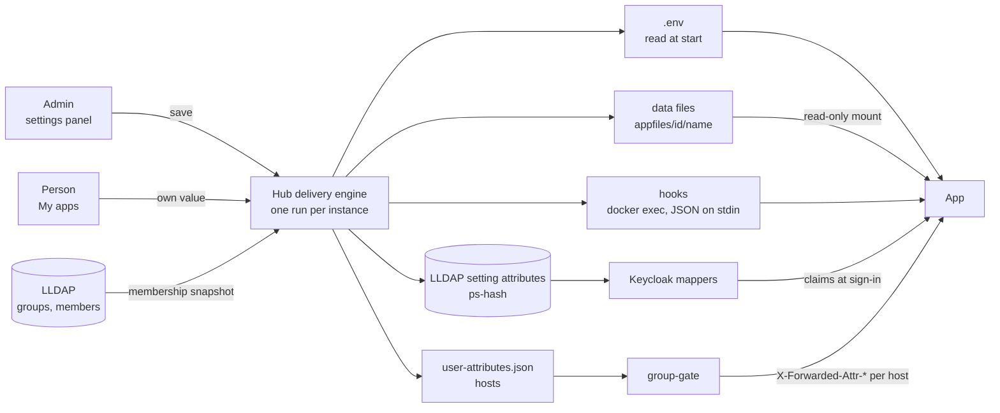

One delivery run, per instance and never two at once:

1. **Snapshot.** The Hub reads the directory once (members, group ids,
   account ids) and works out the population: who has access to the
   instance. Group rows and records count only when their group still has
   the LLDAP id they were saved with.
2. **Resolve.** Per-person options get one value per person (`max`, `min`,
   `priority`, …); values people entered are kept for people still in the
   population whose account still matches.
3. **Compare.** Each unit's desired output (the env, each data file, each
   claim attribute, the headers, each hook's input) is compared with what
   was last delivered (`delivered.json`: hashes only, never values).
   Unchanged units are skipped.
4. **Deliver**, in order: data files, then claims (an LLDAP attribute per
   option, written per person, and a mapper on the instance's Keycloak
   client), then headers (published with the policy file), then hooks, then
   the strongest effect: nothing, one reload or one restart (in the
   background).
5. **Record** the outcome per unit; the panel's Deliveries strip shows it.

If the settings change during a run, the stale run stops at its next write
(`superseded`) and a new run starts with the newest state. If the directory
is unavailable, units that need people keep their last delivery. A disabled
instance gets nothing; a busy one (another operation running) is retried
shortly. Membership changes are debounced 60 seconds per instance, so a
batch of joins gives one restart. On start, data files are written before
the containers are created, and start hooks run after a successful start.

Each delivery fails closed: a value that can't be rendered for a claim or
header is left out (the person gets none, never someone else's or a
default), and a stale claim value is never kept in a token mapper.

## File Sharing (Samba and Time Machine)

The Samba and Time Machine templates serve SMB3 with a password of each
person's own ([operator guide](operations/file-sharing.md),
[contracts §13.16–§13.17](guides/integration-contracts.md#1316-per-person-credentials-and-ids-new-file-sharing)).
They have no web page and no Traefik router. The Hub knows nothing about
Samba: it implements two generic option types, `person_secret` (a
password per person) and `person_id` (a uid per person), plus hooks, `tsv`
data files and hook reports. Everything Samba-specific is in the
templates' manifests and their converge script, `portcullis-sync`.

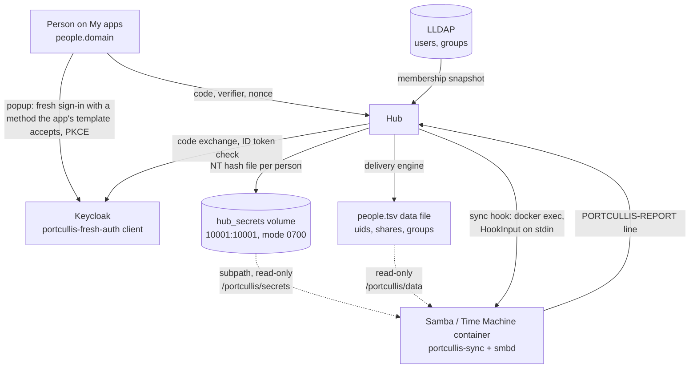

### hub_secrets volume

- **Core** declares the volume `hub_secrets` (`portcullis_hub_secrets`),
  mounts it into the Hub at `/secrets` (`HUB_SECRETS_DIR`), and sets its
  root to `10001:10001`, mode `0700` (the Hub's uid) on every `init`, `up`,
  `upgrade` and `restore`.
- **The Hub** checks the owner and mode at start. If they are wrong, the
  credential routes answer `503` and every instance with a `person_secret`
  option refuses to start, naming the reason.
- **Contents:** one directory per instance and option,
  `<instance>/<key>/` (`0700`). Each holds one `<username>.nt` per active
  password (`0600`, owner 10001): the uppercase hex of MD4 over the
  UTF-16LE encoding of the password, 32 characters and a newline. The
  volume also holds `.epoch` (below).
- **Mounts:** the Hub's override mounts only that instance's and option's
  directory, read-only, as a volume subpath at `/portcullis/secrets` in the
  template's one service. A container never sees another instance's
  hashes. Before every `up` the Hub checks that nothing else mounts the
  volume.
- **Backups:** the volume is never backed up. A core restore empties it
  ([Backups](operations/backups.md#what-is-backed-up-and-how)).

### Creating a password

1. On [My apps](operations/hub.md#my-apps) the person clicks **Create
   password**. The page opens Keycloak's `portcullis-fresh-auth` client in
   a popup (PKCE S256, `prompt=login`, `max_age=0`), so
   they sign in again with a method the app's template accepts (a password
   too, when the template takes one).
2. The popup hands the code back to the page, which posts the code, the
   PKCE verifier and the nonce to the Hub. The Hub exchanges the code with
   Keycloak itself and checks the ID token: the sign-in is at most 300 s
   old, its `pc_fresh` claim (the method that ran in that sign-in; never `amr`)
   is a switched-on method of the instance's template (its own pick, else
   the default; [contract §8](guides/integration-contracts.md#8-keycloak-clients-core-hub-templates)), the nonce matches,
   `aud` / `azp` is the client, and `preferred_username` is the caller.
3. The Hub draws 24 characters from a 54-character alphabet with
   `crypto/rand`. It shows them as 6 groups of 4 joined by `-`: 29
   characters, dashes included. The Hub computes the NT hash itself.
4. Under the Hub's lock, it writes the hash file, rotates the secrets
   epoch, and saves the metadata (id, version, uuid, dates; never the hash)
   to `state.yaml`. Then it writes the audit.
5. The password goes into the one answer (`Cache-Control: no-store`) and
   the buffer is zeroed. It never appears anywhere else: not in logs, the
   audit, hook input or output, or a backup.
6. An immediate `credential_change` delivery runs the app's hook. A
   **regenerate** also removes the old hash: it is applied like a
   revocation (below), so the old password stops working even when the
   hook is skipped or fails.

**Ids:** each person gets a uid from the Hub-wide pool `posix_uid`,
20000–59999. A uid is allocated once, keyed by username and LLDAP uuid,
and never reused. An account that is deleted and created again gets a new
uid, so it never owns the former account's files.

### People file and the sync hook

The people file is an ordinary settings data file
([Settings Delivery](#settings-delivery)) in `tsv` format, read-only at
`/portcullis/data/people.tsv`. It holds each person's uid, the connect
address and the Bonjour switch. For Samba it also holds the share names
and the reader and writer groups, expanded to their members. For Time
Machine it holds the share prefix and each person's size limit. The delivery engine renders it
like any data file. It is written again when people join or leave, when a
setting changes, and on every start. A change to it runs the hook
(`on_membership_change: hook`).

The hook `sync` (`portcullis-sync`, timeout 60 s) runs on `start`,
`settings_change`, `membership_change` and `credential_change`. Docker
exec gives it the full desired state on stdin as JSON (the **HookInput**),
never a diff:

- `trigger` comes first;
- then the data-file document;
- then `credentials`: for each person with an active password, its id and
  version, never a hash.

The script reads the hashes from its own read-only mount. It converges,
idempotently and under its own lock:

1. the Unix accounts (each person's Hub uid; every other account in its
   range is removed);
2. the passdb, on tmpfs;
3. the whole `smb.conf`, which `testparm` must show exactly as hardened.

It then ends the open sessions of people whose account went, whose hash
changed, or whose shares shrank or went from write to read.

Any failure after a change has started is fail-closed: the script stops
smbd and writes a down marker, which the healthcheck and smbd's run
script refuse until a run succeeds. The script prints one
`PORTCULLIS-REPORT` line (below 60 KiB). The line holds:

- former accounts' folders;
- wrong owners;
- refused share and user names;
- the per-person folder sizes.

A detached background job measures the sizes, and every hook run reports
the last ones it cached. The Hub keeps the last report for the File
sharing tab and the doctor. A report never drives revocation.

### Revocation

A password is revoked when its holder leaves the instance's access group,
is deleted (or deleted and created again), revokes it on My apps, or an
admin revokes it on the File sharing tab. The Hub runs one holder check
for every trigger:

- **Hub-made changes** (member removal, user or group deletion) and the
  rule evaluator's removals: the check runs at once, with no debounce.
- **Changes made directly in LLDAP:** the check runs on the evaluator's
  60 s tick. The same tick also compares the share readers and writers
  with the last delivered people file. A removal delivers at once, and
  the hook ends the sessions of people whose shares shrank.

Every revocation is applied the same way, outside the delivery engine:

1. Under the Hub's lock, the hash file and the active metadata go (the
   epoch is rotated). Then the audit is written.
2. No running container: done. The next start's converge has no account
   for them.
3. Otherwise the Hub runs the `credential_change` hooks with a freshly
   built HookInput. It holds the instance's delivery lock (taken within
   2 s) and gives each exec at most 8 s.
4. Anything else is handled by the kill path. That covers: no hook run,
   the lock not obtained, a skip, a failure, a timeout, or a hash file that
   may remain. The Hub kills the project (`compose down`) and starts it
   again in the background, so no old session survives. A hash file that
   may remain also makes the Hub refuse to start file-sharing instances
   until a secrets reconcile succeeds.

Every lifecycle down of the instance (backup, restore, delete, restart,
disable) waits once, at most 10 s, for the delivery lock, so a revocation
hook in flight finishes; then it goes on. A restart's start step then
waits for the delivery lock without a time limit.
Measured in the core `e2e-filesharing` CI job (three runs, plus one
more), from the change until the session was gone and a new login was
refused:

- a removal through the Hub took 0.8–0.9 s;
- a removal directly in LLDAP took 3.4–51.8 s (it waits for the 60 s
  tick);
- a writer demoted to reader took 3.5–3.6 s.

See [Measured revocation times](operations/file-sharing.md#measured-revocation-times).

### Secrets epoch and restores

The Hub writes a random epoch (16 random bytes, hex) both into
`state.yaml` and into `<secrets>/.epoch`. It rotates the epoch on every
credential mutation: create, regenerate, revoke and void. At boot, and
before every credentials delivery unit, it compares the two.

On a mismatch, every credential of every instance is voided
(`reason: restore`) and the volume is emptied. A mismatch comes from a
core restore, an older `state.yaml` next to a newer volume, or a crash
between the two writes. Every uid pool also advances by 1000, so a pool
restored from an older `state.yaml` never hands out a uid that files on
disk may carry. An instance restore voids that instance's credentials
only. In both cases, My apps shows "Your password was reset by a restore
on <date>; create a new one."

## Shared folders and the doctor

A [shared folder](operations/hub.md#shared-folders) is a host directory
several app instances use. The Hub gives it one group (a gid from
60000–60999, or an adopted one), mounts it into each app (read-only for
readers), adds the gid to the app's groups, and keeps the files' ownership
consistent: the folder's group, setgid directories and default ACLs, so
whatever uid and umask an app writes with, the others can use the result.
The rules are [contracts §13.15 and §14](guides/integration-contracts.md#14-shared-folders-and-the-doctor).

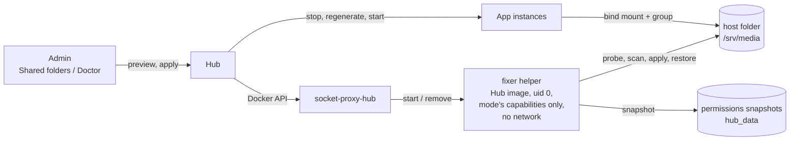

The Hub never touches host files itself and has no host shell. Every
change goes through a short-lived **fixer helper** (the Hub's own image,
started through the Hub's socket proxy, one bind mount of the folder) and
through one sequence: preview (nothing changes) → stop the affected apps →
permissions snapshot → apply exactly the planned entries → verify → save
the settings → start the apps. Undo restores the snapshot the same way.
See [Security & Hardening](operations/hardening.md#shared-folders-and-the-fixer-helper)
for the helper's limits.

The **doctor** reads the whole setup (state, templates, overrides, ports,
settings, group membership, cached disk scans, and the groups of the
processes running in each app's containers) and reports findings with
their severity and the fix it offers: one-click fixes go through the same
previewed operations, risky ones are explained, and it never changes
anything by itself. It also judges ports templates mark LAN only against
the admin's [local networks](operations/hub.md#local-networks).

## AI Support Flow

People's AI clients (Claude, Claude Code, an AI page) reach apps through
`mcp-gate`, as the person ([AI support](operations/ai.md)):

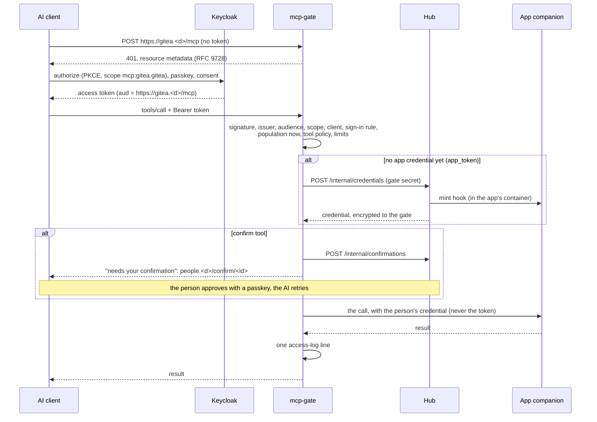

- **One resource per token.** Each MCP endpoint is its own OAuth resource;
  the Hub creates a Keycloak scope per resource whose audience mapper puts
  exactly that URL in `aud`. A token for one app works at no other.
- **The Hub** owns the Keycloak AI clients and `mcp:*` scopes, writes the
  gate's files (`mcp-gate.json`: resources, populations, tool policy;
  `mcp-credentials.json`: per-person credentials encrypted to the gate), runs
  the companions' mint and revoke hooks, serves the confirmation pages and the
  Portcullis MCP on its third listener (`:8890`, reachable only with the gate
  secret).
- **All my apps** (`mcp.<d>/mcp`) is served by the gate itself: it lists the
  tools of every companion the person can use (`<instance>__<tool>`) plus the
  people tools (`portcullis__<tool>`), and routes each call as if it came
  directly, with every per-app rule.
- **Leaving** an app's population refuses the person at their next request;
  the Hub revokes their app credentials, and once they can use no AI resource
  at all, their Keycloak consents and offline sessions.

## Expiry Flow

Temporary group memberships (manual memberships with expiry, or exceptions with expiry in rule-based groups) are enforced strictly, even while the Hub is down.

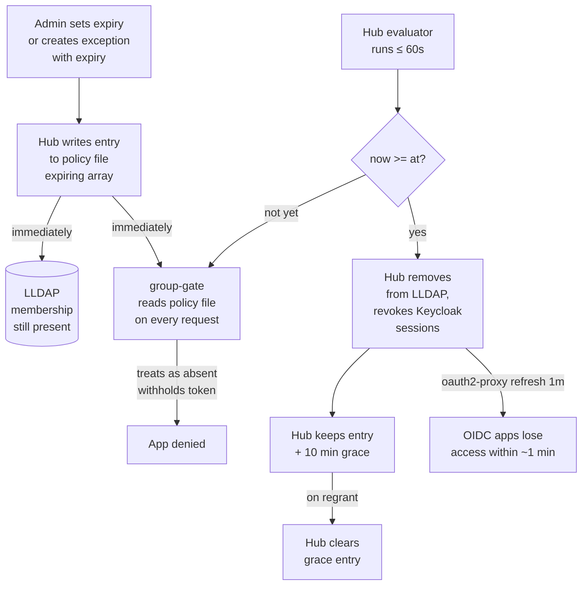

1. **Admin** sets an expiry (date/time) on a membership or exception in the Hub.
2. **Hub** writes the entry to the policy file's `expiring` array immediately: `{"user": "<username>", "group": "<group>", "at": "<RFC 3339 UTC timestamp>"}`. The entry stays in LLDAP.
3. **group-gate** reads the policy file on every request. When `now >= at`, it treats the membership as **absent**, regardless of what the user's token says. It also withholds `Authorization` and `X-Forwarded-Access-Token` for that request.
4. **Forward-auth apps**: denied immediately (403 from group-gate).
5. **Native OIDC apps**: the token still has the group claim until the next Keycloak token refresh.
6. **Hub evaluator** runs at least every 60 seconds and on changes. When it finds an expired entry, it:
    - removes the membership from LLDAP,
    - revokes the user's Keycloak sessions (so OIDC apps lose access at their next token refresh; oauth2-proxy cookie refresh is 1 minute, so this happens within ~1 minute),
    - keeps the `expiring` entry (plus a 10-minute grace period) until the membership is actually removed and the grace ends, or until regrant (admin re-adds, exception include, rule change adds them back).

The grace period ensures enforcement stays strict even if the Hub is restarted or LLDAP removal fails: group-gate keeps denying based on the policy file until the Hub successfully removes the entry and clears it.
