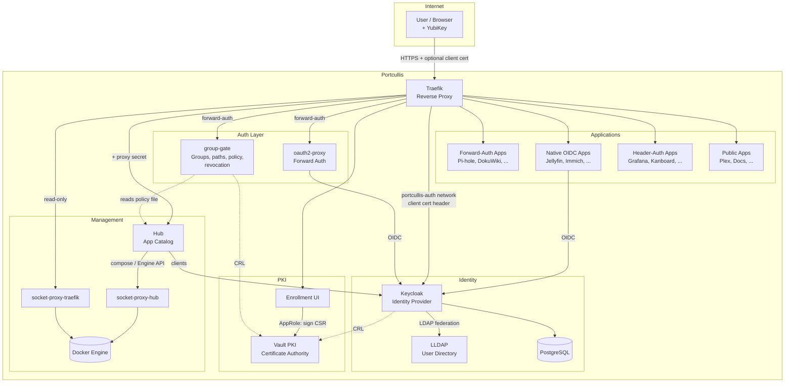
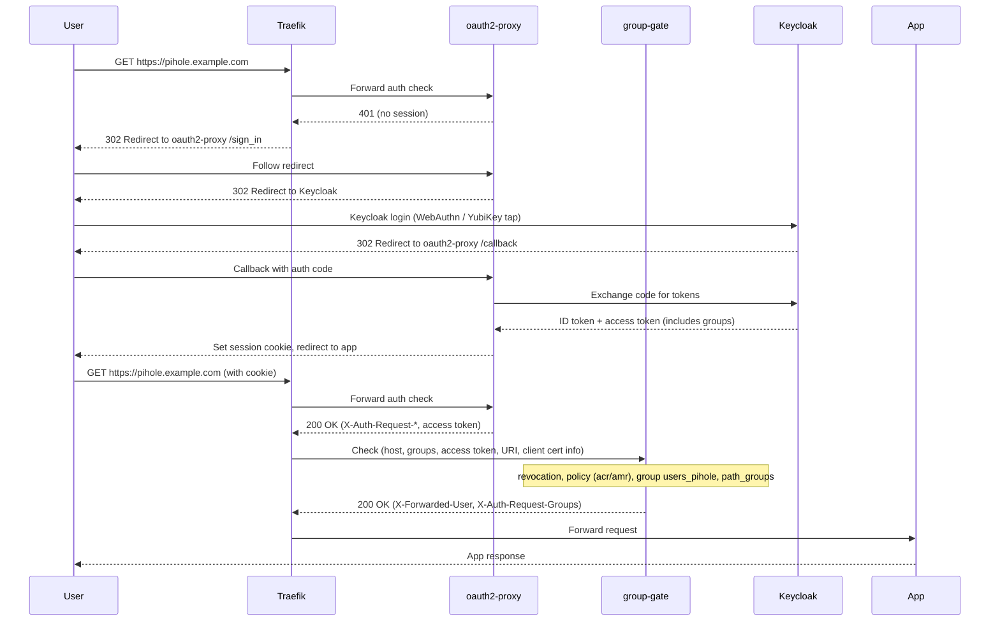
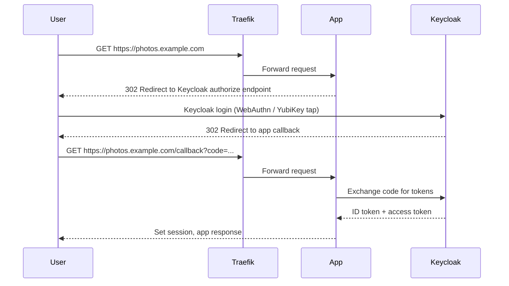
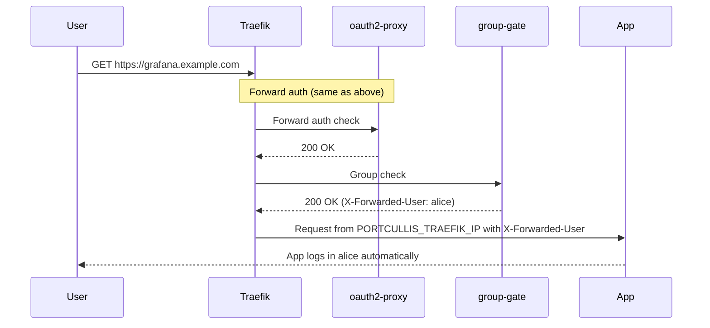
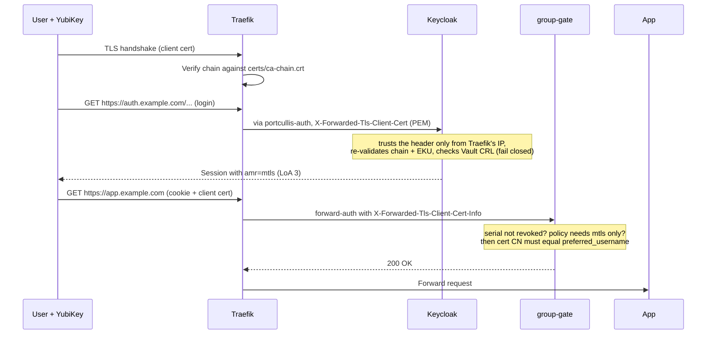
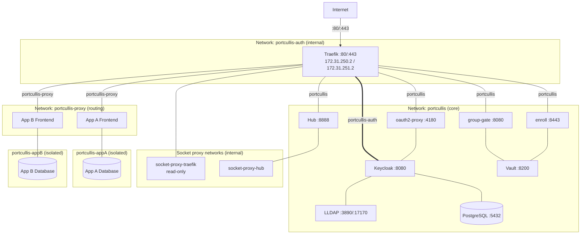
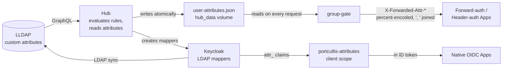
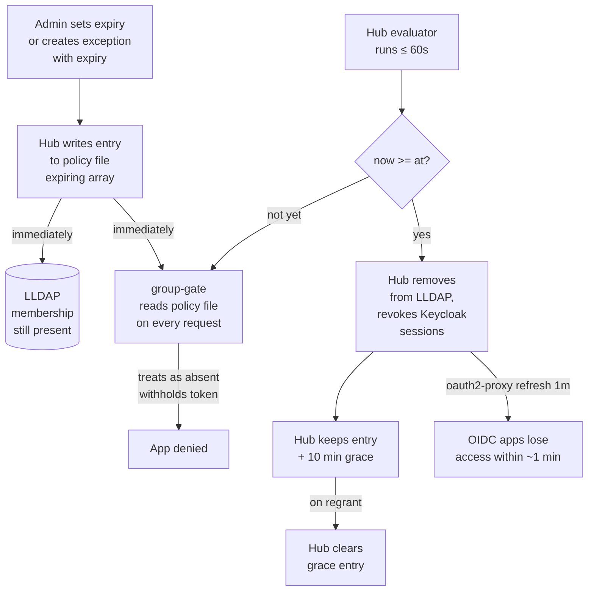

# Architecture

Portcullis is a collection of services that work together to provide unified authentication for self-hosted applications. This page describes how the components connect and how authentication flows work.

## Component Overview

### Component Roles

| Component | Role |
|-----------|------|
| **Traefik** | Reverse proxy. Terminates TLS (one ACME wildcard cert), routes requests by subdomain, applies middleware chains, optionally requests client certificates. Reads Docker labels through its read-only socket proxy. |
| **oauth2-proxy** | Forward authentication. Redirects unauthenticated users to Keycloak (with per-request `acr_values` for step-up), and returns identity headers and the access token on success. |
| **group-gate** | Per-request authorization (forward-auth). Checks client-cert revocation, the app's auth policy (`acr`/`amr`, mTLS binding), the subdomain's required group and `path_groups`. Returns 403 or a step-up page. |
| **Keycloak** | Identity provider. WebAuthn (FIDO2), X.509 (YubiKey PIV) login with CRL checks, password, Level-of-Authentication step-up, OIDC/SAML for apps. Federates users from LLDAP. |
| **LLDAP** | Lightweight LDAP directory. Stores users and groups (custom user fields are LLDAP attributes). They are managed in the Hub; `directory.<domain>` redirects to `people.<domain>` (LLDAP's own UI has no SSO and is reachable only from the server: `portcullis lldap-ui`). |
| **PostgreSQL** | Database backend for Keycloak. |
| **Vault PKI** | Private CA in server mode (raft, auto-unseal). Issues client certificates (default 30 days) for YubiKey PIV slots and publishes the CRL. |
| **Enrollment UI** | `enroll.<domain>`: admins enroll WebAuthn and PIV certificates; any user renews their own certificate at `/self`. Signs CSRs through a least-privilege Vault AppRole. |
| **Hub** | Two listeners: `hub.<domain>` (admins only): app catalog, runs each enabled template as its own compose project, registers Keycloak clients, writes the policy file and `user-attributes.json`, reports drift. `people.<domain>` (any signed-in user): Users & Groups (People, Groups, Org chart, Import), with per-request permission checks (admins, or delegated `edit_details` / `invite` / `remove` permissions). |
| **Monitoring** (optional) | Compose profile `monitoring`: Prometheus, Alertmanager, Grafana at `metrics.<domain>` (`lldap_admin`), blackbox and textfile exporters. See [Monitoring](operations/monitoring.md). |
| **Socket proxies** | `socket-proxy-traefik` (read-only) and `socket-proxy-hub` (what compose needs): the only containers that mount the Docker socket. See [Security & Hardening](operations/hardening.md#docker-socket-proxies). |

## Repository Structure

Portcullis is organized as four separate repositories, each with a distinct responsibility. Their interfaces are defined in [Integration Contracts](guides/integration-contracts.md).

- **Core repo** ([porelli/portcullis](https://github.com/porelli/portcullis)) -- `docker-compose.yml` for all core services, the `./portcullis` admin CLI (libraries in `scripts/lib/`), group-gate (`group-gate/`), the enrollment UI (`enroll/`), Traefik dynamic configuration (`traefik/`), Vault configuration (`vault/`) and the Keycloak realm export. This is the only repo you need to clone to deploy Portcullis.

- **Hub repo** ([porelli/portcullis-hub](https://github.com/porelli/portcullis-hub)) -- The management web UI, published as a signed container image at `ghcr.io/porelli/portcullis-hub` (selected with `HUB_IMAGE`).

- **Templates repo** ([porelli/portcullis-templates](https://github.com/porelli/portcullis-templates)) -- The app templates (`<app-id>/manifest.yaml` + `compose.yml`), the manifest JSON Schema and the template validator. The Hub clones it on first startup as the default template source. Accepts outside contributions.

- **Docs repo** ([porelli/portcullis-docs](https://github.com/porelli/portcullis-docs)) -- This documentation site, built with [Zensical](https://zensical.org). App catalog pages are generated from the template manifests.

## Authentication Flows

Portcullis supports four authentication methods. Each app declares its method in its `manifest.yaml`.

### Forward Auth (oauth2-proxy + group-gate)

Used by apps that have no native SSO support (Pi-hole, DokuWiki, Scrutiny, etc.). Traefik delegates authentication to oauth2-proxy and authorization to group-gate before the request reaches the app. The router's middleware chain is `client-headers@file,portcullis-auth@docker,portcullis-groups@docker,security-headers@file`; `client-headers@file` must come first so group-gate sees the client certificate (for revocation and the mTLS binding).

If the session does not satisfy the app's [access policy](operations/auth-policies.md), group-gate answers with a 403 step-up page that redirects to `https://auth.<domain>/oauth2/start?acr_values=<needed>&prompt=login&rd=https://<app>/`, and Keycloak prompts for the missing factor. (oauth2-proxy only serves `/oauth2/*` on `auth.<domain>`: a host-less router would get Traefik's default TLS options and be refused with 421 on every app host.)

### Native OIDC

Used by apps with built-in OpenID Connect support (Jellyfin, Immich, Vaultwarden, Nextcloud, etc.). The app redirects to Keycloak directly, without oauth2-proxy.

### Header Auth

Used by apps that accept a trusted identity header from the reverse proxy (Grafana, Kanboard, Firefly III, Guacamole, CloudBeaver). The user authenticates via forward auth, and the app reads `X-Forwarded-User` (the LLDAP username, set by group-gate; the email travels separately in `X-Forwarded-Email`). The app accepts that header only from Traefik's fixed IP, so other containers on `portcullis-proxy` cannot impersonate users.

### mTLS (Client Certificate)

When mTLS is enabled, the browser presents the X.509 certificate stored in the YubiKey's PIV slot during the TLS handshake. Traefik verifies it against the Portcullis CA chain, but **does not check revocation**; that happens in group-gate and Keycloak.

Routers on the `protected` tier without forward-auth (e.g. the Vault UI template) rely on the TLS handshake alone: there the certificate works until it expires. See [TLS & mTLS](setup/certificates.md#revocation).

## TLS Tiers

Traefik is configured with three TLS option sets. Each app chooses its tier based on its security requirements.

| Tier | Traefik TLS Option | Client Cert Behavior | Use Case |
|------|-------------------|---------------------|----------|
| **protected** | `RequireAndVerifyClientCert` | Required -- TLS handshake fails without a valid cert | Highest security apps (Vault UI) |
| **authaware** | `VerifyClientCertIfGiven` | Optional -- verified if present, WebAuthn fallback if not | Most apps (default for forward-auth and OIDC apps) |
| **public** | `NoClientCert` | Not requested | Public-facing apps, apps that manage their own auth |

When `MTLS_ENABLED=false` in `.env`, all three tiers behave like `public` -- no client certificates are requested for any app. Routers that relied on `protected` alone become unauthenticated.

For apps the Hub sets the tier from the app's access policy, not from the template (see [Authentication Policies](operations/auth-policies.md#traefik-tls-tier)).

## Network Topology

Traefik is the only service exposed to the internet (ports 80 and 443). It is attached to every network it has to reach; nothing else bridges them.

- **`portcullis`** -- Core services: Keycloak, LLDAP, Vault, PostgreSQL, oauth2-proxy, group-gate, Hub, enroll. Apps are not on it and cannot reach these services directly.
- **`portcullis-proxy`** -- Traefik and app frontend services; Traefik's docker provider routes over it. Fixed subnet (`PORTCULLIS_PROXY_SUBNET`, default `172.31.250.0/24`), Traefik always at `PORTCULLIS_TRAEFIK_IP` (default `172.31.250.2`), other containers from `PORTCULLIS_PROXY_IP_RANGE` (which excludes Traefik's IP). Header-auth apps trust identity headers only from Traefik's address.
- **`portcullis-auth`** -- Internal network with only Traefik (fixed `PORTCULLIS_AUTH_TRAEFIK_IP`, default `172.31.251.2`) and Keycloak. Keycloak accepts proxy headers -- including the forwarded client certificate for X.509 login -- only from that address.
- **`socket-proxy-traefik`, `socket-proxy-hub`** -- Internal networks, each shared by one client and its Docker socket proxy.
- **Per-app networks** -- Each app's compose project (`portcullis-<app-id>`) has its own `default` network. Internal services (databases, caches, workers) live only there, isolated from all other apps.

Frontend services join both `default` and `portcullis-proxy`; internal services only `default`.

[Security & Hardening](operations/hardening.md#networks) lists every network's members and addressing rules.

Native OIDC apps that need to reach Keycloak do so over HTTPS via the public URL (`https://auth.<domain>`), not via the internal network.

DNS is configured as a wildcard record (`*.portcullis.example.com`), so all subdomains resolve to the same server IP. Traefik routes each subdomain to the correct container based on Docker labels.

## Custom Attributes Flow

Custom user fields (department, office, manager, etc.) defined in the Hub flow to apps in two ways:

### For Forward-Auth and Header-Auth Apps

1. **LLDAP**: stores users and custom attributes (created by the Hub as non-user-editable LLDAP user attributes).
2. **Hub**: reads field values via GraphQL, evaluates rules, writes `user-attributes.json` (only fields with `share_with_apps: true`) atomically with the policy file.
3. **group-gate**: reads `user-attributes.json` on every request. On allow, returns `X-Forwarded-Attr-<Header-Name>` headers. Values are percent-encoded (`%` → `%25`, `,` → `%2C`), joined with `, `, limited to 1 KB per value (before encoding).
4. **Traefik**: forwards these headers to the app (the `portcullis-groups` middleware uses `authResponseHeadersRegex: ^X-Forwarded-Attr-`). Client copies are stripped by the forwardAuth regex.
5. **App**: receives the headers. **Apps must percent-decode each value after splitting on `, `**.

### For Native OIDC Apps

1. **LLDAP**: stores users and custom attributes.
2. **Hub**: on every field change (create, update, delete, or `share_with_apps` toggle), syncs Keycloak LDAP attribute mappers on the `portcullis-attributes` client scope via the Keycloak admin API. Each shared field gets:
    - an LDAP attribute mapper: `portcullis-attr-<field>` (reads `<field>` from LDAP)
    - a protocol mapper: `attr_<field>` claim (user attribute `<field>` → claim `attr_<field>` in ID token, access token, userinfo)
3. **Keycloak**: syncs users from LLDAP via LDAP federation (periodic and manual sync). The mappers read field values from LDAP.
4. **App**: receives `attr_<field>` claims in the ID token (no percent-encoding; multi-valued fields are JSON arrays).

The Hub attaches the `portcullis-attributes` client scope as a default scope to every client it creates. On reconcile, it re-attaches missing mappers.

## Expiry Flow

Temporary group memberships (manual memberships with expiry, or exceptions with expiry in rule-based groups) are enforced strictly, even while the Hub is down.

1. **Admin** sets an expiry (date/time) on a membership or exception in the Hub.
2. **Hub** writes the entry to the policy file's `expiring` array immediately: `{"user": "<username>", "group": "<group>", "at": "<RFC 3339 UTC timestamp>"}`. The entry stays in LLDAP.
3. **group-gate** reads the policy file on every request. When `now >= at`, it treats the membership as **absent**, regardless of what the user's token says. It also withholds `Authorization` and `X-Forwarded-Access-Token` for that request.
4. **Forward-auth apps**: denied immediately (403 from group-gate).
5. **Native OIDC apps**: the token still has the group claim until the next Keycloak token refresh.
6. **Hub evaluator** runs at least every 60 seconds and on changes. When it finds an expired entry, it:
    - removes the membership from LLDAP,
    - revokes the user's Keycloak sessions (so OIDC apps lose access at their next token refresh; oauth2-proxy cookie refresh is 1 minute, so this happens within ~1 minute),
    - keeps the `expiring` entry (plus a 10-minute grace period) until the membership is actually removed and the grace ends, or until regrant (admin re-adds, exception include, rule change adds them back).

The grace period ensures enforcement stays strict even if the Hub is restarted or LLDAP removal fails: group-gate keeps denying based on the policy file until the Hub successfully removes the entry and clears it.
