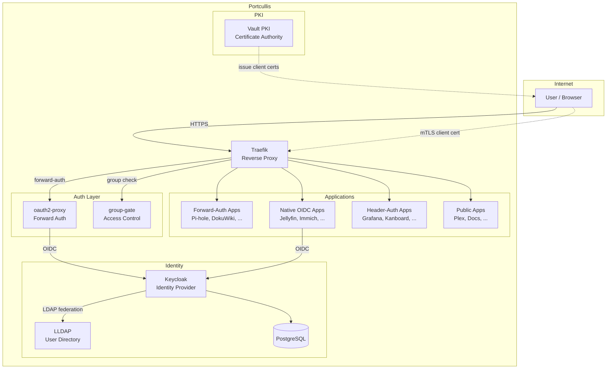
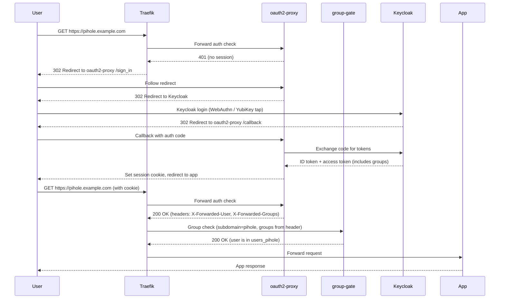
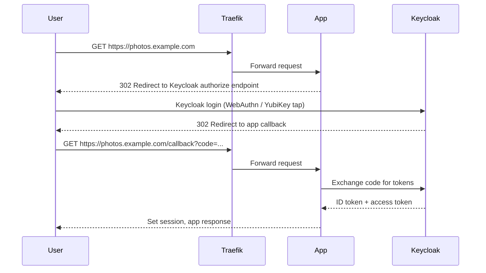
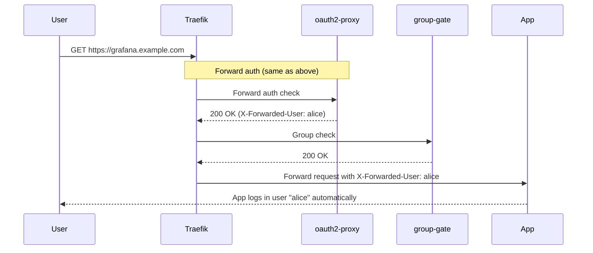
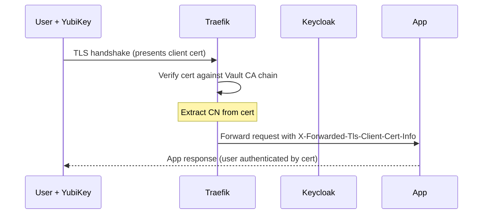
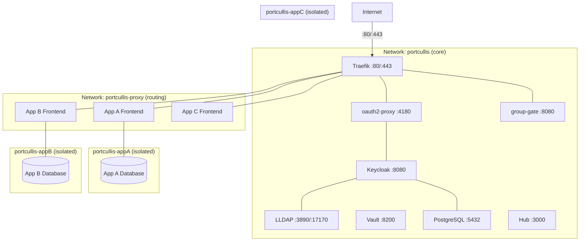

# Architecture

Portcullis is a collection of services that work together to provide unified authentication for self-hosted applications. This page describes how the components connect and how authentication flows work.

## Component Overview

### Component Roles

| Component | Role |
|-----------|------|
| **Traefik** | Reverse proxy. Terminates TLS, routes requests by subdomain, applies middleware chains, optionally requests client certificates. |
| **oauth2-proxy** | Forward authentication. Intercepts requests to protected apps, redirects unauthenticated users to Keycloak, and sets identity headers on success. |
| **group-gate** | Per-app access control. Checks the authenticated user's groups against the required group for each subdomain. Returns 403 if the user lacks access. |
| **Keycloak** | Identity provider. Handles WebAuthn (FIDO2) authentication, issues OIDC/SAML tokens, manages auth flows, and federates users from LLDAP. |
| **LLDAP** | Lightweight LDAP directory. Stores users and groups. Provides a web UI for user management. Keycloak syncs users and groups from LLDAP. |
| **PostgreSQL** | Database backend for Keycloak. |
| **Vault PKI** | Private certificate authority. Issues short-lived (24-hour) client certificates for mTLS authentication via the PIV slot on YubiKeys. |

## Repository Structure

Portcullis is organized as four separate repositories, each with a distinct responsibility:

- **Core repo** ([porelli/portcullis](https://github.com/porelli/portcullis)) -- Contains the `docker-compose.yml` for all core services (Traefik, Keycloak, LLDAP, Vault, oauth2-proxy, group-gate), bootstrap and helper scripts (`scripts/`), Traefik static and dynamic configuration (`traefik/`), Keycloak realm export, and the enrollment UI (`enroll/`). This is the only repo you need to clone to deploy Portcullis.

- **Hub repo** ([porelli/portcullis-hub](https://github.com/porelli/portcullis-hub)) -- The management web UI. Built and published as a container image at `ghcr.io/porelli/portcullis-hub`. The core `docker-compose.yml` pulls this image automatically -- no manual build step is required.

- **Templates repo** ([porelli/portcullis-templates](https://github.com/porelli/portcullis-templates)) -- Houses the 22 app templates (each with a `manifest.yaml` and `compose.yml`). The Hub automatically clones this repo on first startup as the default marketplace source. New templates are contributed here and synced to running instances via the Hub UI.

- **Docs repo** ([porelli/portcullis-docs](https://github.com/porelli/portcullis-docs)) -- This documentation site, built with MkDocs Material. App catalog pages are auto-generated from the template manifests.

## Authentication Flows

Portcullis supports four authentication methods. Each app declares its method in its `manifest.yaml`.

### Forward Auth (oauth2-proxy + group-gate)

Used by apps that have no native SSO support (Pi-hole, DokuWiki, Scrutiny, etc.). Traefik delegates authentication to oauth2-proxy before the request reaches the app.

### Native OIDC

Used by apps with built-in OpenID Connect support (Jellyfin, Immich, Vaultwarden, Nextcloud, etc.). The app redirects to Keycloak directly, without oauth2-proxy.

### Header Auth

Used by apps that accept a trusted identity header from the reverse proxy (Grafana, Kanboard, Firefly III). The user authenticates via forward auth, and the app reads the `X-Forwarded-User` header.

### mTLS (Client Certificate)

When mTLS is enabled, Traefik can authenticate users via X.509 client certificates stored in the PIV slot of their YubiKey. This happens at the TLS layer, before any HTTP processing.

If the app also uses Keycloak, the X.509 authenticator in Keycloak's browser flow can map the certificate CN to a user identity, skipping the WebAuthn prompt entirely.

## TLS Tiers

Traefik is configured with three TLS option sets. Each app chooses its tier based on its security requirements.

| Tier | Traefik TLS Option | Client Cert Behavior | Use Case |
|------|-------------------|---------------------|----------|
| **protected** | `RequireAndVerifyClientCert` | Required -- TLS handshake fails without a valid cert | Highest security apps (Vault UI) |
| **authaware** | `VerifyClientCertIfGiven` | Optional -- verified if present, WebAuthn fallback if not | Most apps (default for forward-auth and OIDC apps) |
| **public** | `NoClientCert` | Not requested | Public-facing apps, apps that manage their own auth |

When `MTLS_ENABLED=false` in `.env`, all three tiers behave like `public` -- no client certificates are requested for any app.

## Network Topology

Portcullis uses a two-network architecture to isolate apps from core services. Traefik bridges between the networks and is the only service exposed to the internet (ports 80 and 443).

- **`portcullis` network** -- Core services only (Keycloak, LLDAP, Vault, PostgreSQL, oauth2-proxy, group-gate, Hub). Apps cannot reach these services directly.
- **`portcullis-proxy` network** -- Traefik and app frontend services. This is how Traefik discovers and routes to app containers.
- **Per-app internal networks** -- Each app's compose project creates its own default network. Internal services (databases, caches, workers) live here, isolated from all other apps.

Each app runs as its own Docker Compose project (`portcullis-<app-id>`). Frontend services join both `default` (for internal communication) and `portcullis-proxy` (for Traefik routing). Internal services only join `default`.

Traefik is connected to both the `portcullis` network (for forward-auth checks via oauth2-proxy and group-gate) and the `portcullis-proxy` network (for routing to app frontends). Native OIDC apps that need to reach Keycloak do so over HTTPS via the public URL, not via the internal network.

DNS is configured as a wildcard record (`*.portcullis.example.com`), so all subdomains resolve to the same server IP. Traefik routes each subdomain to the correct container based on Docker labels.
