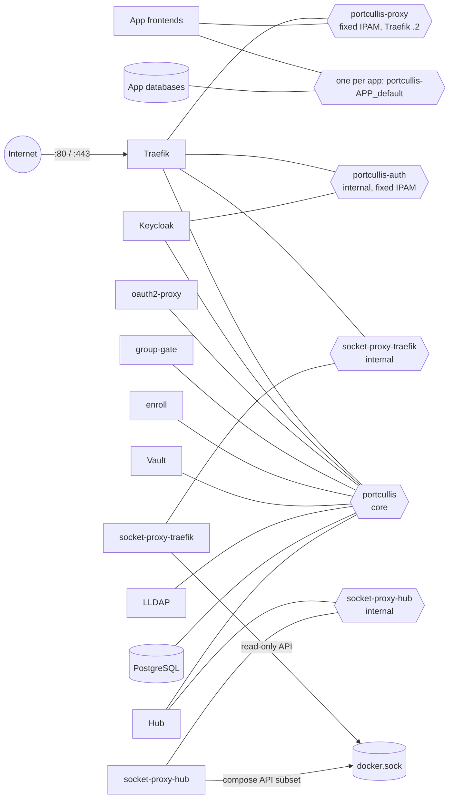

# Security & Hardening

This page covers what the core stack does to limit the damage a compromised
component can do, and where it can't. The authoritative per-service table lives
in the core repo (`docs/hardening.md`). This page summarises it together with
the network layout, header trust and threat model.

## Threat model summary

| Asset / boundary | Threat | Mitigation |
|------------------|--------|------------|
| Logins | Phishing, password reuse | WebAuthn (FIDO2) and PIV client certificates. Both are bound to the origin or the TLS handshake. Per-app [policies](auth-policies.md) can require them |
| User identity | A user changes their own LLDAP email to someone else's | Identity is the immutable username everywhere; email is never used to authorise or link accounts |
| Identity headers (`X-Forwarded-User`, client-cert headers) | Spoofed by an internet client | Traefik deletes client-supplied `X-Forwarded-*` and cert headers on the entrypoint, and forward-auth replaces the identity headers |
| Attribute headers (`X-Forwarded-Attr-*`) | Spoofed by an internet client or by routers without forwardAuth | Client copies stripped by `authResponseHeadersRegex: ^X-Forwarded-Attr-` on every forwardAuth middleware (Traefik can't delete headers by prefix in a headers middleware). Routers without forwardAuth (keycloak, vault-ui, enroll-invite, headscale, netbird, docs) don't strip them; backends there must not trust them |
| Identity headers | Spoofed by another container on `portcullis-proxy` | Header-auth apps trust only Traefik's fixed IP (`PORTCULLIS_TRAEFIK_IP`). Keycloak trusts proxy headers only from Traefik's fixed IP on the internal `portcullis-auth` network |
| Hub (runs compose, so it is effectively host root) | Reached without passing forward-auth | Hub: requires `lldap_admin` and the `X-Portcullis-Proxy-Secret` header. People listener (`people.<domain>`): any signed-in user (group-gate-map.conf `people=*`), per-request permission checks |
| Docker API | A compromised Traefik or Hub takes over the host | No service mounts the socket except two socket proxies with per-client allow-lists |
| Lost or stolen YubiKey cert | Keeps working until expiry | Revocation is checked on every request (group-gate), at Keycloak X.509 login (CRL, fail closed), and by the mTLS binding. On removal or expiry, group-gate also withholds `Authorization` and `X-Forwarded-Access-Token` |
| Expired group membership | Keeps working while Hub is down | Every pending expiry is in the policy file's `expiring` array (plus a 10-min grace after LLDAP removal). group-gate treats it as absent. The Hub also revokes Keycloak sessions (oauth2-proxy cookie refresh is 1 min, so removals and Keycloak logouts take effect within ~1 min; sessions end at Keycloak's idle 8h / max 12h) |
| Path-based admin areas | Bypassed with encoded or dot-segment paths | group-gate normalises the path and denies ambiguous encodings (see [Groups](groups.md#path-rules-path_groups-and-admin_paths)) |
| Templates (outside contributions) | A malicious or careless template opens access | The Hub rejects routing it can't fully see, refuses subdomain collisions and core subdomains, validates custom overrides (no Traefik labels, host-path bind roots, privileges), and fails closed on unknown config. Templates CI lints fork PRs without secrets |
| Public exceptions (share links, off unless an admin turns them on) | Anonymous access to app endpoints, token guessing, share-password brute force, identity spoofing on header-auth apps | Only declared, validated prefixes; listed mode routes only admin-listed share tokens; identity headers stripped; `rate-limit@file`; see [Public exceptions](#public-exceptions) |
| Vault data volume | Copied off the host | Encrypted. The unseal key is in `secrets/` on the host, so a copy of the volume alone is useless |
| Host root / `docker` group | Full compromise | Out of scope. Anyone who can run docker is root-equivalent, and the unseal key is on the host |

Known limits:

- **The Hub can still start arbitrary containers** (privileged, host mounts):
  that is what "run compose for any template" means. Treat it as host root.
- **Auto-unseal trades confidentiality at rest for availability** on the same
  host (see [TLS & mTLS](../setup/certificates.md#vault-server-mode-auto-unseal-and-approle)).
- **Routers without `portcullis-groups@docker`** don't get revocation checks.
  They also get no group or path checks.

## Public exceptions

An app's [public exceptions](auth-policies.md#public-exceptions) are the one
place where Portcullis deliberately lets unauthenticated internet traffic
reach an app. What a turned-on exception exposes:

- **Every endpoint under each opened prefix**, to anyone, without login,
  group, hardware key or policy. Only the app's own checks remain (share
  token, share password, expiry, download limits). In mode `all` that includes
  guessing share tokens; in mode `listed` only the listed shares are routed,
  and any other token on the same prefix still goes through forward-auth.
- **The app's share-password form** (e.g. Nextcloud `/s/<token>/authenticate`)
  to brute force. Only the app's own brute-force protection and Traefik's
  `rate-limit@file` (50 req/s average, burst 100, per client IP) limit it. The
  app must see the real client IP (e.g. Nextcloud's `TRUSTED_PROXIES` =
  Traefik) or its limiter locks out everyone at once.
- **Static files under supporting paths** (assets, l10n, theming; matched by
  extension, e.g. Grafana `/public/plugins` reveals installed plugins), and
  the few `exact` routes a template justifies. A front controller that
  routes extension-suffixed paths to code (Nextcloud's
  `/apps/theming/theme/<id>.css`, `/core/js/oc.js`) still runs those
  `#[PublicPage]` routes.
- **Uploads** where the app allows them on a share (Nextcloud file drop via
  `/public.php/dav`).
- **The host's TLS tier.** With an mTLS-only policy the host drops from
  `protected@file` to `authaware@file`: group-gate still enforces the client
  certificate per request on gated routers, but native-OIDC apps then check it
  only at login (Keycloak acr), and routers without group-gate not at all.

What it can't do:

- reach paths outside the prefixes: the router matches `Path(p)` /
  `PathPrefix(p/)` on Traefik's sanitised path (dot-segments resolved), so
  `/s/x/../../apps/files` is matched as `/apps/files` and stays gated;
- overlap admin paths, login gates or other routers of the app (the Hub
  refuses the template), or `/admin`, `/oauth2`, `/.well-known`;
- carry an identity: `X-Forwarded-User`, `X-Forwarded-Email`, the other
  forward-auth headers, `Remote-*` and the template's `identity_headers`
  (and their `_` forms) are deleted, so a header-auth app (Grafana) can't be
  told who the visitor is;
- carry a login past the hardware key: core's public guard (group-gate
  `/public-guard`, first middleware of every public router) answers 403 to
  requests with `Authorization`, `Proxy-Authorization`, the template's
  `credential_headers`, `credential_cookies` or `credential_query`. Cookie
  and query names are normalised the way PHP does (php-src
  `php_register_variable_ex`: leading spaces, ` `/`.` → `_`, `name[…]`,
  NUL), raw and percent-decoded, case-insensitively; non-UTF-8 names are
  refused. It also denies any path outside the published patterns, a `#`,
  and encoded `/`, `\`, NUL or `#`. A plain session cookie the template doesn't list
  (Nextcloud's `oc<instanceid>`, needed for share passwords and CSRF) is
  passed; it only reaches share-scoped routes and static files there;
- be opened by a template on its own: the Hub generates the router, only
  while an admin (or a template default that opens nothing until an admin
  lists a share) has it on, and reports any running exposure label that
  differs from what it would render as drift.

Trade-off: an app user signed in with a remember-me cookie gets the
guard's 403 on a public link in the same browser (open it in a private
window). The guard's version-3 requirement means the Hub and core are
upgraded together.

Not everything with a share feature can be scoped: Vaultwarden Send needs the
web vault at `/` and the password-login token endpoint, and Kanboard's router
reads `?controller=` before the path, so neither declares public exceptions.

## Networks

Each box is a service; each hexagon is a Docker network. A line means "is attached to".

| Network | Members | Addressing | Purpose |
|---------|---------|------------|---------|
| `portcullis` | Traefik and all core services | Docker default | Core service traffic: forward-auth, Vault, LLDAP, PostgreSQL |
| `portcullis-proxy` | Traefik and app frontends | `PORTCULLIS_PROXY_SUBNET` (default `172.31.250.0/24`). Dynamic range `PORTCULLIS_PROXY_IP_RANGE` (`172.31.250.128/25`). Traefik pinned at `PORTCULLIS_TRAEFIK_IP` (`172.31.250.2`), outside the range | Routing plane. Traefik's docker provider uses this network. No app container can ever get Traefik's address |
| `portcullis-auth` | Traefik and Keycloak only (`internal: true`) | `PORTCULLIS_AUTH_SUBNET` (`172.31.251.0/28`), range `PORTCULLIS_AUTH_IP_RANGE` (`172.31.251.8/29`), Traefik at `PORTCULLIS_AUTH_TRAEFIK_IP` (`172.31.251.2`) | The only path from which Keycloak accepts proxy headers, including the forwarded client cert for X.509 login |
| `socket-proxy-traefik` | Traefik + its socket proxy (`internal: true`) | Docker default | Read-only Docker API for Traefik |
| `socket-proxy-hub` | Hub + its socket proxy (`internal: true`) | Docker default | Docker API for the Hub |
| `monitoring` (profile `monitoring`, `internal: true`) | Prometheus, Alertmanager, Grafana, blackbox, textfile exporter | Docker default | Scraping and dashboards. Prometheus and blackbox also join `portcullis`, Grafana joins `portcullis-proxy` (routed at `metrics.<domain>`) |
| `alerting` (profile `monitoring`) | Alertmanager | Docker default | Alertmanager's only network with egress, for the receivers |
| `portcullis-<app>_default` | One app's services | Docker default | App-internal traffic (databases, caches). Isolated from other apps and from core |

CI checks that exactly `keycloak` and `traefik` are on `portcullis-auth`, and
that each socket-proxy network has exactly its two members.

**Changing the ranges.** Only do this if the defaults collide with a host, LAN
or VPN network, ideally before `./portcullis init`. The rules:

- the IP range must be inside its subnet
- the range must not contain the Traefik IP
- the two subnets must not overlap

`./portcullis up` and `upgrade` validate them and refuse to run when an
existing network has different IPAM:

- `portcullis-proxy`: disable the apps in the Hub, `./portcullis down`,
  `docker network rm portcullis-proxy`, `./portcullis up`, then re-enable the
  apps so their env picks up the new Traefik IP.
- `portcullis-auth` (core only): `./portcullis down && ./portcullis up`.

## Docker socket proxies

No service mounts `/var/run/docker.sock` except two
[linuxserver/socket-proxy](https://github.com/linuxserver/docker-socket-proxy)
containers (HAProxy, pinned by digest). Each sits on its own internal network,
shared with exactly one client (integration contract
[§6](../guides/integration-contracts.md#6-docker-access)):

| Proxy | Client | Allowed API sections | Methods |
|-------|--------|---------------------|---------|
| `socket-proxy-traefik` | Traefik (`TRAEFIK_PROVIDERS_DOCKER_ENDPOINT=tcp://socket-proxy-traefik:2375`) | `CONTAINERS`, `NETWORKS`, `EVENTS`, `VERSION`, `PING` | `GET`/`HEAD` only (`POST=0`) |
| `socket-proxy-hub` | Hub (`DOCKER_HOST=tcp://socket-proxy-hub:2375`) | `CONTAINERS`, `IMAGES`, `NETWORKS`, `VOLUMES`, `EXEC`, `EVENTS`, `INFO`, `VERSION`, `PING`, `ALLOW_LOGS` | All. `POST=1` also allows `PUT`/`DELETE` on the allowed sections |

The Hub's set is what `docker compose up/down/ps/logs` and the Hub's own Engine
API calls (status, logs, exec, events) need:

- containers: create, start, stop, kill, rm, inspect, list, wait, logs, exec
- images: pull (`/images/create`) and inspect
- networks and volumes: create, inspect, rm
- `/events`, `/info`, `/version`, `/_ping`

Everything else is denied: `BUILD`, `COMMIT`, `SWARM`, `NODES`, `SERVICES`,
`TASKS`, `SECRETS`, `CONFIGS`, `PLUGINS`, `SYSTEM` (df / prune), `AUTH`,
`DISTRIBUTION`, `SESSION`, and container `archive` / `export`. CI runs a real
`docker compose` project through `socket-proxy-hub` and checks the denials.

## Container hardening

Every core service gets:

- `security_opt: [no-new-privileges:true]` and `cap_drop: [ALL]`
- `mem_limit` and `pids_limit`
- an image pinned `tag@sha256:digest`. The Hub comes from `HUB_IMAGE`; enroll is
  built from `enroll/Dockerfile`, whose base images are pinned

CI fails if any of these is missing.

| Service | User | Root FS | `cap_add` | Notes |
|---------|------|---------|-----------|-------|
| socket proxies | root | read-only | `SYS_CHROOT` | Exception: HAProxy needs root to open the root-owned socket |
| traefik | root | read-only | `NET_BIND_SERVICE` | Exception: binds :80/:443 and owns the ACME volume. Without `CAP_DAC_OVERRIDE` it reads files by mode only (`certs/server.key` is group 0, `0640`) |
| postgres | 70:70 | read-only | — | |
| vault | 100:1000 | read-only | — | `disable_mlock` (raft), so no `IPC_LOCK`. Reads the unseal key via group 1000 |
| lldap | 1000 (rootless image) | read-only | — | |
| keycloak | 1000 | **writable** | — | Exception: `start` re-augments the server because the x509 lookup provider is a build option |
| forward-auth (oauth2-proxy) | 65532 (distroless) | read-only | — | No healthcheck: the image has no shell or HTTP client |
| group-gate | 10003:10003 | read-only | — | Locally built image (core's `group-gate/Dockerfile`) with pinned Python deps (`requirements.txt`: cryptography, PyJWT, with hashes). Only world-readable mounts |
| hub | 10001:10001 | read-only (`tmpfs /tmp`, `/home/hub`) | — | Writes `/data` (volume) and `/project/templates` (chowned to 10001 by `./portcullis up`). Go stdlib + yaml.v3 only (custom-override and rule parser: alecthomas/participle/v2). Libraries: go-ldap/ldap/v3, hasura/go-graphql-client, Nerzal/gocloak/v14, moby/moby/client |
| enroll | 10002:10002 | read-only | — | Reads `secrets/enroll/` via group 10002 |

**Secrets the containers read** stay operator-owned, with the container's group
and mode `0640` (dirs `0750`). The CLI repairs them on every `init`, `up`,
`upgrade`, `vault init` and `restore`. Without root it changes ownership
through a throwaway pinned `alpine` container (`--network none`,
`--cap-drop ALL --cap-add CHOWN`).

| Path | Group | Read by |
|------|-------|---------|
| `secrets/vault-unseal/unseal-key` | 1000 | vault (auto-unseal) |
| `secrets/enroll/{role-id,secret-id}` | 10002 | enroll |
| `secrets/hub/core.env` | 10001 | Hub (as `/project/.env`) |
| `certs/server.key` (dev/CI only) | 0 | Traefik |

**The Hub never sees the core `.env`.** It gets `secrets/hub/core.env`, which
holds only what templates may reference: `PORTCULLIS_DOMAIN`, Traefik's IP, the
proxy subnet and range, `PORTAL_DISPLAY_NAME`, `HEADSCALE_*`, `HEADPLANE_*`,
`NETBIRD_*`, `COTURN_*`, and the names listed in `HUB_SHARED_ENV`. Core secrets
are refused. `./portcullis up` rewrites the file in place. `secrets/` and
`backups/` are masked from the Hub with empty tmpfs mounts.

## Header spoofing protections

- **Entrypoint.** The `websecure` entrypoint has no
  `forwardedHeaders.trustedIPs`, so Traefik deletes client-supplied
  `X-Forwarded-*` and `X-Forwarded-Tls-Client-Cert(-Info)` headers.
  `aliasHeadersStrategy=delete` also drops alias spellings such as
  `X_Forwarded_Tls_Client_Cert`. The cert headers that group-gate, enroll and
  Keycloak see therefore always describe a certificate Traefik verified.
- **Forward-auth headers.** Traefik's `forwardAuth` deletes every
  `authResponseHeaders` entry from the upstream request and re-adds only the
  values oauth2-proxy and group-gate return. A client can't send its own
  `X-Forwarded-User` or `X-Auth-Request-Groups` through.
- **Identity is the LLDAP username, never the email.** LLDAP lets users edit
  their own mail, including to someone else's address. So:
    - Keycloak's LDAP federation does not trust it (`trustEmail=false`, tokens carry `email_verified=false`).
    - oauth2-proxy keys sessions on `preferred_username` and accepts the unverified email because nothing authorises by it.
    - Apps get `X-Forwarded-User` / `X-Auth-Request-User` = immutable username, and `X-Forwarded-Email` / `X-Auth-Request-Email` = email (display only).
    - Every identity header is in the forward-auth middlewares' `authResponseHeaders`, which is what strips client-supplied copies.
    - enroll and the Hub use `X-Forwarded-User` as-is. The mTLS binding compares the cert CN with `preferred_username`.
    - Native-OIDC apps must key accounts on `sub` / `preferred_username` and must not link existing accounts by email (e.g. Vaultwarden `SSO_SIGNUPS_MATCH_EMAIL`). Apps that insist on `email_verified=true` need their "allow unverified email" option.
    - Apps that refuse `email_verified=false` but accept it absent (Vaultwarden SSO signups) get the `email-unverified` client scope instead of `email` (manifest `email_verified_claim: false`): the `email` claim without `email_verified`. The email is no more trusted than before. Vaultwarden still matches pending email invitations by email, so its template turns invitations off (`INVITATIONS_ALLOWED=false`, `SIGNUPS_ALLOWED=false`) and gates the SSO login paths with group-gate (`users_vaultwarden`).

    **Rule: email is never an identity or account-linking key.**
- **Header-auth apps** accept identity headers only from
  `${PORTCULLIS_TRAEFIK_IP}`, through the app's proxy allow-list or a small
  gate in front of it. Templates CI checks this statically and with a forged
  request (see [Header Auth Pattern](../guides/header-auth-app.md#header-security)).
- **Keycloak** accepts proxy headers only from
  `PORTCULLIS_AUTH_TRAEFIK_IP` on `portcullis-auth`, decided by the TCP peer
  address (`--proxy-trusted-addresses`). The `127.0.0.1:8080` publish for the
  CLI's admin API is untrusted, so it can't inject a cert. See
  [mTLS login](../setup/certificates.md#trusted-proxy-address).
- **Paths.** Traefik's default path handling stays on (`sanitizePath`,
  decoding of unreserved `%XX`). Encoded `/`, `\`, `;` and `%00` are allowed
  through because apps such as GitLab and Nextcloud use them. group-gate's
  `path_groups` matching therefore normalises the path itself and denies
  encoded slashes and NULs that survive one decode.

## Hub proxy secret

The Hub has no login of its own. Every request except `GET /healthz` must
carry `X-Portcullis-Proxy-Secret` equal to `HUB_PROXY_SECRET` (at least 32
characters, compared in constant time). Otherwise the Hub answers 403, and it
refuses to start without the variable.

`./portcullis init` generates the secret. The core router injects it with the
`hub-proxy-secret@docker` headers middleware, placed **after**
`portcullis-auth` and `portcullis-groups`. So the secret is never sent to
oauth2-proxy or group-gate, and only requests that passed forward-auth and the
`lldap_admin` check carry it. A container that reaches the Hub directly on the
`portcullis` network can't spoof `X-Forwarded-User` without the secret.

To rotate it, empty `HUB_PROXY_SECRET` in `.env` and run
`./portcullis upgrade`.
