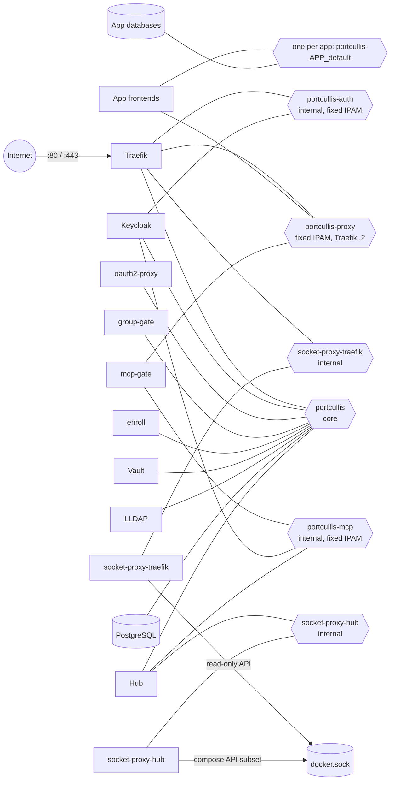

# Security & Hardening

This page covers what the core stack (`docker-compose.yml` in the core repo)
does to limit the damage a compromised component can do, and where it can't:
the threat model, network layout, Docker socket proxies, per-service container
settings, the secrets containers read, the shared-folder fixer, LAN-only
ports, and header trust.

## Threat model summary

| Asset / boundary | Threat | Mitigation |
|------------------|--------|------------|
| Logins | Phishing, password reuse | WebAuthn (FIDO2) and PIV client certificates. Both are bound to the origin or the TLS handshake. Per-app [policies](auth-policies.md) can require them |
| User identity | A user changes their own LLDAP email to someone else's | Identity is the immutable username everywhere; email is never used to authorise or link accounts |
| Identity headers (`X-Forwarded-User`, client-cert headers) | Spoofed by an internet client | Traefik deletes client-supplied `X-Forwarded-*` and cert headers on the entrypoint, and forward-auth replaces the identity headers |
| Attribute headers (`X-Forwarded-Attr-*`) | Spoofed by an internet client or by routers without forwardAuth | Client copies stripped by `authResponseHeadersRegex: ^X-Forwarded-Attr-` on every forwardAuth middleware (Traefik can't delete headers by prefix in a headers middleware). Routers without forwardAuth (keycloak, enroll-invite, headscale, netbird, docs) don't strip them; backends there must not trust them |
| Identity headers | Spoofed by another container on `portcullis-proxy` | Header-auth apps trust only Traefik's fixed IP (`PORTCULLIS_TRAEFIK_IP`). Keycloak trusts proxy headers only from Traefik's fixed IP on the internal `portcullis-auth` network |
| Hub (runs compose, so it is effectively host root) | Reached without passing forward-auth | Hub: requires `lldap_admin` and the `X-Portcullis-Proxy-Secret` header. People listener (`people.<domain>`): any signed-in user (group-gate-map.conf `people=*`), per-request permission checks |
| Docker API | A compromised Traefik or Hub takes over the host | No service mounts the socket except two socket proxies with per-client allow-lists |
| Forward-auth session cookies (shared cookie secret) | A cookie stolen from one host replayed elsewhere | Same parity as the main domain: `forward-auth` and `forward-auth-ext` share the cookie secret, but oauth2-proxy's HMAC covers the cookie name, so a `_oauth2_proxy` (main domain) value isn't accepted as `__Host-portcullis_ext` or vice versa. A stolen `__Host-portcullis_ext` value is a session on every extra-domain host, as the `.<domain>` cookie is on every main-domain host: browsers send it to its host only, and group-gate still checks each host's group and policy. Sessions re-validate with Keycloak every minute (cookie refresh), so a Keycloak logout ends both |
| Lost or stolen YubiKey cert | Keeps working until expiry | Revocation is checked on every request (group-gate), at Keycloak X.509 login (CRL, fail closed), and by the mTLS binding. On removal or expiry, group-gate also withholds `Authorization` and `X-Forwarded-Access-Token` |
| Expired group membership | Keeps working while Hub is down | Every pending expiry is in the policy file's `expiring` array (plus a 10-min grace after LLDAP removal). group-gate treats it as absent. The Hub also revokes Keycloak sessions (oauth2-proxy cookie refresh is 1 min, so removals and Keycloak logouts take effect within ~1 min; sessions end at Keycloak's idle 8h / max 12h) |
| Path-based admin areas | Bypassed with encoded or dot-segment paths | group-gate normalises the path and denies ambiguous encodings (see [Groups](groups.md#path-rules-path_groups-and-admin_paths)) |
| Templates (outside contributions) | A malicious or careless template opens access | The Hub rejects routing it can't fully see, refuses hostname collisions and core hosts, validates custom overrides (no Traefik labels, host-path bind roots, privileges), and fails closed on unknown config. Templates CI lints fork PRs without secrets |
| Public exceptions (share links, off unless an admin turns them on) | Anonymous access to app endpoints, token guessing, share-password brute force, identity spoofing on header-auth apps | Only declared, validated prefixes; listed mode routes only admin-listed share tokens; identity headers stripped; `rate-limit@file`; see [Public exceptions](#public-exceptions) |
| AI clients (MCP, [AI support](ai.md)) | A token replayed at another app, an AI acting beyond the person, injected instructions in app content, a secret leaking into the model | `mcp-gate` checks every request: signature, issuer, the exact audience and scope of that one resource (a token for two resources works nowhere), the client, the resource's sign-in rule (certificate methods never count) and the person's population **on every request**. It never forwards the person's token; destructive tools need a confirmation in the person's browser; no tool takes or returns a secret. See [AI support](#ai-support-mcp-gate) |
| An LLDAP account deleted and re-created under the same name | The newcomer inherits the previous holder's Keycloak user (passkeys, sessions, consents, AI connections) | Keycloak links LLDAP accounts by LLDAP's immutable `entryUUID`: the newcomer is a new Keycloak user (new `sub`); the old copy and its passkeys, sessions and consents are removed at the next lookup |
| Password guessing (only while the password method is on) | Online guessing of a person's LLDAP password at `auth.<domain>` | Keycloak's brute-force protection (realm, `keycloak configure`): after 10 failures each further one adds 60 s of wait, at most 15 min, never a permanent lockout (so nobody can lock an account out for good); Traefik's `rate-limit-auth@file`; `admin` and `portcullis-hub` never sign in with a password (refused before any check, not counted) |
| Vault data volume | Copied off the host | Encrypted. The unseal key is in `secrets/` on the host, so a copy of the volume alone is useless |
| Host root / `docker` group | Full compromise | Out of scope. Anyone who can run docker is root-equivalent, and the unseal key is on the host |

Known limits:

- **The Hub can still start arbitrary containers** (privileged, host mounts):
  that is what "run compose for any template" means. Treat it as host root.
- **Auto-unseal trades confidentiality at rest for availability** on the same
  host (see [TLS & mTLS](../setup/certificates.md#vault-server-mode-auto-unseal-and-approle)).
- **Routers without `portcullis-groups@docker`** don't get revocation checks.
  They also get no group or path checks.

## Public exceptions

An app's [public exceptions](auth-policies.md#public-exceptions) are the one
place where Portcullis deliberately lets unauthenticated internet traffic
reach an app. What a turned-on exception exposes:

- **Every endpoint under each opened prefix**, to anyone, without login,
  group, hardware key or policy. Only the app's own checks remain (share
  token, share password, expiry, download limits). In mode `all` that includes
  guessing share tokens; in mode `listed` only the listed shares are routed,
  and any other token on the same prefix still goes through forward-auth.
- **The app's share-password form** (e.g. Nextcloud `/s/<token>/authenticate`)
  to brute force. Only the app's own brute-force protection and Traefik's
  `rate-limit@file` (50 req/s average, burst 100, per client IP) limit it. The
  app must see the real client IP (e.g. Nextcloud's `TRUSTED_PROXIES` =
  Traefik) or its limiter locks out everyone at once.
- **Static files under supporting paths** (assets, l10n, theming; matched by
  extension, e.g. Grafana `/public/plugins` reveals installed plugins), and
  the few `exact` routes a template justifies. A front controller that
  routes extension-suffixed paths to code (Nextcloud's
  `/apps/theming/theme/<id>.css`, `/core/js/oc.js`) still runs those
  `#[PublicPage]` routes.
- **Uploads** where the app allows them on a share (Nextcloud file drop via
  `/public.php/dav`).
- **The host's TLS tier.** With an mTLS-only policy the host drops from
  `protected@file` to `authaware@file`: group-gate still enforces the client
  certificate per request on gated routers, but native-OIDC apps then check it
  only at login (Keycloak's template check), and routers without group-gate not at all.

What it can't do:

- reach paths outside the prefixes: the router matches `Path(p)` /
  `PathPrefix(p/)` on Traefik's sanitised path (dot-segments resolved), so
  `/s/x/../../apps/files` is matched as `/apps/files` and stays gated;
- overlap admin paths, login gates or other routers of the app (the Hub
  refuses the template), or `/admin`, `/oauth2`, `/.well-known`;
- carry an identity: `X-Forwarded-User`, `X-Forwarded-Email`, the other
  forward-auth headers, `Remote-*` and the template's `identity_headers`
  (and their `_` forms) are deleted, so a header-auth app (Grafana) can't be
  told who the visitor is;
- carry a login past the hardware key: core's public guard (group-gate
  `/public-guard`, first middleware of every public router) answers 403 to
  requests with `Authorization`, `Proxy-Authorization`, the template's
  `credential_headers`, `credential_cookies` or `credential_query`. Cookie
  and query names are normalised the way PHP does (php-src
  `php_register_variable_ex`: leading spaces, ` `/`.` → `_`, `name[…]`,
  NUL), raw and percent-decoded, case-insensitively; non-UTF-8 names are
  refused. It also denies any path outside the published patterns, a `#`,
  and encoded `/`, `\`, NUL or `#`. A plain session cookie the template doesn't list
  (Nextcloud's `oc<instanceid>`, needed for share passwords and CSRF) is
  passed; it only reaches share-scoped routes and static files there;
- be opened by a template on its own: the Hub generates the router, only
  while an admin (or a template default that opens nothing until an admin
  lists a share) has it on, and reports any running exposure label that
  differs from what it would render as drift.

Trade-off: an app user signed in with a remember-me cookie gets the
guard's 403 on a public link in the same browser (open it in a private
window). The guard serves only version 6 of the policy file (keyed by full
hostname), so the Hub and core are upgraded together.

Not everything with a share feature can be scoped: Vaultwarden Send needs the
web vault at `/` and the password-login token endpoint, and Kanboard's router
reads `?controller=` before the path, so neither declares public exceptions.

## Networks

Each box is a service; each hexagon is a Docker network. A line means "is attached to".

| Network | Members | Addressing | Purpose |
|---------|---------|------------|---------|
| `portcullis` | Traefik and all core services | Docker default | Core service traffic: forward-auth, Vault, LLDAP, PostgreSQL |
| `portcullis-proxy` | Traefik and app frontends | `PORTCULLIS_PROXY_SUBNET` (default `172.31.250.0/24`). Dynamic range `PORTCULLIS_PROXY_IP_RANGE` (`172.31.250.128/25`). Traefik pinned at `PORTCULLIS_TRAEFIK_IP` (`172.31.250.2`), outside the range | Routing plane. Traefik's docker provider uses this network. No app container can ever get Traefik's address |
| `portcullis-auth` | Traefik and Keycloak only (`internal: true`) | `PORTCULLIS_AUTH_SUBNET` (`172.31.251.0/28`), range `PORTCULLIS_AUTH_IP_RANGE` (`172.31.251.8/29`), Traefik at `PORTCULLIS_AUTH_TRAEFIK_IP` (`172.31.251.2`) | The only path from which Keycloak accepts proxy headers, including the forwarded client cert for X.509 login |
| `portcullis-mcp` | `mcp-gate`, Keycloak and the Hub only (`internal: true`) | `PORTCULLIS_MCP_SUBNET` (`172.31.253.0/28`), range `PORTCULLIS_MCP_IP_RANGE` (`172.31.253.8/29`), Keycloak at `PORTCULLIS_MCP_KEYCLOAK_IP` (`.2`), the Hub at `PORTCULLIS_MCP_HUB_IP` (`.3`) | The gate's only path to Keycloak's keys and the Hub's MCP listener; the gate pins both names to these addresses in `extra_hosts`, so no container can shadow them. The gate itself is on `portcullis-proxy` at `PORTCULLIS_MCP_GATE_IP` (`172.31.250.3`, outside the dynamic range) |
| `socket-proxy-traefik` | Traefik + its socket proxy (`internal: true`) | Docker default | Read-only Docker API for Traefik |
| `socket-proxy-hub` | Hub + its socket proxy (`internal: true`) | Docker default | Docker API for the Hub |
| `monitoring` (profile `monitoring`, `internal: true`) | Prometheus, Alertmanager, Grafana, blackbox, textfile exporter | Docker default | Scraping and dashboards. Prometheus and blackbox also join `portcullis`, Grafana joins `portcullis-proxy` (routed at `metrics.<domain>`) |
| `alerting` (profile `monitoring`) | Alertmanager | Docker default | Alertmanager's only network with egress, for the receivers |
| `portcullis-<app>_default` | One app's services | Docker default | App-internal traffic (databases, caches). Isolated from other apps and from core |

CI checks that exactly `keycloak` and `traefik` are on `portcullis-auth`, and
that each socket-proxy network has exactly its two members.

**Changing the ranges.** Only do this if the defaults collide with a host, LAN
or VPN network, ideally before `./portcullis init`. The rules:

- the IP range must be inside its subnet
- the range must not contain the Traefik IP
- the two subnets must not overlap

`./portcullis up` and `upgrade` validate them and refuse to run when an
existing network has different IPAM:

- `portcullis-proxy`: disable the apps in the Hub, `./portcullis down`,
  `docker network rm portcullis-proxy`, `./portcullis up`, then re-enable the
  apps so their env picks up the new Traefik IP.
- `portcullis-auth` (core only): `./portcullis down && ./portcullis up`.

## Docker socket proxies

No service mounts `/var/run/docker.sock` except two
[linuxserver/socket-proxy](https://github.com/linuxserver/docker-socket-proxy)
containers (HAProxy, pinned by digest). Each sits on its own internal network,
shared with exactly one client (integration contract
[§6](../guides/integration-contracts.md#6-docker-access)):

| Proxy | Client | Network | Allowed API sections (`1`) | Methods |
|-------|--------|---------|---------------------|---------|
| `socket-proxy-traefik` | Traefik (`TRAEFIK_PROVIDERS_DOCKER_ENDPOINT=tcp://socket-proxy-traefik:2375`) | `socket-proxy-traefik` | `CONTAINERS`, `NETWORKS`, `EVENTS`, `VERSION`, `PING` | `GET`/`HEAD` only (`POST=0`) |
| `socket-proxy-hub` | Hub (`DOCKER_HOST=tcp://socket-proxy-hub:2375`) | `socket-proxy-hub` | `CONTAINERS`, `IMAGES`, `NETWORKS`, `VOLUMES`, `EXEC`, `EVENTS`, `INFO`, `VERSION`, `PING`, `ALLOW_LOGS`, `ALLOW_ARCHIVE` (instance backups / restores: the archive endpoints of never-started helper containers) | All. `POST=1` also allows `PUT`/`DELETE` on the allowed sections |

The Hub's set is what `docker compose up/down/ps/logs` and the Hub's own Engine
API calls (status, logs, exec, events) need:

- containers: create, start, stop, kill, rm, inspect, list, wait, logs, exec
- images: pull (`/images/create`) and inspect
- networks and volumes: create, inspect, rm
- `/events`, `/info`, `/version`, `/_ping`

Everything else is denied: `BUILD`, `COMMIT`, `SWARM`, `NODES`, `SERVICES`,
`TASKS`, `SECRETS`, `CONFIGS`, `PLUGINS`, `SYSTEM` (df / prune), `AUTH`,
`DISTRIBUTION`, `SESSION`, and container `archive` / `export`. CI runs a real
`docker compose` project through `socket-proxy-hub` and checks the denials.

**Limits of a socket proxy.** The Hub can still create containers with any
`HostConfig` (privileged, host bind mounts): that is inherent to "runs compose
for arbitrary templates". The proxy removes the rest of the API surface (swarm,
plugins, image builds, system prune, secrets). Treat the Hub as
host-root-equivalent and keep it behind `lldap_admin` and the
[proxy secret](#hub-proxy-secret).

## Container hardening

Every core service gets:

- `security_opt: [no-new-privileges:true]` and `cap_drop: [ALL]`
- `mem_limit` and `pids_limit`
- an image pinned `tag@sha256:digest`. The Hub comes from `HUB_IMAGE` and
  Keycloak from `KEYCLOAK_IMAGE` (`ghcr.io/porelli/portcullis-keycloak`, our
  own image: the official Keycloak pinned `tag@sha256` plus the sign-in
  extension built with Gradle dependency verification; `edge` on core `main`,
  a core release pins a released tag by digest); enroll
  and group-gate are built from `enroll/Dockerfile` / `group-gate/Dockerfile`,
  whose base images are pinned. group-gate's Python dependencies are exact pins
  with hashes in `group-gate/requirements.txt`, installed wheels-only with
  `pip install --require-hashes`

CI fails if any of these is missing.

| Service | User | Root FS | `cap_add` | Healthcheck | Notes |
|---------|------|---------|-----------|-------------|-------|
| socket-proxy-traefik / -hub | root | read-only (`tmpfs /run`) | `SYS_CHROOT` | `/_ping` | Exception: HAProxy needs root to open the root-owned socket and `chroot`s to `/` |
| traefik | root | read-only (`tmpfs /tmp`) | `NET_BIND_SERVICE` | `traefik healthcheck --ping` | Exception: root for ports 80/443 and the root-owned ACME volume. Without `CAP_DAC_OVERRIDE` it reads files by mode only (`certs/server.key` is group 0, `0640`) |
| postgres | 70:70 | read-only (`tmpfs /var/run/postgresql`, `/tmp`) | — | `pg_isready` | `/var/lib/postgresql` is postgres-owned in the image, so the entrypoint needs no `chown` |
| vault | 100:1000 | read-only (`tmpfs /tmp`) | — | `vault status` | `disable_mlock` (raft), so no `IPC_LOCK`. Reads `secrets/vault-unseal/` via group 1000 |
| lldap | 1000 (`-rootless` image) | read-only (`tmpfs /tmp`) | — | `lldap healthcheck` | |
| keycloak | 1000 (image) | **writable** (`tmpfs /tmp`) | — | `/health/ready` | Image `ghcr.io/porelli/portcullis-keycloak` (`KEYCLOAK_IMAGE`). Exception: `start` re-augments the server into `/opt/keycloak/lib` because the x509 lookup provider (and the sign-in extension's providers) are build options; never `--optimized`. Reads `hub_data` read-only (`/hub-data/signin-keycloak.json`, the Hub's sign-in methods and templates; missing or invalid = nobody signs in) |
| forward-auth (oauth2-proxy) | 65532 (distroless) | read-only | — | **none** | Exception: the image has no shell or HTTP client |
| forward-auth-ext (oauth2-proxy) | 65532 (distroless) | read-only | — | **none** | Same image, provider config, client and cookie secret as forward-auth; serves extra-domain hosts only (contract §5): relative callback `/oauth2/callback` built from the request host (`X-Forwarded-Host`, trusted from `OAUTH2_PROXY_TRUSTED_PROXY_IPS` only), host-only cookie `__Host-portcullis_ext` (`Secure`, no `Domain`, `Path=/`), no redirect whitelist (only relative redirects are accepted). Both oauth2-proxies send PKCE S256 and the `portcullis-forward-auth` client requires it (`pkce.code.challenge.method`), so a code delivered to a stale callback URI is useless without the verifier. Routed only by the Hub's per-host `Host(<h>) && PathPrefix(/oauth2/)` routers. Its middleware `portcullis-auth-ext` lists the same `authResponseHeaders` / `authResponseHeadersRegex` as `portcullis-auth` (CI compares them) |
| group-gate | 10003:10003 (`USER` in Dockerfile) | read-only (`tmpfs /tmp`) | — | `/healthz` | Image `portcullis-group-gate`: pinned `python` alpine base + `cryptography` (CRL parsing) and `PyJWT` (token claims) + the script. Only world-readable mounts |
| hub | 10001:10001 (image) | read-only (`tmpfs /tmp`, `/home/hub`) | — | image `HEALTHCHECK` (`/healthz`) | Writes `/data` (volume) and `/project/templates` (chowned to 10001 by `./portcullis up`). Go; libraries: yaml.v3, alecthomas/participle/v2 (custom-override and rule parser), go-ldap/ldap/v3, hasura/go-graphql-client, Nerzal/gocloak/v14, moby/moby/client + api |
| enroll | 10002:10002 (`USER` in Dockerfile) | read-only | — | `/healthz` | Reads `secrets/enroll/` via group 10002 |
| mcp-gate | 10005:10005 + group 10001 | read-only (`tmpfs /tmp`) | — | `mcp-gate healthcheck` | Image `portcullis-mcp-gate`, built from `mcp-gate/` (Go, the official MCP Go SDK; pinned base images). No Docker access, no LLDAP or Keycloak admin credentials. Reads `hub_data` read-only (the gate files), writes `mcp_gate_data` (the access log). `mem_limit` 1g (`GOMEMLIMIT` 900MiB; the gate caps one person's requests in flight and the memory request bodies hold, [contracts §15.9](../guides/integration-contracts.md#159-rate-limits-and-all-my-apps); results and aggregate refreshes aren't budgeted, so many people at once can still exhaust it and the container restarts, one person can't), `pids_limit` 256 |
| prometheus, alertmanager, blackbox, textfile-exporter (profile `monitoring`) | 65534:65534 | read-only | — | `/-/ready`, `/-/healthy`, `/metrics` | `monitoring` network is `internal`; nothing published. Alertmanager's only egress is the `alerting` network |
| grafana (profile `monitoring`) | 472:472 | read-only (`tmpfs /tmp`) | — | `/api/health` | Header auth only from `PORTCULLIS_TRAEFIK_IP`; login form and basic auth off |

**Throwaway containers the CLI starts:**

- the chown helper: pinned `alpine`, `--network none`, only `CAP_CHOWN`
- for backups, the volume snapshot and LLDAP check: the `portcullis-group-gate`
  image (built first if missing), the volume owner's uid, `--network none`,
  read-only, no capabilities
- `restic`: pinned, the operator's uid, read-only, no capabilities;
  `--network none` for a local repository
- for `backup verify`, a `postgres` without network

**Helper containers the Hub starts** (contract §6; labelled
`io.portcullis.hub.helper`, removed after each use and at every Hub start):

- the volume helper (instance backups and restores): pinned `alpine`, uid
  65534, `--network none`, no capabilities, never started (the daemon copies
  through the archive endpoints)
- the shared-folder fixer: the Hub's own image by image ID, `hub folderfix
  <mode>` as uid 0 with only its mode's capabilities, no network, read-only
  root filesystem, one bind mount of the folder. See
  [Shared folders and the fixer helper](#shared-folders-and-the-fixer-helper)

## Secrets the containers read

The CLI keeps these **operator-owned** with the container's group, so the
operator can still rewrite them and nobody else can read them. It repairs them
(`secrets_fix_perms`) on every `init`, `up`, `upgrade`, `vault init` and
`restore`.

| Path | Group | Mode | Read by |
|------|-------|------|---------|
| `secrets/vault-unseal/unseal-key` | 1000 | 0640 (dir 0750) | vault (auto-unseal) |
| `secrets/enroll/{role-id,secret-id}` | 10002 | 0640 (dir 0750) | enroll |
| `secrets/enroll/{invite-client-secret,keycloak-client-secret,invite-api-secret}` | 10002 | 0640 | enroll (invite IdP client, Keycloak service account `portcullis-enroll`, Hub invite API) |
| `secrets/hub/core.env` | 10001 | 0640 (dir 0750) | Hub (as `/project/.env`) |
| `secrets/hub/lldap/{username,password}` | 10001 | 0640 (dir 0750) | Hub (`/run/portcullis/lldap`, LLDAP account `portcullis-hub`, `lldap_admin`) |
| `secrets/hub/invite/secret` | 10001 | 0640 (dir 0750) | Hub (`/run/portcullis/invite/secret`, same value as enroll's `invite-api-secret`) |
| `secrets/mcp-gate/age.key` | 10005 | 0640 (dir 0700) | mcp-gate (decrypts the AI credentials the Hub wrote) |
| `secrets/mcp-gate/{age.pub,hub-secret}` | 10001 | 0640 | Hub (encrypts to `age.pub`; holds no identity) and mcp-gate (`hub-secret`, through group 10001) |
| `secrets/monitoring/prometheus/{vault-token,tls-targets.json}` | 65534 | 0640 (dir 0750) | Prometheus (Vault metrics token: policy `portcullis-metrics`) |
| `secrets/monitoring/alertmanager/alertmanager.yml` | 65534 | 0640 (dir 0750) | Alertmanager (receivers incl. SMTP password / webhook URLs) |
| `secrets/monitoring/grafana/admin-password` | 472 | 0640 (dir 0750) | Grafana |
| `certs/server.key` (dev/CI only) | 0 | 0640 | Traefik |
| `templates/` | owner 10001 | 0755 | Hub (writes) |
| `appfiles/` | owner 10001 | 0750 | Hub (writes settings data files, see [below](#settings-data-files-and-secrets)) |

Without root, the CLI changes owner/group through a throwaway container
(pinned `alpine`, `--network none`, `--cap-drop ALL --cap-add CHOWN`). Anyone
who can run docker is root-equivalent anyway.

**The Hub never sees the core `.env`.** It gets `secrets/hub/core.env`, which
holds only what templates may reference: `PORTCULLIS_DOMAIN`,
`PORTCULLIS_TRAEFIK_IP`, the proxy subnet and range, `PORTAL_DISPLAY_NAME`,
`HEADSCALE_*`, `HEADPLANE_*`, `NETBIRD_*`, `COTURN_*`, and the names listed in
`HUB_SHARED_ENV`. Core secrets are refused. `./portcullis up` rewrites the file
in place. `secrets/` and `backups/` are masked from the Hub with empty tmpfs
mounts.

## Settings data files and secrets

App settings ([Hub → App settings](hub.md#app-settings)) reach apps through
the app's `.env`, data files, hooks, token claims and request headers. What
protects each:

- **Secrets at rest.** Secret options are stored only in
  `${HUB_DATA_DIR}/settings/<id>/secrets.json` (mode 0600, directory 0700,
  written atomically); `state.yaml` holds only whether each is set and
  when. The Hub never returns a secret: not in the panel, the save's
  answer, Expert (`[set]`), logs, op records or the audit (`replaced`,
  `generated`, `cleared`).
- **Secrets in transit to the app.** Only three ways: the app's `.env`
  (mode 0600, single-quoted), a data file's secrets file (mode 0600), or a
  hook's standard input. Never in process arguments, a hook's
  environment, labels or the compose override. Hook output and every delivery error are
  redacted (the instance's stored secrets in every encoding, plus
  secret-looking env values) before they are clipped and stored.
- **Backups** carry the secrets store as one member of the archive; the
  archived env has the secret variables blanked and the restore writes them
  again from the store. Protect backups like the `.env` itself.

**Data files.** The Hub writes them under `<core>/appfiles` (mounted in the
Hub at `/project/appfiles`):

| Path | Owner | Mode | Read by |
|------|-------|------|---------|
| `appfiles/` | 10001 | 0750 (`./portcullis up` creates and repairs it) | the Hub |
| `appfiles/<id>/<name>/` | 10001 | 0750 | the app's service, through a read-only bind mount of this directory |
| `appfiles/<id>/<name>/<name>.json` | 10001 | 0640 | the service as root, or with `group_add: ["10001"]` |
| `appfiles/<id>/<name>/<name>.secrets.json` | 10001 | 0600 | the service as root or `user: "10001"`; only written when the file carries a secret option |

Files are written atomically (a new inode each time, which is why the
directory is mounted, not the file). They hold only what the template
declared for that file: instance values, the population's per-person
values, group records whose group still exists with the same LLDAP id, and
values people entered (only for people with access whose account still
matches). They are generated from the Hub's state, so they are not backed
up; deleting an instance removes its directory.

**Fail closed.** If Users & Groups is unavailable, per-person files keep
their last delivery, and a per-person file that was never delivered stops
the start (`503`) instead of starting the app without it. Apps must treat a
missing record or entry as "nothing granted".

## Shared folders and the fixer helper

[Shared folders](hub.md#shared-folders) need a process that changes group
owners, modes and ACLs on the host's files: Docker's archive endpoints
can't do that. The Hub never gets a host shell or SSH for it. It starts a
short-lived **fixer helper** container instead, one per run, and removes it
afterwards (and at every Hub start, should one be left over).

**Which image.** The fixer is the Hub's own binary (`hub folderfix
<mode>`), run from the Hub's own image by its **image ID**, never by a tag
or a name. The Hub finds that image by reading its own full container ID
from `/proc/self/mountinfo` and inspecting exactly that container, which
must answer with the same ID and with core's compose labels (project
`portcullis`, service `hub`). Nothing another container could shadow (a
hostname, a container name, a short ID) is ever consulted. If the check
fails, folder operations answer `503` "the Hub can't find its own image",
with no fallback. Two setups make it fail on purpose:

- a **non-standard Docker data root** whose path doesn't contain
  `docker/containers/` (the default `/var/lib/docker` and Docker Desktop
  work);
- a **core project not named `portcullis`** (for example a
  `COMPOSE_PROJECT_NAME` override).

`HUB_FIXER_IMAGE` (pinned by `@sha256:`) replaces the image for
development and is honoured **only with `HUB_DEV=1`**; otherwise the Hub
refuses to start. An image chosen through the environment and run as root
with file capabilities would be a privilege pivot. Anyone who can set the
Hub's environment can also change `HUB_IMAGE`, so this narrows that path
rather than closing it: protect `.env` like the rest of the core
configuration.

**How it runs.** uid 0 with `no-new-privileges`, all capabilities dropped
and only its mode's added back, no network, read-only root filesystem, no
host namespaces, at most 16 processes and 256 MiB, no healthcheck, and one
bind mount: the folder (read-only except to apply or restore). The
capabilities are the measured minimum for each mode (the Hub's CI drops
each one in turn and checks the run fails):

| Mode | Used for | Capabilities |
|------|----------|--------------|
| `probe`, `scan`, `snapshot`, `restore --dry-run` | Check path, the doctor's disk checks, the permissions snapshot, the undo's preview and verify | `DAC_READ_SEARCH` |
| `apply`, `restore` | Applying a folder, undoing the last fix | `CHOWN`, `FOWNER`, `FSETID`, `DAC_READ_SEARCH` |
| `apply --mkdir` | An apply that creates missing subfolders | the above plus `DAC_OVERRIDE` |

`DAC_READ_SEARCH` reads directories uid 0 doesn't own; `CHOWN` sets the
folder group; `FOWNER` sets modes and ACLs on others' files; `FSETID` keeps
the setgid bit (uid 0 isn't in the folder's group). `SETFCAP` is never
granted. The Hub refuses every run (`503`) under **userns-remap or rootless
Docker**, where ids inside the helper are translated and owners and ACL
entries would be wrong.

**What it never does.** It never follows a symlink, never leaves the
folder's filesystem or enters another mount, and never opens a device or
FIFO. It skips (and reports) hard-linked files, setuid/setgid files and
files with file capabilities, because changing them would widen access or
drop the capabilities. It writes only on ext4, XFS, Btrfs and ZFS. Every
run on a defined folder must find the folder root's stored device, inode
and mount root, or it changes nothing. An apply changes exactly the entries
the preview planned (by count and digest), and nothing is removed: groups
and owners that had access keep it through ACL entries.

**Folder groups are reserved.** Gids 60000–60999 belong to shared folders.
A template may not use them (numeric ids, compose `user:` and `group_add`,
or option defaults those name), a settings save may not set one, and a
custom override may not set a `user:` with one, so an app can't get a
folder's access without being assigned it. What the Hub can't see
statically (a root container that changes its own groups, an image's own
`USER`, a `PGID` passed some other way) the doctor checks at run time: it
reads the groups of the processes in each app's containers and reports any
folder gid an app holds without an assignment.

**Directories are group-writable** even for read-only uses: every directory
gets `g+rwx` and setgid, so files created in them land in the folder's
group with group write. This holds for readers too (an app can read a folder
that changed since its last start), so a reader could write files there.
Restrict write access by controlling the set of apps assigned the folder,
not by relying on the mount's read-only flag alone.

**Residual risks:**

- **Swapping a subfolder while an app starts.** A writer app could replace
  a subfolder with a symlink, and Docker resolves bind sources on the host.
  The Hub probes the subfolder right before the container starts and again
  right after (on a mismatch it takes the app down at once, and the doctor
  shows a Problem). This narrows the window, it doesn't close it: another
  app that writes the folder keeps running and could swap the subfolder
  between the first probe and the container start, then swap it back before
  the second probe.
- **Folders nested through a host bind mount.** If `/mnt/b` is a host bind
  mount of `/srv/photos/sub`, a folder at `/mnt/b` has its own device,
  inode and a path that doesn't overlap `/srv/photos`, so the Hub can't see
  that it is nested: two gids would then apply to one subtree. Don't define
  folders across bind mounts of each other.
- **Moves during a fix.** The fixer checks that each entry is still inside
  the folder right before it changes it, but a process with a wider view of
  the same filesystem (a host process, another container with a broader
  bind mount) can still move an entry out in the instant between that
  check and the change.

## File sharing

The Samba and Time Machine templates enforce hardened SMB3 and trust only the Local networks (§ [File Sharing](file-sharing.md)).

### Hardened SMB

Both templates require exactly:

- **`server min protocol = SMB3`**: SMB2, SMB1 and older are refused.
- **`server smb encrypt = required`**: every session is AES-128-GCM encrypted. The client asking for no encryption still gets an encrypted session.
- **`server signing = mandatory`**, **`ntlm auth = ntlmv2-only`**, **`lanman auth = no`**: NTLMv1 is refused.
- **`map to guest = never`**, **`restrict anonymous = 2`**, **`guest ok = no`**: guest access is refused.
- **`hosts allow = <PORTCULLIS_LOCAL_NETWORKS>`**, **`hosts deny = 0.0.0.0/0 ::/0`**: only the configured local networks may connect.
- **`wide links = no`**, **`follow symlinks = no`**, **`smb3 unix extensions = no`**: symlinks are never followed, and the SMB3 Unix extensions are off.
- **`disable netbios = yes`**, **`smb ports = 445`**: only port 445 is published (no 137–139).

`testparm -s` must show exactly these values. At boot a mismatch makes the converge script exit 4 before smbd starts (the container restarts in a loop). At hook time the script brings smbd down instead: the container stays up, unhealthy, until a hook run succeeds or the app restarts ([File Sharing](file-sharing.md#hardened-smb)). The templates' converge script (`portcullis-sync`) writes `smb.conf`, and the images' own config switches do nothing.

### Container hardening

- **Capabilities:** `CHOWN`, `SETUID`, `SETGID` and `NET_BIND_SERVICE` only (§ [Container hardening](#container-hardening)). Neither image needs `KILL` (root can signal per-user smbd processes without it) or `FOWNER`.
- **Passdb and state on tmpfs:** `/var/lib/samba`, `/var/cache/samba`, `/run/samba`, `/run/portcullis` are tmpfs, so no hash reaches a Docker volume or an instance backup.
- **Hash files:** on the `hub_secrets` volume (§ [Secrets volume](#secrets-volume) below), read-only to the container, owned by uid 10001, mode `0600`. The converge script drops to uid/gid 10001 (no `DAC_OVERRIDE` / `DAC_READ_SEARCH`) and imports hashes from a `0600` root-owned temp file on tmpfs, never from argv.

### Hosts allow and the userland proxy

**Measured on the test server** (Docker 29.9.3, default settings: `userland-proxy` on): a connection to a published Samba / Time Machine port, even one bound to `127.0.0.1`, reached smbd from the **bridge gateway of the instance's own network** (for example `192.168.64.1`), not from the client's address: Docker's `docker-proxy` relayed it. The gateway sits in Docker's default address pools (`172.17.0.0/16`–`172.31.0.0/16`, then `192.168.x.0/20` once those are used), which are inside the default Local networks (`172.16.0.0/12`, `192.168.0.0/16`). So with the userland proxy on, **`hosts allow` can't tell clients apart**: every client looks local.

What actually limits who can connect:

- **Who can reach the published port.** Publish on a LAN address only (rebind the port in the Hub), and keep the host firewall closed to anything outside your LAN. This is the real boundary.
- **Disabling the userland proxy** (`"userland-proxy": false` in `/etc/docker/daemon.json`, then restart Docker) lets Docker forward with NAT, so smbd should see the real client address and `hosts allow` works as defence in depth. This was not measured for a LAN client here (the test server can't publish SMB beyond loopback).
- Narrowing Local networks does **not** help while the proxy is on: the gateway is still in a range you probably also use for the LAN.

### Secrets volume

The `hub_secrets` volume holds NT hash files (contract § [Per-person credentials](../guides/integration-contracts.md#1316-per-person-credentials-and-ids-new-file-sharing)):

- One `<username>.nt` per active credential: 32 uppercase hex characters and `\n`, mode `0600`.
- Directories `0700`, all owned by uid 10001.
- **Never in backups:** `./portcullis backup` never copies it. A core restore empties it (removes the volume and recreates it with its labels and ownership). See [Backups](backups.md).
- The Hub checks at start that `HUB_SECRETS_DIR` (default `/secrets`) is owned by its own uid (10001) and is mode `0700`. Otherwise it fails closed: credential routes answer `503` and every instance with a `person_secret` option refuses to enable or start.

## LAN-only ports and host firewalls

A template can mark a port **LAN only** (`lan_only: true`, Samba's SMB for
example): it should be reachable only from your local networks. The flag
changes nothing in how the port is bound; the
[doctor](hub.md#local-networks) judges the binding against Settings →
Local networks and offers to bind it to a LAN address.

**Why the doctor doesn't trust your host firewall.** Docker publishes a
container port by writing its own iptables NAT and forwarding rules. That
traffic is forwarded to the container and never passes the host's `INPUT`
chain, where ufw (and most host firewall front-ends) put their rules. A
`ufw deny 445` therefore doesn't stop a published `0.0.0.0:445`. Binding the
port to a LAN address (the doctor's **Rebind…**), filtering in your router,
or rules in Docker's `DOCKER-USER` chain do. The Hub can't see host
firewalls or NAT and doesn't probe reachability from outside, so it judges
only the bind address.

**Host-network apps.** Docker publishes nothing for a service on the host
network: the app listens on the host directly, and its port's bind setting
has no effect. A LAN-only port of such an app is therefore **always a
Problem, explain-only**: restrict it through the app's own listen address
and your router or host firewall.

## Header spoofing protections

- **Entrypoint.** The `websecure` entrypoint has no
  `forwardedHeaders.trustedIPs`, so Traefik deletes client-supplied
  `X-Forwarded-*` and `X-Forwarded-Tls-Client-Cert(-Info)` headers.
  `aliasHeadersStrategy=delete` also drops alias spellings such as
  `X_Forwarded_Tls_Client_Cert`. The cert headers that group-gate, enroll and
  Keycloak see therefore always describe a certificate Traefik verified.
- **Forward-auth headers.** Traefik's `forwardAuth` deletes every
  `authResponseHeaders` entry from the upstream request and re-adds only the
  values oauth2-proxy and group-gate return. A client can't send its own
  `X-Forwarded-User` or `X-Auth-Request-Groups` through.
- **No stale groups from Keycloak's cache.** Keycloak's LDAP federation runs
  with `cachePolicy=NO_CACHE` (realm export, enforced on existing realms by
  `./portcullis keycloak configure`): a removed membership or changed
  attribute in LLDAP is in the user's next token (forward-auth refreshes
  every minute), not held in a cached user until eviction or the daily sync.
- **Identity is the LLDAP username, never the email.** LLDAP lets users edit
  their own mail, including to someone else's address. So:
    - Keycloak's LDAP federation does not trust it (`trustEmail=false`, tokens carry `email_verified=false`).
    - oauth2-proxy's session user is always the token's `sub` (Keycloak's user UUID). Its alpha `userIDClaim` is only a deprecated alias of `emailClaim`, so it is not used (CI rejects it). Instead `oauth2-proxy/alpha.yaml` builds `X-Auth-Request-User`, `X-Forwarded-User` and `X-Auth-Request-Preferred-Username` from the `preferred_username` claim, keeps `emailClaim: email`, and accepts the unverified email (`insecureAllowUnverifiedEmail`) because nothing authorises by it.
    - group-gate reads the username **only** from `X-Auth-Request-Preferred-Username` (set by `portcullis-auth`, which must run first) and denies the request when it is missing. It never falls back to the email or `sub`.
    - Apps get `X-Forwarded-User` / `X-Auth-Request-User` = immutable username, and `X-Forwarded-Email` / `X-Auth-Request-Email` = email (display only).
    - Every identity header is in the forward-auth middlewares' `authResponseHeaders`, which is what strips client-supplied copies.
    - Apps also get `X-Auth-Request-Groups`. All of these headers are `authResponseHeaders` of the forward-auth middlewares, so Traefik deletes client-supplied copies (the e2e test sends spoofed ones). Header-auth apps must log users in by `X-Forwarded-User` as a username and take the email from `X-Forwarded-Email`.
    - enroll and the Hub use `X-Forwarded-User` as-is (no email → username lookup). group-gate's mTLS binding compares the cert CN with that same username and requires the token's `preferred_username` to match it.
    - Keycloak links the LLDAP account by its immutable `entryUUID` (`uuidLDAPAttribute`, in the realm export and re-asserted by `./portcullis keycloak configure`), so a re-created name never inherits the previous holder's Keycloak user: it gets a new `sub`.
    - Native-OIDC apps must key accounts on `sub` (a re-created username has a new one: an app that links by `preferred_username` alone would hand the newcomer the old app account) and must not link existing accounts by email (e.g. Vaultwarden `SSO_SIGNUPS_MATCH_EMAIL`). Apps that insist on `email_verified=true` need their "allow unverified email" option. AI credential mints get the person's checked Keycloak `sub` and a credential belongs to the LLDAP account it was minted for (a re-created name gets a new one); Gitea mints only for the account linked to that `sub`. Residual: Nextcloud keys accounts on the username (user_oidc), so a re-created name gets the former person's Nextcloud account on the web and through AI alike: delete it (`occ user:delete`) before re-using the name ([AI support → Nextcloud](ai.md#ai-nextcloud)).
    - Apps that refuse `email_verified=false` but accept it absent (Vaultwarden SSO signups) get the `email-unverified` client scope instead of `email` (manifest `email_verified_claim: false`): the `email` claim without `email_verified`. The email is no more trusted than before. Vaultwarden still matches pending email invitations by email, so its template turns invitations off (`INVITATIONS_ALLOWED=false`, `SIGNUPS_ALLOWED=false`) and gates the SSO login paths with group-gate (`users_vaultwarden`).

    **Rule: email is never an identity or account-linking key.**
- **Header-auth apps** accept identity headers only from
  `${PORTCULLIS_TRAEFIK_IP}`, through the app's proxy allow-list or a small
  gate in front of it. Templates CI checks this statically and with a forged
  request (see [Header Auth Pattern](../guides/header-auth-app.md#header-security)).
- **Keycloak** accepts proxy headers only from
  `PORTCULLIS_AUTH_TRAEFIK_IP` on `portcullis-auth`, decided by the TCP peer
  address (`--proxy-trusted-addresses`). The `127.0.0.1:8080` publish for the
  CLI's admin API is untrusted, so it can't inject a cert. See
  [mTLS login](../setup/certificates.md#trusted-proxy-address).
- **Paths.** Traefik's default path handling stays on (`sanitizePath`,
  decoding of unreserved `%XX`). Encoded `/`, `\`, `;` and `%00` are allowed
  through because apps such as GitLab and Nextcloud use them. group-gate's
  `path_groups` matching therefore normalises the path itself and denies
  encoded slashes and NULs that survive one decode. `path_groups` checks also
  deny a `#` in the URI or an encoded one in the path.

### Attribute headers

On every request group-gate allows (`/` and `/authenticated`, app and core
subdomains alike) it also returns `X-Forwarded-Attr-<Header-Name>` for the
signed-in user's shared custom fields, read from the Hub's
`user-attributes.json` in `hub_data`
([contract §4.1 / §5](../guides/integration-contracts.md)):

- control characters (0x00–0x1F, 0x7F) are stripped, and values over 1 KB are
  dropped and logged
- then `%` → `%25` and `,` → `%2C` in every value (so `Doe, Jane` stays one
  value; apps percent-decode each item), and the values are joined with `, `.
  Non-ASCII is sent as UTF-8 bytes
- field names must match `^[a-z][a-z0-9]*(_[a-z0-9]+)*$` (at most 31
  characters) and header names `^[A-Za-z0-9]+(-[A-Za-z0-9]+)*$`; a field with
  an invalid name or header name is skipped (logged), the others still get
  their headers
- a missing or corrupt file (logged) means no attribute headers, never a deny.
  Two fields on one header (compared case-insensitively) make the file corrupt

`portcullis-groups` forwards them with
`authResponseHeadersRegex: ^X-Forwarded-Attr-`. A headers middleware can only
delete headers by exact name (and the field names are the Hub's), so
client-sent `X-Forwarded-Attr-*` are deleted by the same regex on every
forwardAuth middleware (`portcullis-auth`, `-auth-console`, `-groups`, `-self`,
`-public-guard`): Traefik removes all request headers matching it before
copying the auth server's. Public routers therefore get none, and `_` aliases
are dropped by the entrypoints (`aliasHeadersStrategy`). CI sends forged ones
through the gated and public test routers.

**Per-person setting headers.** An app's per-person options can be
delivered as headers too (`X-Forwarded-Attr-<Name>`, e.g. Grafana's
`X-Forwarded-Attr-Grafana-Role`). The Hub publishes them per host in the
same file (`hosts`: host → header suffix → user → value), and group-gate
returns them only on allow and only for that host, so one app's role never
reaches another app. Because an app may grant privileges from such a
header, the Hub refuses a header delivery unless no client can send it
itself:

- the header name is exactly `^X-Forwarded-Attr-[A-Za-z0-9]+(-[A-Za-z0-9]+){0,30}$`;
- every router that reaches the delivering backend (its network namespace,
  `network_mode: service:` followed) runs Portcullis forward-auth and
  group-gate, which strip client copies;
- the app is not `public`, not `custom` without Portcullis sign-in, and
  can't be switched to its own login only; no Traefik-labelled service runs
  on `network_mode: host`;
- the Hub's public-exception router, which has no forward-auth, deletes
  every declared header name and its `_` spelling with its strip
  middleware.

Routers with **no** forwardAuth middleware (`keycloak`, `keycloak-resources`,
`lldap` (redirect only), `enroll-invite`, and in the app overlays `headscale`,
`netbird-*`, `docs`) do not strip client-sent `X-Forwarded-Attr-*`. Their
backends must never trust those headers (none of them reads them).

### Sessions, temporary memberships and the people directory

- **Temporary memberships.** The policy file (version 6, the only version
  group-gate serves; keyed by full hostname) lists `expiring` `{user, group, at}` entries. group-gate
  treats a membership as absent once `now >= at` (for the host and
  path-group checks and in the `X-Auth-Request-Groups` it returns), whatever
  the token says, so expiry holds even while the Hub is down. A malformed entry
  denies (fail closed). The access token still names the expired group, so when
  group-gate strips a membership it withholds `Authorization` and
  `X-Forwarded-Access-Token` (both are `portcullis-groups`
  `authResponseHeaders`, so Traefik deletes them). Otherwise it echoes them
  unchanged: apps keep the token, and the Keycloak console behind
  `portcullis-auth-console` keeps its own bearer. A file without `version`
  denies as well; only a missing file means "nothing published".
- **Session re-validation.** Forward-auth sessions are re-validated every
  minute (`OAUTH2_PROXY_COOKIE_REFRESH=1m`, a legacy option that still applies
  with `--alpha-config`): once the session cookie is a minute old, oauth2-proxy
  redeems the refresh token with Keycloak. A Keycloak logout or a session the
  Hub revokes (membership removal) then fails the refresh and ends access, and
  changed groups reach group-gate, within about a minute. The refresh also ends
  forward-auth sessions at Keycloak's SSO session limits (8 h idle, 12 h max);
  the 168 h cookie lifetime (`cookie_expire`) is only an upper bound.
- **`people.<domain>`** (the Hub's directory listener `:8889`,
  [contract §5.1](../guides/integration-contracts.md)) is open to any signed-in
  user: `people=*` in `group-gate-map.conf` (`*` is valid only there; in the
  policy file's `groups` it is ignored, in `path_groups` it is malformed). It
  has the admin Hub's chain (`client-headers`, `portcullis-auth`,
  `portcullis-groups`, `hub-proxy-secret`, `security-headers`), and the Hub
  checks permissions per request and registers no app, policy or Docker
  endpoint there.

### Routing rules around Keycloak and oauth2-proxy

- **oauth2-proxy's endpoints** (`/oauth2/start`, `/oauth2/callback`,
  `/oauth2/sign_out`) are routed only on `auth.<domain>`. A host-less
  `PathPrefix(/oauth2/)` router cannot carry the tiers' TLS options, and
  Traefik answers 421 on it. group-gate's step-up page therefore sends the
  browser to `https://auth.<domain>/oauth2/start?pc_method=…&rd=<app>`. CI
  rejects router rules without `Host(`.
- **Keycloak's `/admin` and `/realms/master` router** uses
  `portcullis-auth-console`: the same forward-auth, minus `Authorization` in
  `authResponseHeaders`. The admin console sends its own bearer token to the
  admin API; `portcullis-auth` would replace it with the forward-auth session's
  token ("You do not have permission to access this resource").

### Setup links (enroll)

`enroll-invite` (`enroll.<domain>/invite/*`) is the only enroll router without
forward-auth.

- **The token** is 256 bit, stored as SHA-256, single use, bound to one LLDAP
  user, valid 72 h (max 7 days) and revoked by a newer link. `GET` only shows
  it (link previews must not burn it); the same-origin `POST` redeems it.
- **The identity provider.** enroll then acts as the hidden identity provider
  `portcullis-invite`. Keycloak shows it only for
  `kc_idp_hint=portcullis-invite`, and its first-login flow links the existing
  LLDAP user and never creates one. The flow uses a 10-minute HttpOnly
  redemption cookie scoped to `/invite/`, a 60 s single-use code bound to the
  broker redirect URI and the PKCE challenge, and an ES256 id_token.
- **Unrouted ports.** Its token / JWKS port (8445) and the Hub's invite API
  (8444, bearer secret) are not routed by Traefik. `./portcullis invite` (the
  CLI, through `docker exec`) uses a loopback-only listener (8446), the only
  way to invite an administrator.
- **Admins only through the CLI.** The Hub API refuses `admin`,
  `portcullis-hub` and every member of `lldap_admin`, `lldap_password_manager`
  and the core-console groups of `group-gate-map.conf` (LLDAP group lookup,
  fails closed), so a leaked API secret cannot take over an admin account. The
  check is repeated for API-made invites at redeem, at the authorization code
  and at the token exchange: a user promoted to `lldap_admin` after the invite
  was made is refused, and their pending API invites are cancelled.
- **Passkey required.** The invite session (amr `inv`, which meets no
  sign-in template: the person touches the new passkey once more to open apps) cannot
  finish without the passkey registration (`webauthn-register-passwordless`,
  added when the link is redeemed by enroll's service account
  `portcullis-enroll`, realm-management view-users + manage-users). enroll
  already held the LLDAP admin bind and Vault signing rights, so this adds no
  new class of power to it.
- **Re-invites.** A re-invite of a user who already has keys adds one more
  (spare). `./portcullis invite <user> --replace-keys` (lost or stolen key)
  deletes the user's WebAuthn credentials and sessions first.

### Service accounts and public routers

- **The Hub's LLDAP account.** The Hub logs in to LLDAP as `portcullis-hub`
  (`lldap_admin`; LLDAP 0.6.3's `lldap_password_manager` cannot create users or
  groups). It could already start arbitrary containers through its socket
  proxy, so this is no new trust
  ([contract §9.1](../guides/integration-contracts.md#91-service-account-core-provides)). The account cannot
  sign in: Keycloak's federation filters it out (`(!(uid=portcullis-hub))`)
  and group-gate denies it (`GATE_DENY_USERS`).
- **Public guard.** Public exceptions (the Hub's `portcullis-public-<app>`
  routers) have no forward-auth: nothing is signed in and no identity header is
  passed (the Hub's strip middleware deletes client copies). Their first
  middleware, `portcullis-public-guard@docker` (group-gate `/public-guard`),
  returns 403 unless the policy file (version 6) publishes the request's full
  hostname in `public_paths`, the normalised path is inside one of its patterns (prefix /
  exact / static files; encoded `/`, `\`, NUL or `#` denied, and so is any `#`
  in `X-Forwarded-Uri`: browsers never send fragments), and the request carries
  none of `Authorization`, `Proxy-Authorization`, the app's
  `credential_headers` (also in `_` form), `credential_cookies` or
  `credential_query`. Cookie and query names are compared case-insensitively
  after PHP's mangling (`main/php_variables.c` `php_register_variable_ex`:
  leading spaces dropped, ` `/`.` → `_`, `name[...]` is `name`, an unclosed `[`
  → `_`, NUL ends the name), both raw and percent-/`+`-decoded; names that are
  not valid UTF-8 (overlong forms) are refused. It never returns identity
  headers. See [Public exceptions](#public-exceptions).
- **Logs.** The guard's logs (like group-gate's path denials) show the path
  with token-like segments masked as `<token>` and query parameter names only.
  Never share tokens, query values, cookies or credentials.

## AI support (mcp-gate)

Every MCP request goes through core's `mcp-gate`
([AI support](ai.md), [contracts §15](../guides/integration-contracts.md#15-ai-support-mcp-new-ai-support)).

- **Token rules.** The gate reads the resource from the request's host and
  path only (never `X-Forwarded-*`), accepts only `Authorization: Bearer`,
  RS256/ES256 tokens of the realm's keys (fetched from the internal Keycloak
  URL only, and re-fetched when the set is over 10 minutes old, so a key
  removed from the realm stops verifying within about 11 minutes), the exact
  issuer, an audience that is this resource's URL and no
  other URL, the resource's scope, an AI client this resource allows (never
  `portcullis-forward-auth`, `portcullis-fresh-auth` or an app client), an
  `amr` that meets the resource's sign-in rule (YubiKey and browser
  certificates never count: AI clients present none), and a username that is in the
  resource's population right now. An `Origin` header must be on the allowed
  list (empty by default).
- **No token passthrough.** The gate never forwards the person's token, a
  cookie, `Proxy-Authorization` or any `X-Forwarded-*`, `X-Auth-Request-*`,
  `Remote-*` or `X-Portcullis-*` header the client sent. It sends only what
  the companion's identity mode defines: the person's own app credential
  (encrypted at rest to the gate's age key; the Hub can replace one, never
  read it back) or identity headers plus a caller secret. MCP tokens and
  browser sessions never cross: an MCP token on an app page or the people
  page gets a sign-in redirect or `401`, and a browser session's cookies on
  an MCP route get `401`.
- **Secrets never reach the model.** No Portcullis tool takes a secret as an
  argument (the person types it on the Hub's own form); results never carry
  invite links, passwords, share tokens, provider keys or Hub secrets, and go
  through one redactor that fails closed. Templates mark tools that would
  take a secret `never` (Gitea's Actions secrets).
- **What companions may do.** A sampling or roots request from a companion
  ends the tool call with an error (logged `deny:sampling` / `deny:roots`);
  nothing is answered to the companion. URL
  elicitations may point only at the app's own hosts and `people.<domain>`.
  Every companion is reachable by its alias on `portcullis-proxy`, so it must
  serve nothing without its credential or caller secret.
- **Companion names can't be taken over.** The gate reaches a companion by
  its alias `portcullis-mcp-<instance>--<companion>` through Docker DNS and
  sends it app credentials or a caller secret. `./portcullis init`, `up`,
  `upgrade` and `restore` refuse to run, and `./portcullis status` fails,
  while any container on `portcullis-proxy` answers to such a name (or to a
  core service name) without being that companion: the alias must belong to
  exactly one container, listed by the instance's own compose project
  (`portcullis-<instance>`), created from the Hub's override for that
  instance and running the service that override gives the alias to.
  A Docker error fails the check closed. Residual: the check reads the
  labels and project membership Docker reports, which anyone with Docker
  access can forge (and could do far worse); apps can't, because the Hub
  refuses `com.docker.compose.*` labels in templates and custom overrides
  and names the projects itself.
- **The Hub's MCP listener** (`HUB_MCP_ADDR`, `:8890`) is bound on all of the
  Hub's interfaces; every request but `GET /healthz` needs
  `X-Portcullis-MCP-Secret` (`secrets/mcp-gate/hub-secret`, compared in
  constant time), and no Traefik router targets the port (core CI checks it).
  The Hub trusts the gate's identity headers only on that listener.
- **Files.** The gate files in `hub_data` are 0640, group 10001; at start the
  Hub sets every other file in its data directory that has a group or other
  bit to 0600 (the policy, portal and attribute files keep 0644 without write
  bits). The access log is 0640 in `mcp_gate_data`.
- **Trust networks.** An identity-header companion and its app share a
  private `internal: true` network nothing else may join; the app trusts
  identity headers only from it. Residual: a container on the host network
  with `NET_RAW` (Docker grants it by default) can forge traffic onto that
  bridge from the host side. Templates with such a companion may not use host
  networking themselves; run other host-network apps you trust only.
- More residuals (disconnect, `app_oauth` apps, the AI page) are listed in
  [AI support → Residuals](ai.md#residuals).

## Hub proxy secret

The Hub has no login of its own. Every request except `GET /healthz` must
carry `X-Portcullis-Proxy-Secret` equal to `HUB_PROXY_SECRET` (at least 32
characters, compared in constant time). Otherwise the Hub answers 403, and it
refuses to start without the variable.

`./portcullis init` generates the secret. The core router injects it with the
`hub-proxy-secret@docker` headers middleware, placed **after**
`portcullis-auth` and `portcullis-groups`. So the secret is never sent to
oauth2-proxy or group-gate, and only requests that passed forward-auth and the
`lldap_admin` check carry it. A container that reaches the Hub directly on the
`portcullis` network can't spoof `X-Forwarded-User` without the secret.

To rotate it, empty `HUB_PROXY_SECRET` in `.env` and run
`./portcullis upgrade`.

## Domains service

The **domains** service manages enrolled extra domains: DNS records, ACME DNS-01
for wildcard certificates, and serving those certificates to Traefik.

### Network isolation

The service sits on three networks, each with exactly the members below:

- **`portcullis-domains`** (internal, fixed subnet `172.31.252.0/28`): domains + Hub.
  The HTTP API (`:8080`) accepts connections only addressed to this subnet or
  loopback, never from other networks.
- **`domains-egress`** (internet access): domains only. It reaches ACME and DNS
  providers over this, isolated from the other services.
- **`portcullis-certs`** (internal): domains + Traefik. The certificate endpoint
  (`:8443`) uses mutual TLS with a private CA.

Traefik never routes the domains service.

### API authentication

The Hub and the domains service share a bearer secret
(`secrets/domains/api-secret`, ≥ 32 characters, generated by `./portcullis init`).
Every API request (except `GET /healthz`) carries `Authorization: Bearer <secret>`,
compared in constant time.

DNS credentials are sent to the service **once** and never appear in the Hub's
state, logs, audit or errors. The service's own errors are redacted against the
domain's credentials before being logged, stored or returned (providers may echo
tokens or request bodies).

### Credentials at rest

Everything the service stores (credentials, ACME account, per-domain state,
certificates and keys) lives in **one age-encrypted file** (`domains_data/store.age`,
mode `0600`). The age key is `secrets/domains/age.key` (X25519 identity, generated
by `./portcullis init`), mounted read-only into domains only.

The encrypted file is in core backups (`BACKUP_FILE_VOLUMES`). Treat it like
Vault's raft snapshot: whoever has a backup and the age key (both in `secrets/`)
can decrypt every enrolled domain's DNS credentials.

### Certificate endpoint (domains → Traefik)

Traefik fetches certificates from `https://domains:8443/traefik/dynamic` via its
HTTP provider (polling every 10 s). The endpoint:

- **requires** and **verifies** a client certificate on every interface (TLS
  `RequireAndVerifyClientCert` against a private CA)
- returns only `tls.certificates` with inline PEM (cert chain + key), never
  routers, services, middlewares or other Traefik config
- checks every certificate's SANs before serving: they must be exactly `<d>` and
  `*.<d>` for an enrolled domain `<d>`, never the main domain or any host at or
  under it (except enrolled subdomains of the main domain themselves)

Traefik's static config (`TRAEFIK_PROVIDERS_HTTP_*`) tells it to use the client
certificate for this endpoint. Certificates and keys are never on a shared volume.

**Private CA** (generated by `./portcullis init` / `up`):

- CA valid 10 years, renewed < 1 year left (then all three)
- Server certificate (`DNS:domains`) valid until the CA expires, renewed < 30 days left
- Client certificate (Traefik) valid until the CA expires, renewed < 30 days left
- ECDSA P-256, `extendedKeyUsage` `serverAuth` / `clientAuth`

After any renewal, `./portcullis up` / `upgrade` restarts `domains`, waits for
it to be healthy, then restarts `traefik`, so both load the new files (neither
re-reads them while running).
`./portcullis status` warns when a certificate expires within 30 days.

The network membership (`portcullis-certs`: domains + Traefik) is defense in
depth; reaching the port is never enough — the client certificate is required.

### Public IP detection

The service needs the server's public IPv4 and, when it has one, IPv6, to create
A/AAAA records. An explicit `PORTCULLIS_PUBLIC_IPV4` / `_IPV6` in `.env` always
wins (an empty `_IPV6` means "no IPv6"). Otherwise `./portcullis up` (and
`dns setup`) detect them over HTTPS only (`--proto =https --tlsv1.2`), requiring:

- at least two independent services to answer
- all answers to agree
- only global unicast addresses (no private, shared, loopback, link-local,
  documentation, benchmark, multicast or reserved ranges)

Anything else gives no address. Without an IPv4, the service publishes no record
and sets the domain's `last_error`. Without an IPv6, it publishes no AAAA and
removes existing AAAA records at `<d>` and `*.<d>`.

A detection that ran and failed keeps the last detected address
(`secrets/domains/last-public-ipv4` / `last-public-ipv6`), because "no IPv6"
removes the AAAA records; a skipped lookup never uses it. The addresses reach the service through
`secrets/domains/public-ips.env` (mode 0600, compose `env_file`), never through
the compose `environment:`. While no domain is enrolled, `./portcullis` does no
lookups at all and publishes no address unless `.env` sets
`PORTCULLIS_PUBLIC_IPV4` / `_IPV6`: the first enrolled domain may need one more
`./portcullis up` (or the address set in `.env`). With the IPv4 unknown, the
service keeps the records it set before, still uses a configured IPv6 and still
renews certificates.

`PORTCULLIS_DOMAINS_SUBNET` (the API network `portcullis-domains`, default
`172.31.252.0/28`) is validated by `./portcullis`: a valid CIDR of at least /29,
no overlap with the proxy or auth subnets, and equal to the existing
`portcullis_portcullis-domains` network's subnet.

### Container hardening

- **Image.** Built locally from core's `domains/`, uid/gid 10004, `no-new-privileges`
- **Root filesystem.** Read-write (Go runtime, lego's cache)
- **Volumes.** `domains_data` read-write; `secrets/domains/` read-only (age key,
  API secret group 10001, endpoint certs group 10004/0)
- **Caps.** All dropped
- **Network.** Three isolated networks as above
- **Limits.** 512 MB memory, 1024 pids

Provider HTTP requests have a 2-minute deadline (dial, TLS, headers and body).
