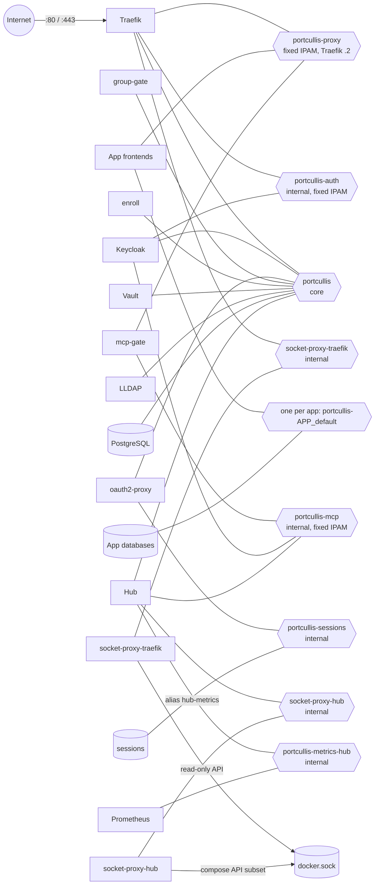

# Security & Hardening

This page covers what the core stack (`docker-compose.yml` in the core repo)
does to limit the damage a compromised component can do, and where it can't:
the threat model, network layout, Docker socket proxies, per-service container
settings, the secrets containers read, the shared-folder fixer, LAN-only
ports, header trust, the VPN service and worker servers.

## Threat model summary

| Asset / boundary | Threat | Mitigation |
|------------------|--------|------------|
| Logins | Phishing, password reuse | WebAuthn (FIDO2) passkeys and YubiKey certificates (PIV). Both are bound to the origin or the TLS handshake. Per-app [templates](auth-policies.md) can require them. Browser certificates are files and can be copied, so they score like a synced passkey (2.5) and never count as a YubiKey certificate |
| User identity | A user changes their own LLDAP email to someone else's | Identity is the immutable username everywhere; email is never used to authorise or link accounts |
| Identity headers (`X-Forwarded-User`, certificate headers) | Spoofed by an internet client | Traefik deletes client-supplied `X-Forwarded-*` and cert headers on the entrypoint, and forward-auth replaces the identity headers |
| Attribute headers (`X-Forwarded-Attr-*`) | Spoofed by an internet client or by routers without forwardAuth | Client copies stripped by `authResponseHeadersRegex: ^X-Forwarded-Attr-` on every forwardAuth middleware (Traefik can't delete headers by prefix in a headers middleware). Routers without forwardAuth (keycloak, enroll-invite, headscale, netbird, docs) don't strip them; backends there must not trust them |
| Identity headers | Spoofed by another container on `portcullis-proxy` | Header-auth apps trust only Traefik's fixed IP (`PORTCULLIS_TRAEFIK_IP`). Keycloak trusts proxy headers only from Traefik's fixed IP on the internal `portcullis-auth` network |
| Hub (runs compose, so it is effectively host root) | Reached without passing forward-auth | Hub: requires `lldap_admin` and the `X-Portcullis-Proxy-Secret` header. People listener (`people.<domain>`): any signed-in user (group-gate-map.conf `people=*`), per-request permission checks |
| Docker API | A compromised Traefik or Hub takes over the host | No service mounts the socket except two socket proxies with per-client allow-lists |
| Forward-auth session cookies (shared cookie secret) | A cookie stolen from one host replayed elsewhere | Same parity as the main domain: `forward-auth` and `forward-auth-ext` share the cookie secret, but oauth2-proxy's HMAC covers the cookie name, so a `_oauth2_proxy` (main domain) value isn't accepted as `__Host-portcullis_ext` or vice versa. A stolen `__Host-portcullis_ext` value is a session on every extra-domain host, as the `.<domain>` cookie is on every main-domain host: browsers send it to its host only, and group-gate still checks each host's group and policy. The cookie is only a ticket: the session itself is in the [session store](#session-store-sessions), so signing out deletes it and the stolen ticket stops working. Sessions re-validate with Keycloak every minute (cookie refresh), so a Keycloak logout ends both |
| Session store (`sessions`, Valkey) | Another container reads or rewrites sessions; one oauth2-proxy touches the other's | Reachable only on the internal `portcullis-sessions` network (the store and the two oauth2-proxies); the default user is off; each oauth2-proxy has its own user and password, limited to its own ticket keys and the handful of commands oauth2-proxy sends. Sessions are encrypted with a per-ticket secret that only the browser's cookie holds. Memory only: nothing on disk, a restart signs everyone out |
| Lost or stolen YubiKey or browser certificate | Keeps working until expiry | Revocation is checked on every request (group-gate, both CAs' CRLs), at Keycloak certificate login (that CA's CRLs, fail closed), and by the certificate binding; a revocation on the web is normally enforced within a minute. On removal or expiry, group-gate also withholds `Authorization` and `X-Forwarded-Access-Token` |
| Expired group membership | Keeps working while Hub is down | Every pending expiry is in the policy file's `expiring` array (plus a 10-min grace after LLDAP removal). group-gate treats it as absent. The Hub also revokes Keycloak sessions (oauth2-proxy cookie refresh is 1 min, so removals and Keycloak logouts take effect within ~1 min; sessions end at Keycloak's idle 8h / max 12h) |
| Path-based admin areas | Bypassed with encoded or dot-segment paths | group-gate normalises the path and denies ambiguous encodings (see [Groups](groups.md#path-rules-path_groups-and-admin_paths)) |
| Templates (outside contributions) | A malicious or careless template opens access | The Hub rejects routing it can't fully see, refuses hostname collisions and core hosts, validates custom overrides (no Traefik labels, host-path bind roots, privileges), and fails closed on unknown config. Templates CI lints fork PRs without secrets |
| Public exceptions (share links, off unless an admin turns them on) | Anonymous access to app endpoints, token guessing, share-password brute force, identity spoofing on header-auth apps | Only declared, validated prefixes; listed mode routes only admin-listed share tokens; identity headers stripped; `rate-limit@file`; see [Public exceptions](#public-exceptions) |
| AI clients (MCP, [AI support](ai.md)) | A token replayed at another app, an AI acting beyond the person, injected instructions in app content, a secret leaking into the model | `mcp-gate` checks every request: signature, issuer, the exact audience and scope of that one resource (a token for two resources works nowhere), the client, the resource's sign-in rule (certificate methods never count) and the person's population **on every request**. It never forwards the person's token; destructive tools need a confirmation in the person's browser; no tool takes or returns a secret. See [AI support](#ai-support-mcp-gate) |
| An LLDAP account deleted and re-created under the same name | The newcomer inherits the previous holder's Keycloak user (passkeys, sessions, consents, AI connections) | Keycloak links LLDAP accounts by LLDAP's immutable `entryUUID`: the newcomer is a new Keycloak user (new `sub`); the old copy and its passkeys, sessions and consents are removed at the next lookup |
| Password guessing (only while the password method is on) | Online guessing of a person's LLDAP password at `auth.<domain>` | Keycloak's brute-force protection (realm, `keycloak configure`): after 10 failures each further one adds 60 s of wait, at most 15 min, never a permanent lockout (so nobody can lock an account out for good); Traefik's `rate-limit-auth@file`; `admin` and `portcullis-hub` never sign in with a password (refused before any check, not counted) |
| VPN-only apps ([VPN](vpn.md)) | Reached from the internet, from a LAN or Docker address, from another person's device, or through a gateway claiming another VPN's addresses | A VPN-only router never exists on `websecure`; Traefik's `vpnsecure` honours PROXY v2 only from `wg` on a network of exactly `wg` and Traefik; the edge admits a provider's connection only on its own port, from its own gateway, from an address in its own ranges that is one of its fresh devices; an allowlist on the connection's address; then the normal sign-in and the device ↔ person binding in group-gate, which counts only on its VPN paths. Missing, invalid, expired or stale device lists deny. See [VPN](#vpn-wg-the-edge-and-gateways) |
| Worker servers ([Multiple servers](servers.md)) | A stolen or compromised worker takes over the primary, reaches another worker, reads sessions or keeps working after revocation | A worker gets no session cookie, proxy secret, cookie secret, ACME, DNS, Vault, LLDAP or Keycloak admin credential, and no other server's bundles. Every connection is opened by the primary; its end of the tunnel listens on nothing. The agent's API is narrower than `socket-proxy-hub`, every reply is untrusted input to the Hub. Node certificates come from their own CA, which signs no person in. Revocation needs nothing from the worker and rotates what it held. See [Multiple servers](#multiple-servers) |
| Vault data volume | Copied off the host | Encrypted. The unseal key is in `secrets/` on the host, so a copy of the volume alone is useless |
| Host root / `docker` group | Full compromise | Out of scope. Anyone who can run docker is root-equivalent, and the unseal key is on the host |

Known limits:

- **The Hub can still start arbitrary containers** (privileged, host mounts):
  that is what "run compose for any template" means. Treat it as host root.
- **Auto-unseal trades confidentiality at rest for availability** on the same
  host (see [Certificates](../setup/certificates.md#vault-server-mode-auto-unseal-and-approle)).
- **Routers without `portcullis-groups@docker`** don't get revocation checks.
  They also get no group or path checks.

## Public exceptions

An app's [public exceptions](auth-policies.md#public-exceptions) are the one
place where Portcullis deliberately lets unauthenticated internet traffic
reach an app. What a turned-on exception exposes:

- **Every endpoint under each opened prefix**, to anyone, without login,
  group, hardware key or policy. Only the app's own checks remain (share
  token, share password, expiry, download limits). In mode `all` that includes
  guessing share tokens; in mode `listed` only the listed shares are routed,
  and any other token on the same prefix still goes through forward-auth.
- **The app's share-password form** (e.g. Nextcloud `/s/<token>/authenticate`)
  to brute force. Only the app's own brute-force protection and Traefik's
  `rate-limit@file` (50 req/s average, burst 100, per client IP) limit it. The
  app must see the real client IP (e.g. Nextcloud's `TRUSTED_PROXIES` =
  Traefik) or its limiter locks out everyone at once.
- **Static files under supporting paths** (assets, l10n, theming; matched by
  extension, e.g. Grafana `/public/plugins` reveals installed plugins), and
  the few `exact` routes a template justifies. A front controller that
  routes extension-suffixed paths to code (Nextcloud's
  `/apps/theming/theme/<id>.css`, `/core/js/oc.js`) still runs those
  `#[PublicPage]` routes.
- **Uploads** where the app allows them on a share (Nextcloud file drop via
  `/public.php/dav`).
- **The host's TLS tier.** With a certificate-only template the host drops from
  `protected@file` (or `protected-any@file`) to `authaware@file`: group-gate still enforces the
  certificate per request on gated routers, but native-OIDC apps then check it
  only at login (Keycloak's template check), and routers without group-gate not at all.

What it can't do:

- reach paths outside the prefixes: the router matches `Path(p)` /
  `PathPrefix(p/)` on Traefik's sanitised path (dot-segments resolved), so
  `/s/x/../../apps/files` is matched as `/apps/files` and stays gated;
- overlap admin paths, login gates or other routers of the app (the Hub
  refuses the template), or `/admin`, `/oauth2`, `/.well-known`;
- carry an identity: `X-Forwarded-User`, `X-Forwarded-Email`, the other
  forward-auth headers, `Remote-*` and the template's `identity_headers`
  (and their `_` forms) are deleted, so a header-auth app (Grafana) can't be
  told who the visitor is;
- carry a login past the hardware key: core's public guard (group-gate
  `/public-guard`, first middleware of every public router) answers 403 to
  requests with `Authorization`, `Proxy-Authorization`, the template's
  `credential_headers`, `credential_cookies` or `credential_query`. Cookie
  and query names are normalised the way PHP does (php-src
  `php_register_variable_ex`: leading spaces, ` `/`.` → `_`, `name[…]`,
  NUL), raw and percent-decoded, case-insensitively; non-UTF-8 names are
  refused. It also denies any path outside the published patterns, a `#`,
  and encoded `/`, `\`, NUL or `#`. A plain session cookie the template doesn't list
  (Nextcloud's `oc<instanceid>`, needed for share passwords and CSRF) is
  passed; it only reaches share-scoped routes and static files there;
- be opened by a template on its own: the Hub generates the router, only
  while an admin (or a template default that opens nothing until an admin
  lists a share) has it on, and reports any running exposure label that
  differs from what it would render as drift.

Trade-off: an app user signed in with a remember-me cookie gets the
guard's 403 on a public link in the same browser (open it in a private
window). The guard serves only version 6 of the policy file (keyed by full
hostname), so the Hub and core are upgraded together.

Not everything with a share feature can be scoped: Vaultwarden Send needs the
web vault at `/` and the password-login token endpoint, and Kanboard's router
reads `?controller=` before the path, so neither declares public exceptions.

## Networks

Each box is a service; each hexagon is a Docker network. A line means "is attached to".



| Network | Members | Addressing | Purpose |
|---------|---------|------------|---------|
| `portcullis` | Traefik and all core services | Docker default | Core service traffic: forward-auth, Vault, LLDAP, PostgreSQL |
| `portcullis-proxy` | Traefik and app frontends | `PORTCULLIS_PROXY_SUBNET` (default `172.31.250.0/24`). Dynamic range `PORTCULLIS_PROXY_IP_RANGE` (`172.31.250.128/25`). Traefik pinned at `PORTCULLIS_TRAEFIK_IP` (`172.31.250.2`), outside the range | Routing plane. Traefik's docker provider uses this network. No app container can ever get Traefik's address |
| `portcullis-auth` | Traefik and Keycloak only (`internal: true`) | `PORTCULLIS_AUTH_SUBNET` (`172.31.251.0/28`), range `PORTCULLIS_AUTH_IP_RANGE` (`172.31.251.8/29`), Traefik at `PORTCULLIS_AUTH_TRAEFIK_IP` (`172.31.251.2`) | The only path from which Keycloak accepts proxy headers, including the forwarded certificate for YubiKey and browser certificate login |
| `portcullis-mcp` | `mcp-gate`, Keycloak and the Hub only (`internal: true`) | `PORTCULLIS_MCP_SUBNET` (`172.31.253.0/28`), range `PORTCULLIS_MCP_IP_RANGE` (`172.31.253.8/29`), Keycloak at `PORTCULLIS_MCP_KEYCLOAK_IP` (`.2`), the Hub at `PORTCULLIS_MCP_HUB_IP` (`.3`) | The gate's only path to Keycloak's keys and the Hub's MCP listener; the gate pins both names to these addresses in `extra_hosts`, so no container can shadow them. The gate itself is on `portcullis-proxy` at `PORTCULLIS_MCP_GATE_IP` (`172.31.250.3`, outside the dynamic range) |
| `portcullis-sessions` | `sessions`, `forward-auth` and `forward-auth-ext` only (`internal: true`) | Docker default | The oauth2-proxies' path to their [session store](#session-store-sessions); nothing else can reach it |
| `socket-proxy-traefik` | Traefik + its socket proxy (`internal: true`) | Docker default | Read-only Docker API for Traefik |
| `socket-proxy-hub` | Hub + its socket proxy (`internal: true`) | Docker default | Docker API for the Hub |
| `monitoring` (profile `monitoring`, `internal: true`) | Prometheus, Alertmanager, Grafana, blackbox, textfile exporter | Docker default | Scraping and dashboards. Prometheus and blackbox also join `portcullis`, Grafana joins `portcullis-proxy` (routed at `metrics.<domain>`) |
| `alerting` (profile `monitoring`) | Alertmanager | Docker default | Alertmanager's only network with egress, for the receivers |
| `portcullis-<app>_default` | One app's services | Docker default | App-internal traffic (databases, caches). Isolated from other apps and from core |
| `portcullis-vpn` (`internal: true`) | `wg` and the wired VPN providers' gateways only; **never Traefik** | `PORTCULLIS_VPN_NET` (`172.31.254.0/26`), range `PORTCULLIS_VPN_IP_RANGE` (`172.31.254.8/29`), `wg` at `PORTCULLIS_VPN_WG_IP` (`.3`), gateways pinned by the Hub at `.16`–`.62` (slot `n` → `.16 + n`) | The gateways' only path to the edge ports (`9001 + slot`). Traefik isn't on it, so a gateway can't reach `vpnsecure` or spoof `wg` there |
| `portcullis-vpn-edge` (`internal: true`) | exactly Traefik and `wg` | `PORTCULLIS_VPN_EDGE_SUBNET` (`172.31.254.64/28`), range `PORTCULLIS_VPN_EDGE_IP_RANGE` (`172.31.254.72/29`), Traefik at `PORTCULLIS_VPN_EDGE_TRAEFIK_IP` (`.66`), `wg` at `PORTCULLIS_VPN_EDGE_WG_IP` (`.67`) | Traefik's `vpnsecure` (`.66:8443`) listens only here and trusts PROXY v2 only from `.67` |
| `wg-egress` | `wg` only | Docker default | Publishes the built-in VPN's UDP port and carries the resolver's upstream queries |
| `portcullis-metrics-wg` (`internal: true`) | `wg` (alias `wg-metrics`) and Prometheus only | Docker default | `wg`'s metrics (`wg-metrics:9100`), bound to that address only |
| `portcullis-metrics-hub` (`internal: true`) | the Hub (alias `hub-metrics`) and Prometheus only | Docker default | The Hub's [usage metrics](monitoring.md#usage-history) (`hub-metrics:9100`, `GET /metrics` and `/healthz` only), bound to that address only; the Hub refuses to start on a wildcard, loopback or foreign address |
| `portcullis-link` (`internal: true`) | exactly the Hub and `wg` | `PORTCULLIS_LINK_NET` (`172.31.254.80/29`), the Hub at `PORTCULLIS_LINK_HUB_IP` (`.82`), `wg` at `PORTCULLIS_LINK_WG_IP` (`.83`), no dynamic range | The Hub's only path to the worker agents: link's **control** CONNECT listener (`.83:3128`) |
| `portcullis-link-data` (`internal: true`) | `wg` and the relays only | `PORTCULLIS_LINK_DATA_NET` (`172.31.254.128/26`), `wg` at `PORTCULLIS_LINK_DATA_WG_IP` (`.130`), relays from `PORTCULLIS_LINK_DATA_IP_RANGE` (`172.31.254.160/27`) | The relays' only path to worker apps: link's **data** CONNECT listener (`.130:3129`) |

CI checks that exactly `keycloak` and `traefik` are on `portcullis-auth`,
that each socket-proxy network has exactly its two members, and that
`portcullis-sessions` has exactly `sessions`, `forward-auth` and
`forward-auth-ext`. For the VPN it checks, over every profile and on Docker,
Podman and the SELinux overlay, that `portcullis-vpn` has exactly `wg` in
core, `portcullis-vpn-edge` exactly `wg` and Traefik, `wg-egress` exactly
`wg`, and that Traefik isn't on `portcullis-vpn`; for the link, that
`portcullis-link` has exactly the Hub and `wg`, that `wg` is the only core
service on `portcullis-link-data`, and that only the Hub and `wg` carry the
`link_doc` volume and group 10009. `./portcullis up` validates
the VPN networks' addresses (a /26 at least, `wg` and the dynamic range
outside the gateway window, no overlaps) and refuses a mismatch with an
existing network.

**Changing the ranges.** Only do this if the defaults collide with a host, LAN
or VPN network, ideally before `./portcullis init`. The rules:

- the IP range must be inside its subnet
- the range must not contain the Traefik IP
- the two subnets must not overlap

`./portcullis up` and `upgrade` validate them and refuse to run when an
existing network has different IPAM:

- `portcullis-proxy`: disable the apps in the Hub, `./portcullis down`,
  `docker network rm portcullis-proxy`, `./portcullis up`, then re-enable the
  apps so their env picks up the new Traefik IP.
- `portcullis-auth` (core only): `./portcullis down && ./portcullis up`.

## Docker socket proxies

No service mounts the engine socket except two
[linuxserver/socket-proxy](https://github.com/linuxserver/docker-socket-proxy)
containers (HAProxy, pinned by digest) on the primary, and one on each
[worker server](servers.md), `socket-proxy-agent`. Each sits on its own internal network,
shared with exactly one client (integration contract
[§6](../guides/integration-contracts.md#6-engine-access)):

| Proxy | Client | Network | Allowed API sections (`1`) | Methods |
|-------|--------|---------|---------------------|---------|
| `socket-proxy-traefik` | Traefik (`TRAEFIK_PROVIDERS_DOCKER_ENDPOINT=tcp://socket-proxy-traefik:2375`) | `socket-proxy-traefik` | `CONTAINERS`, `NETWORKS`, `EVENTS`, `VERSION`, `PING` | `GET`/`HEAD` only (`POST=0`) |
| `socket-proxy-hub` | Hub (`DOCKER_HOST=tcp://socket-proxy-hub:2375`) | `socket-proxy-hub` | `CONTAINERS`, `IMAGES`, `NETWORKS`, `VOLUMES`, `EXEC`, `EVENTS`, `INFO`, `VERSION`, `PING`, `ALLOW_LOGS`, `ALLOW_ARCHIVE` (instance backups / restores: the archive endpoints of never-started helper containers) | All. `POST=1` also allows `PUT`/`DELETE` on the allowed sections |
| `socket-proxy-agent` (worker only, `docker-compose.worker.yml`) | the worker's agent (`AGENT_ENGINE=tcp://socket-proxy-agent:2375`) | `socket-proxy-agent` | the same as `socket-proxy-hub` (image, sections, limits; a core test compares them) | All, as `socket-proxy-hub` |
| **Socket source** (every proxy) | — | — | `${PORTCULLIS_ENGINE_SOCKET:-/var/run/docker.sock}`, mounted read-only at `/var/run/docker.sock`: Docker's socket, or under [rootless Podman](rootless-podman.md) the operator's `/run/user/<uid>/podman/podman.sock` | — |

The Hub's set is what `docker compose up/down/ps/logs` and the Hub's own Engine
API calls (status, logs, exec, events) need:

- containers: create, start, stop, kill, rm, inspect, list, wait, logs, exec
- images: pull (`/images/create`) and inspect
- networks and volumes: create, inspect, rm
- `/events`, `/info`, `/version`, `/_ping`

Everything else is denied: `BUILD`, `COMMIT`, `SWARM`, `NODES`, `SERVICES`,
`TASKS`, `SECRETS`, `CONFIGS`, `PLUGINS`, `SYSTEM` (df / prune), `AUTH`,
`DISTRIBUTION`, `SESSION`, and container `archive` / `export`. Podman's own
API (`/libpod/…`, with or without a version prefix: `play kube`, `generate`,
`machine`) never matches an allowed section, so both proxies deny it on both
runtimes. CI runs a real `docker compose` project through `socket-proxy-hub`
and checks the denials, the Podman ones and `/build` included. On a worker
the engine socket's literal appears once, in `socket-proxy-agent`; core's
servers e2e jobs check live, on both stacks, that only those proxies mount
the socket, read-only. No engine API is ever reachable over the network: the
primary reaches a worker's engine only through the agent's API.

**Usage reads stay inside these sections.** The Hub's [Usage](hub.md#usage)
page reads container stats (`/containers/{id}/stats?stream=false&one-shot=true`)
and writable-layer sizes (`/containers/{id}/json?size=true`) through
`CONTAINERS`, image sizes through `IMAGES` and the host's CPUs and memory
through `INFO`. `SYSTEM` (`/system/df`) and `ALLOW_TOP` (`/containers/{id}/top`)
stay off, and so does Podman's `/libpod/containers/stats`; CI asserts all three
still answer `403`. Storage is measured by the fixer's read-only `usage` mode
(one read-only mount at `/vol`, `DAC_READ_SEARCH` only, no network, idle IO).
The sampler copies only named inspect fields, never `Config.Env`.

**Limits of a socket proxy.** The Hub can still create containers with any
`HostConfig` (privileged, host bind mounts): that is inherent to "runs compose
for arbitrary templates". The proxy removes the rest of the API surface (swarm,
plugins, image builds, system prune, secrets). Treat the Hub as
host-root-equivalent (under [rootless Podman](#rootless-podman):
operator-equivalent) and keep it behind `lldap_admin` and the
[proxy secret](#hub-proxy-secret).

## Container hardening

Every core service gets:

- `security_opt: [no-new-privileges:true]` and `cap_drop: [ALL]`
- `mem_limit` and `pids_limit`
- an image pinned `tag@sha256:digest`. The Hub comes from `HUB_IMAGE` and
  Keycloak from `KEYCLOAK_IMAGE` (`ghcr.io/porelli/portcullis-keycloak`, our
  own image: the official Keycloak pinned `tag@sha256` plus the sign-in
  extension built with Gradle dependency verification; core `main` defaults to
  its `edge` tag, the latest build of the extension repo's `main`, and a core
  release pins a released tag by digest); enroll
  and group-gate are built from `enroll/Dockerfile` / `group-gate/Dockerfile`,
  whose base images are pinned. group-gate's Python dependencies are exact pins
  with hashes in `group-gate/requirements.txt`, installed wheels-only with
  `pip install --require-hashes`

CI fails if any of these is missing.

| Service | User | Root FS | `cap_add` | Healthcheck | Notes |
|---------|------|---------|-----------|-------------|-------|
| socket-proxy-traefik / -hub | root | read-only (`tmpfs /run`) | `SYS_CHROOT` | `/_ping` | Exception: HAProxy needs root to open the root-owned socket and `chroot`s to `/` |
| traefik | root | read-only (`tmpfs /tmp`) | `NET_BIND_SERVICE` | `traefik healthcheck --ping` | Exception: root for ports 80/443 and the root-owned ACME volume. Without `CAP_DAC_OVERRIDE` it reads files by mode only (`certs/server.key` is group 0, `0640`) |
| postgres | 70:70 | read-only (`tmpfs /var/run/postgresql`, `/tmp`) | — | `pg_isready` | `/var/lib/postgresql` is postgres-owned in the image, so the entrypoint needs no `chown` |
| vault | 100:1000 | read-only (`tmpfs /tmp`) | — | `vault status` | `disable_mlock` (raft), so no `IPC_LOCK`. Reads `secrets/vault-unseal/` via group 1000 |
| lldap | 1000 (`-rootless` image) | read-only (`tmpfs /tmp`) | — | `lldap healthcheck` | |
| keycloak | 1000 (image) | **writable** (`tmpfs /tmp`) | — | `/health/ready` | Image `ghcr.io/porelli/portcullis-keycloak` (`KEYCLOAK_IMAGE`). Exception: `start` re-augments the server into `/opt/keycloak/lib` because the x509 lookup provider (and the sign-in extension's providers) are build options; never `--optimized`. Reads `hub_data` read-only (`/hub-data/signin-keycloak.json`, the Hub's sign-in methods and templates; missing or invalid = nobody signs in) |
| sessions (Valkey) | 999:1000 (the image's `valkey`) | read-only (`tmpfs /data`) | — | an unauthenticated `PING` must answer `NOAUTH` | Image `valkey/valkey` alpine, pinned. The [session store](#session-store-sessions) of both oauth2-proxies: no ports, only on `portcullis-sessions`, no persistence (`save ""`, `appendonly no`), `maxmemory 64mb` with `volatile-ttl`, `mem_limit` 128m, `pids_limit` 64. Reads `secrets/sessions/valkey.conf` read-only |
| forward-auth (oauth2-proxy) | 65532 (distroless) | read-only | — | **none** | Exception: the image has no shell or HTTP client. Sessions in `sessions` (user `forward-auth`), starts once it is healthy |
| forward-auth-ext (oauth2-proxy) | 65532 (distroless) | read-only | — | **none** | Same image, provider config, client and cookie secret as forward-auth; serves extra-domain hosts only (contract §5): relative callback `/oauth2/callback` built from the request host (`X-Forwarded-Host`, trusted from `OAUTH2_PROXY_TRUSTED_PROXY_IPS` only), host-only cookie `__Host-portcullis_ext` (`Secure`, no `Domain`, `Path=/`), no redirect whitelist (only relative redirects are accepted). Both oauth2-proxies send PKCE S256 and the `portcullis-forward-auth` client requires it (`pkce.code.challenge.method`), so a code delivered to a stale callback URI is useless without the verifier. Routed only by the Hub's per-host `Host(<h>) && PathPrefix(/oauth2/)` routers. Its middleware `portcullis-auth-ext` lists the same `authResponseHeaders` / `authResponseHeadersRegex` as `portcullis-auth` (CI compares them) |
| group-gate | 10003:10003 + group 10001 (`group_add`) | read-only (`tmpfs /tmp`) | — | `/healthz` | Image `portcullis-group-gate`: pinned `python` alpine base + `cryptography` (CRL and CA-file parsing) and `PyJWT` (token claims) + the script. Mounts `certs/yubikey-ca.crt` and `certs/browser-ca.crt` read-only (`/etc/group-gate/ca/`). Writes only `group_gate_data` (`/data`, owned `10003:10001`): the opened log `opened/` (mode 2770, group 10001; files 0640) for sign-in history. A write failure never denies a request |
| hub | 10001:10001 (image) | read-only (`tmpfs /tmp`, `/home/hub` (1777: Podman's compat API refuses uid=/gid=)) | — | image `HEALTHCHECK` (`/healthz`) | Writes `/data` (volume) and `/project/templates` (chowned to 10001 by `./portcullis up`). Mounts `group_gate_data` read-write at `/group-gate-data` only to read the opened log and delete day files older than the history limit (never today's). Go; libraries: yaml.v3, alecthomas/participle/v2 (custom-override and rule parser), go-ldap/ldap/v3, hasura/go-graphql-client, Nerzal/gocloak/v14, moby/moby/client + api |
| enroll | 10002:10002 (`USER` in Dockerfile) | read-only | — | `/healthz` | Reads `secrets/enroll/` via group 10002. Generates browser certificates' keys in memory, answers the `.p12` and its password once to the Hub, clears them and never stores or logs them |
| dns-tool (profile `tools`) | 10004:10004 | read-only | — | none (one-shot) | Image `portcullis-domains` (entrypoint `domains dns`, built if missing, never pulled). Only `./portcullis dns …` starts it (`docker compose run --rm --no-deps -T`); the image's health check is disabled for it. Network `domains-egress` only; no volumes, no `environment`, no `env_file`, no ports, no Traefik labels; `mem_limit` 128m, `pids_limit` 64. The provider credentials arrive as JSON on stdin ([The dns tool](#the-dns-tool)) |
| mcp-gate | 10005:10005 + group 10001 | read-only (`tmpfs /tmp`) | — | `mcp-gate healthcheck` | Image `portcullis-mcp-gate`, built from `mcp-gate/` (Go, the official MCP Go SDK; pinned base images). No Docker access, no LLDAP or Keycloak admin credentials. Reads `hub_data` read-only (the gate files), writes `mcp_gate_data` (the access log). `mem_limit` 1g (`GOMEMLIMIT` 900MiB; the gate caps one person's requests in flight and the memory request bodies hold, [contracts §15.9](../guides/integration-contracts.md#159-rate-limits-and-all-my-apps); results and aggregate refreshes aren't budgeted, so many people at once can still exhaust it and the container restarts, one person can't), `pids_limit` 256 |
| wg (profile `wg`) | 10006:10006 + group 10007 (`group_add`) | read-only | — | `wg healthcheck` | Image `portcullis-wg`, built from `wg/` (Go; wireguard-go and the gVisor netstack: userspace WireGuard). **No `cap_add`, `devices`, `sysctls`, `/dev/net/tun`, `privileged`, `network_mode` or engine socket, on any runtime** (CI's VPN wiring check and the no-`NET_ADMIN` / `SYS_ADMIN` lint). The internet-exposed service, so never the Hub's group 10001 and no `hub_data`: reads `vpn_doc` read-only (group 10007), writes `wg_data` (`status.json`), reads `secrets/wg/people.key` read-only. The link role adds group 10009 (`link_doc` read-only), the read-only `link.key`, `link-tls.key`, `link-tls.crt` and `certs/node-ca.crt`, and the networks `portcullis-link` and `portcullis-link-data`. `mem_limit` 128m, `pids_limit` 128. See [VPN](#vpn-wg-the-edge-and-gateways) and [Multiple servers](#multiple-servers) |
| relays (primary, one compose project per instance placed on a worker) | 65534:65534 | read-only | — | `portcullis-relay healthcheck` (image) | Image `ghcr.io/porelli/portcullis-relay` (`RELAY_IMAGE` → `HUB_RELAY_IMAGE`, a digest or `:edge`). Started by the Hub, one per routed service, carrying exactly the labels the service would carry on the primary. `mem_limit` 64m, `pids_limit` 64. Networks `portcullis-proxy` and `portcullis-link-data` only; its token lives in the relay project's env file (0600). See [Relays](#relays-and-the-cookie-rule) |
| agent (worker only) | 10008:10008 + group 10001 | read-only (`tmpfs /tmp`) | — | `portcullis-agent healthcheck` (image) | Image `ghcr.io/porelli/portcullis-agent` (`AGENT_IMAGE`). No published port: it serves only inside its own userspace WireGuard tunnel. Networks `socket-proxy-agent` (internal) and `worker-egress`; joins the worker's `portcullis-proxy` itself. Mounts `worker-data/` at the same host path, and **read-only** at their host paths the checkout, the engine's data root and every folder root (it refuses to start without them). `mem_limit` 256m, `pids_limit` 256. Under SELinux `label=disable` ([below](#the-agent)) |
| socket-proxy-agent (worker only) | root | read-only (`tmpfs /run`) | `SYS_CHROOT` | `/_ping` | `socket-proxy-hub`'s service byte for byte; `label=disable` under SELinux, as it mounts the engine socket |
| mail-cert (profile `tools`) | 10004:2000 | read-only | — | none (one-shot) | Image `portcullis-domains` (entrypoint `domains mail-cert`), started only by `./portcullis mail …` like `dns-tool`; network `domains-egress` only; volumes `mail_acme` and `mail_tls`; the DNS credentials on stdin. Its own ACME account and key, never Traefik's. The mail server itself is no core service: it is the wired [mail provider](#mail) |
| prometheus, alertmanager, blackbox, textfile-exporter (profile `monitoring`) | 65534:65534 | read-only | — | `/-/ready`, `/-/healthy`, `/metrics` | `monitoring` network is `internal`; nothing published. Alertmanager's only egress is the `alerting` network |
| grafana (profile `monitoring`) | 472:472 | read-only (`tmpfs /tmp`) | — | `/api/health` | Header auth only from `PORTCULLIS_TRAEFIK_IP`; login form and basic auth off |

**Throwaway containers the CLI starts:**

- the chown helper: fully qualified, pinned `alpine`, `--network none`, only `CAP_CHOWN`
- `traefik-account-uri` (reading Traefik's ACME account for the CAA pin): the
  `portcullis-domains` image as root (to read the root-owned `acme.json`),
  `--network none`, `--read-only`, `--cap-drop ALL`, `no-new-privileges`, the
  `traefik_acme` volume read-only. It prints only the account URI
  (`.letsencrypt.Account.Registration.uri`, checked to be a plain `https`
  URI), never anything else from the file, which holds private keys
- for backups, the volume snapshot and LLDAP check: the `portcullis-group-gate`
  image (built first if missing), the volume owner's uid, `--network none`,
  read-only, no capabilities. Each volume is mounted at `/vol`, a path the
  group-gate image doesn't have, so an empty named volume is never given the
  helper image's mountpoint owner
- `restic`: fully qualified and pinned, the operator's uid, read-only, no
  capabilities; `--network none` for a local repository
- for `backup verify`, a fully qualified, pinned `postgres` without network

**Helper containers the Hub starts** (contract §6; labelled
`io.portcullis.hub.helper`, removed after each use and at every Hub start):

- the volume helper (instance backups and restores): fully qualified, pinned
  `alpine`, uid 65534, `--network none`, no capabilities, never started (the
  daemon copies through the archive endpoints). Volumes are mounted at
  `/data`, a path the `alpine` image doesn't have, so an empty named volume
  is never given an image mountpoint's owner
- the shared-folder fixer: the Hub's own image by image ID, `hub folderfix
  <mode>` as uid 0 with only its mode's capabilities, no network, read-only
  root filesystem, one bind mount of the folder. See
  [Shared folders and the fixer helper](#shared-folders-and-the-fixer-helper)

## Secrets the containers read

The CLI keeps these **operator-owned** with the container's group, so the
operator can still rewrite them and nobody else can read them. It repairs them
(`secrets_fix_perms`) on every `init`, `up`, `upgrade`, `vault init` and
`restore`.

| Path | Group | Mode | Read by |
|------|-------|------|---------|
| `secrets/vault-unseal/unseal-key` | 1000 | 0640 (dir 0750) | vault (auto-unseal) |
| `secrets/enroll/{role-id,secret-id}` | 10002 | 0640 (dir 0750) | enroll |
| `secrets/enroll/{invite-client-secret,keycloak-client-secret,invite-api-secret}` | 10002 | 0640 | enroll (invite IdP client, Keycloak service account `portcullis-enroll`, Hub invite API) |
| `secrets/hub/core.env` | 10001 | 0640 (dir 0750) | Hub (as `/project/.env`) |
| `secrets/hub/lldap/{username,password}` | 10001 | 0640 (dir 0750) | Hub (`/run/portcullis/lldap`, LLDAP account `portcullis-hub`, `lldap_admin`) |
| `secrets/hub/invite/secret` | 10001 | 0640 (dir 0750) | Hub (`/run/portcullis/invite/secret`, same value as enroll's `invite-api-secret`) |
| `secrets/mcp-gate/age.key` | 10005 | 0640 (dir 0700) | mcp-gate (decrypts the AI credentials the Hub wrote) |
| `secrets/mcp-gate/{age.pub,hub-secret}` | 10001 | 0640 | Hub (encrypts to `age.pub`; holds no identity) and mcp-gate (`hub-secret`, through group 10001) |
| `secrets/lldap/key-seed` | 1000 | 0640 (dir 0700) | lldap (`LLDAP_KEY_SEED_FILE`: the seed of the key protecting stored passwords, see [LLDAP's key seed](#lldaps-key-seed)) |
| `secrets/sessions/valkey.conf` | 1000 | 0640 (dir 0700) | sessions (its config and ACL users: the SHA-256 of `FORWARD_AUTH_REDIS_PASSWORD` / `FORWARD_AUTH_EXT_REDIS_PASSWORD`, never the passwords; rewritten from `.env` on every run) |
| `secrets/wg/people.key` | 10006 | 0640 (dir 0750) | wg (the built-in VPN's private key, written by `./portcullis vpn init` inside a throwaway `wg` container, never printed; an empty file means the built-in VPN is off) |
| `secrets/monitoring/prometheus/{vault-token,tls-targets.json}` | 65534 | 0640 (dir 0750) | Prometheus (Vault metrics token: policy `portcullis-metrics`) |
| `secrets/monitoring/alertmanager/alertmanager.yml` | 65534 | 0640 (dir 0750) | Alertmanager (receivers incl. SMTP password / webhook URLs) |
| `secrets/monitoring/grafana/admin-password` | 472 | 0640 (dir 0750) | Grafana |
| `certs/server.key` (dev/CI only) | 0 | 0640 | Traefik |
| `templates/` | owner 10001 | 0755 | Hub (writes) |
| `appfiles/` | owner 10001 | 0750 | Hub (writes settings data files, see [below](#settings-data-files-and-secrets)) |

Without root, the CLI changes owner/group through a throwaway container
(fully qualified, pinned `alpine`, `--network none`, `--cap-drop ALL --cap-add CHOWN`).
Anyone who can run docker is root-equivalent anyway.

**The Hub never sees the core `.env`.** It gets `secrets/hub/core.env`, which
holds only what templates may reference: `PORTCULLIS_DOMAIN`,
`PORTCULLIS_TRAEFIK_IP`, the proxy subnet and range, `PORTAL_DISPLAY_NAME`,
`HEADSCALE_*`, `HEADPLANE_*`, `NETBIRD_*`, `COTURN_*`, and the names listed in
`HUB_SHARED_ENV`. Core secrets are refused. `./portcullis up` rewrites the file
in place. `secrets/` and `backups/` are masked from the Hub with empty tmpfs
mounts.

## LLDAP's key seed

LLDAP stores each password as an OPAQUE record. The server key protecting
those records is derived from `key_seed`. The upstream image's config
template ships a **public** default seed (`"RanD0m STR1ng"`). With it,
anyone holding `users.db` (for example a backup's `lldap_data.tar.gz`) could
attack the stored passwords offline without any server secret. So every
install has its own seed.

**Where it lives.** `secrets/lldap/key-seed`: 48 bytes from the system's
CSPRNG (`openssl rand`), base64, 64 characters, no newline.

- `./portcullis init` makes it once, also with `--env-only`. It writes a 0600
  temporary file, links it into place only if no seed exists, and checks the
  result is 64 characters. An existing seed is never replaced.
- `secrets_fix_perms` (every `up`, `upgrade`, `vault init`, `restore`) keeps
  it operator-owned, group 1000 (the `-rootless` image's `lldap` user),
  0640, in a 0700 directory. Only LLDAP mounts it, read-only at
  `/run/portcullis/lldap/key-seed`. Under rootless Podman with SELinux it
  is labelled `Z`.
- On Kubernetes the CLI syncs it as the Secret `secrets-lldap` (key
  `key-seed`), mounted 0440 with `fsGroup` 1000 in the lldap pod only.

**How LLDAP reads it.**

- Through `LLDAP_KEY_SEED_FILE`, never as a plain `LLDAP_KEY_SEED` value or
  on a command line. `LLDAP_KEY_FILE` is empty, so a missing, empty or
  unreadable seed makes LLDAP refuse to start instead of writing a random
  key file.
- LLDAP doesn't run the image's entrypoint, which copies the template
  (public seed included) into `/data/lldap_config.toml`. It runs
  `tini -- /app/lldap run --config-file /dev/null` and is configured by
  environment only (`LLDAP_DATABASE_URL` and the rest).

**Fail closed.**

- `./portcullis up` and `upgrade` refuse when the seed is missing, empty, a
  directory, shorter than 32 bytes of base64, not base64, or the public
  default.
- `./portcullis status` shows a Problem for those, and for what the running
  container has: a plain `LLDAP_KEY_SEED`, no readable seed file, a
  non-empty `LLDAP_KEY_FILE`, or any `key_seed` in `/data/lldap_config.toml`
  (`lldap.key_seed` in `--json`).
- LLDAP itself refuses to start when the seed doesn't match the key that
  `users.db` was written with ("The private key encoding the passwords has
  changed").

**Backup and restore.**

- The seed is part of `secrets/`, so every backup carries it: in clear in the
  local `backups/` tree (0700, like `.env` and the Vault keys), encrypted by
  restic offsite.
- `restore` and `backup verify` refuse a backup without a usable seed, or
  without `lldap_data.tar.gz`. A `users.db` is useless without its seed.
- A restore puts the backup's seed back together with its `users.db`. The
  seed it replaces stays in `backups/pre-restore-*`.
- Backups made before the seed existed are refused (no back-compat).

**Never regenerate the seed on an existing install.** A new seed voids every
stored LLDAP password: admin's, `portcullis-hub`'s and anyone's set in
LLDAP. LLDAP won't start until it is forced once. `init` refuses up front
(Docker / Podman) when it would make a seed for an `lldap_data` volume that
already holds a `users.db`.

### Fixing an install made before the seed (by hand)

An install made before this change has no `secrets/lldap/key-seed`, and its
`/data/lldap_config.toml` carries the public default. `up` refuses until
it's fixed.

What it changes:

- Every stored LLDAP password becomes invalid.
- Admin's password record is re-written from `.env`'s
  `LLDAP_ADMIN_PASSWORD`. It's the same value, so Keycloak, enroll and the
  CLI keep working, and admin still signs in by security key.
- `portcullis-hub`'s password is re-set by `up` from
  `secrets/hub/lldap/password`.
- Anyone else who had an LLDAP password set by hand gets a new one through
  `./portcullis lldap-ui`.
- Passkeys, certificates and the Hub's per-person SMB passwords aren't
  affected.

Do it in a quiet moment. Docker, in the install root:

```sh
# 1. The seed: refused if one exists, checked to be 64 characters, never printed
( set -eu; f=secrets/lldap/key-seed; umask 077; mkdir -p secrets/lldap
  if [ -e "$f" ]; then echo "$f exists: not overwriting"; exit 1; fi
  t="$(mktemp secrets/lldap/.key-seed.XXXXXX)"
  openssl rand -base64 48 | tr -d '\n' > "$t"
  [ "$(wc -c < "$t" | tr -d ' ')" = 64 ] || { rm -f "$t"; echo "openssl failed"; exit 1; }
  ln "$t" "$f" && rm -f "$t"
  sudo chown "$(id -u)":1000 "$f" && chmod 640 "$f" && chmod 700 secrets/lldap
  echo "seed written" )
# 2. Stop what uses LLDAP, delete the old config copy (it carries the public default)
docker compose stop hub keycloak lldap
docker compose run --rm --no-deps -T --entrypoint rm lldap -f /data/lldap_config.toml
# 3. ONE forced start: LLDAP records the new key and re-writes admin's record from .env
log="$(mktemp)"
docker compose run --rm --no-deps -T -e LLDAP_FORCE_UPDATE_PRIVATE_KEY=true -e LLDAP_FORCE_LDAP_USER_PASS_RESET=true \
  --entrypoint sh lldap -c 'timeout 25 /app/lldap run --config-file /dev/null; true' > "$log" 2>&1
grep -iE 'successfully \(re\)set password for "admin"|error' "$log"; rm -f "$log"
# 4. Everything back up (re-sets portcullis-hub's password, restarts the Hub)
./portcullis up
./portcullis status   # "lldap key seed: this install's own"
./portcullis backup   # the first backup with the seed
```

Run step 3 once. A forced start with an unchanged key refuses, and step 1
refuses to replace the seed. If step 3 prints an error and no "successfully
(re)set" line, don't go on: check `docker compose logs lldap`. Under rootless
Podman, use `podman unshare chown 0:1000` instead of `sudo chown` in step 1.

## Settings data files and secrets

App settings ([Hub → App settings](hub.md#app-settings)) reach apps through
the app's `.env`, data files, hooks, token claims and request headers. What
protects each:

- **Secrets at rest.** Secret options are stored only in
  `${HUB_DATA_DIR}/settings/<id>/secrets.json` (mode 0600, directory 0700,
  written atomically); `state.yaml` holds only whether each is set and
  when. The Hub never returns a secret: not in the panel, the save's
  answer, Expert (`[set]`), logs, op records or the audit (`replaced`,
  `generated`, `cleared`).
- **Secrets in transit to the app.** Only three ways: the app's `.env`
  (mode 0600, single-quoted), a data file's secrets file (mode 0600), or a
  hook's standard input. Never in process arguments, a hook's
  environment, labels or the compose override. Hook output and every delivery error are
  redacted (the instance's stored secrets in every encoding, plus
  secret-looking env values) before they are clipped and stored.
- **Backups** carry the secrets store as one member of the archive; the
  archived env has the secret variables blanked and the restore writes them
  again from the store. Protect backups like the `.env` itself.

**Data files.** The Hub writes them under `<core>/appfiles` (mounted in the
Hub at `/project/appfiles`):

| Path | Owner | Mode | Read by |
|------|-------|------|---------|
| `appfiles/` | 10001 | 0750 (`./portcullis up` creates and repairs it) | the Hub |
| `appfiles/<id>/<name>/` | 10001 | 0750 | the app's service, through a read-only bind mount of this directory |
| `appfiles/<id>/<name>/<name>.json` | 10001 | 0640 | the service as root, or with `group_add: ["10001"]` |
| `appfiles/<id>/<name>/<name>.secrets.json` | 10001 | 0600 | the service as root or `user: "10001"`; only written when the file carries a secret option |

Files are written atomically (a new inode each time, which is why the
directory is mounted, not the file). They hold only what the template
declared for that file: instance values, the population's per-person
values, group records whose group still exists with the same LLDAP id, and
values people entered (only for people with access whose account still
matches). They are generated from the Hub's state, so they are not backed
up; deleting an instance removes its directory.

**Fail closed.** If Users & Groups is unavailable, per-person files keep
their last delivery, and a per-person file that was never delivered stops
the start (`503`) instead of starting the app without it. Apps must treat a
missing record or entry as "nothing granted".

## Shared folders and the fixer helper

[Shared folders](hub.md#shared-folders) need a process that changes group
owners, modes and ACLs on the host's files: Docker's archive endpoints
can't do that. The Hub never gets a host shell or SSH for it. It starts a
short-lived **fixer helper** container instead, one per run, and removes it
afterwards (and at every Hub start, should one be left over).

**Which image.** The fixer is the Hub's own binary (`hub folderfix
<mode>`), run from the Hub's own image by its **image ID**, never by a tag
or a name. The Hub finds that image by reading its own full container ID
from `/proc/self/mountinfo` and inspecting exactly that container, which
must answer with the same ID and with core's compose labels (project
`portcullis`, service `hub`). Nothing another container could shadow (a
hostname, a container name, a short ID) is ever consulted. If the check
fails, folder operations answer `503` "the Hub can't find its own image",
with no fallback. Two setups make it fail on purpose:

- a **non-standard Docker data root** whose path doesn't contain
  `docker/containers/` (the default `/var/lib/docker` and Docker Desktop
  work);
- a **core project not named `portcullis`** (for example a
  `COMPOSE_PROJECT_NAME` override).

`HUB_FIXER_IMAGE` (pinned by `@sha256:`) replaces the image for
development and is honoured **only with `HUB_DEV=1`**; otherwise the Hub
refuses to start. An image chosen through the environment and run as root
with file capabilities would be a privilege pivot. Anyone who can set the
Hub's environment can also change `HUB_IMAGE`, so this narrows that path
rather than closing it: protect `.env` like the rest of the core
configuration.

**How it runs.** uid 0 with `no-new-privileges`, all capabilities dropped
and only its mode's added back, no network, read-only root filesystem, no
host namespaces, at most 16 processes and 256 MiB, no healthcheck, and one
bind mount: the folder (read-only except to apply or restore). The
capabilities are the measured minimum for each mode (the Hub's CI drops
each one in turn and checks the run fails):

| Mode | Used for | Capabilities |
|------|----------|--------------|
| `probe`, `scan`, `snapshot`, `restore --dry-run` | Check path, the doctor's disk checks, the permissions snapshot, the undo's preview and verify | `DAC_READ_SEARCH` |
| `apply`, `restore` | Applying a folder, undoing the last fix | `CHOWN`, `FOWNER`, `FSETID`, `DAC_READ_SEARCH` |
| `apply --mkdir` | An apply that creates missing subfolders | the above plus `DAC_OVERRIDE` |

`DAC_READ_SEARCH` reads directories uid 0 doesn't own; `CHOWN` sets the
folder group; `FOWNER` sets modes and ACLs on others' files; `FSETID` keeps
the setgid bit (uid 0 isn't in the folder's group). `SETFCAP` is never
granted. The Hub refuses every run (`503`) under **userns-remap or rootless
Docker**, where ids inside the helper are translated and owners and ACL
entries would be wrong. Under **rootless Podman** it runs, because every
container shares one mapping and the fixer checks it has exactly that shape
([below](#rootless-podman)).

**What it never does.** It never follows a symlink, never leaves the
folder's filesystem or enters another mount, and never opens a device or
FIFO. It skips (and reports) hard-linked files, setuid/setgid files and
files with file capabilities, because changing them would widen access or
drop the capabilities. It writes only on ext4, XFS, Btrfs and ZFS. Every
run on a defined folder must find the folder root's stored device, inode
and mount root, or it changes nothing. An apply changes exactly the entries
the preview planned (by count and digest), and nothing is removed: groups
and owners that had access keep it through ACL entries.

**Folder groups are reserved.** Gids 60000–60999 belong to shared folders.
A template may not use them (numeric ids, compose `user:` and `group_add`,
or option defaults those name), a settings save may not set one, and a
custom override may not set a `user:` with one, so an app can't get a
folder's access without being assigned it. What the Hub can't see
statically (a root container that changes its own groups, an image's own
`USER`, a `PGID` passed some other way) the doctor checks at run time: it
reads the groups of the processes in each app's containers and reports any
folder gid an app holds without an assignment.

**Directories are group-writable** even for read-only uses: every directory
gets `g+rwx` and setgid, so files created in them land in the folder's
group with group write. This holds for readers too (an app can read a folder
that changed since its last start), so a reader could write files there.
Restrict write access by controlling the set of apps assigned the folder,
not by relying on the mount's read-only flag alone.

**Residual risks:**

- **Swapping a subfolder while an app starts.** A writer app could replace
  a subfolder with a symlink, and Docker resolves bind sources on the host.
  The Hub probes the subfolder right before the container starts and again
  right after (on a mismatch it takes the app down at once, and the doctor
  shows a Problem). This narrows the window, it doesn't close it: another
  app that writes the folder keeps running and could swap the subfolder
  between the first probe and the container start, then swap it back before
  the second probe.
- **Folders nested through a host bind mount.** If `/mnt/b` is a host bind
  mount of `/srv/photos/sub`, a folder at `/mnt/b` has its own device,
  inode and a path that doesn't overlap `/srv/photos`, so the Hub can't see
  that it is nested: two gids would then apply to one subtree. Don't define
  folders across bind mounts of each other.
- **Moves during a fix.** The fixer checks that each entry is still inside
  the folder right before it changes it, but a process with a wider view of
  the same filesystem (a host process, another container with a broader
  bind mount) can still move an entry out in the instant between that
  check and the change.

## Mail

The mail server is a **mail provider**: an app instance whose template has
a `mail:` block, wired by a full administrator into the server's one mail
slot ([Mail operations](mail.md)). It is the one app other mail servers on
the internet talk to directly, and it holds everyone's mailbox, so the slot
contains it whatever template it comes from (any installed mail template may
be wired, from any source)
([contracts §3.5](../guides/integration-contracts.md#35-mail-providers-the-mail-block-new-mail-provider),
[§19.1](../guides/integration-contracts.md#191-the-slot-networks-volumes-files-and-the-override)).

**What core runs for the slot:**

| Name | Kind | Members |
|------|------|---------|
| `portcullis-mail-api` | internal network, fixed subnet `172.31.255.16/28` | the Hub at `.18`; the wired provider's API service at `.19` (alias `mail-api`), attached by the Hub's override. Nothing else |
| `portcullis-metrics-mail` | internal network | Prometheus; the wired provider's metrics services, attached by the override |
| `mail_slot` | volume, `10001:65534` `2750` | the Hub read-write, Prometheus read-only: the metrics targets and their password |
| `mail_provider_slot` | volume, `10001:2000` `2750` | the Hub read-write; the wired provider's `gated` services read-only (the whole volume): its API secret, metrics secret, relay password and gate files. Never backed up, emptied by a restore |
| `mail_tls`, `mail_acme` | volumes | `mail-cert` (the certificate, its key and ACME account); `mail_tls` read-only into the wired provider's `tls` services |

The Hub has the group 2000 (`group_add`), the mail-provider group, so it
writes the slot files (`0640`, group 2000, written in place, never on argv
or in a log); the override adds group 2000 to the provider's `tls` and
`gated` services so they can read them.

**Containing a provider.** A template the admin wires gains exactly what the
slot allows:

1. **An allowlist.** The `mail:` block names services and ports, and the
   Hub's override renders exactly those: the four ports on the listener
   service, the API network on the API service, the metrics network, the
   certificate and the slot files on the services the block lists, and one
   Traefik router for MTA-STS, autoconfig and autodiscover. The template
   itself gets the VPN gateway's hardening on **every** service: no
   `ports`, no Traefik labels, not privileged, `cap_drop: [ALL]` with at
   most `NET_BIND_SERVICE`, no devices, no `pid`, `ipc`, `volumes_from` or
   host network, read-only binds of its own files only, plain volumes, its
   own plain networks only (never a core network, fixed addresses only
   inside its own subnets), no IPv6, literal pinned images, no YAML anchors,
   no per-person secrets, `instances: single`. The provider never gets
   engine access, `hub_data`, LLDAP, Keycloak or DNS credentials, the
   wildcard key, other instances' networks, or a core network other than
   the two above. Before every `up` of every instance the Hub checks the
   rendered project: `portcullis_mail_tls` and `portcullis_mail_provider_slot`
   are mounted only into the wired provider's `tls` and `gated` services,
   read-only, and on core networks only the Hub's own attachments exist.
2. **Wiring is deliberate.** A full administrator with a fresh sign-in with
   a security key (or the host operator, through the CLI) types the
   instance id after the powers are spelled out; never from MCP or AI;
   audited with the template's source, commit and fingerprint. Installing a
   template never wires it.
3. **Template updates hold.** Any change to the wired template (its block,
   its compose file, any file of its directory, an image bump) keeps the
   instance on its current containers until a full administrator confirms
   it ([Template updates hold](mail.md#template-updates-hold)).
4. **The Hub checks every rule itself**, never trusting the provider: the
   DNS allowlist and the DMARC floor (the Hub and the domains service);
   mail passwords by uuid, echoed and compared, and rows that end only on a
   confirmed answer; the mass-removal guard before it sends a document;
   LAN-only, through each password's reported networks; the void after every
   wiring and restore, verified by listing credentials; the session reset
   after every revoke; strict decoding of every answer (unknown keys
   refused, sizes capped, ids shaped, texts clipped and shown as plain
   text).
5. **The damage bound.** A provider that turns hostile can read and send the
   mail of the people in `mail_users`: that is inherent to running a mail
   server, and it is why the warning says so ("… and can read every
   mailbox") and wiring needs a fresh, typed confirmation. It can't affect
   sign-in, other apps, DNS outside the validated mail names, or the
   certificate of any other host.

**The four ports.** `25` (SMTP, STARTTLS) is public by necessity and never
offers AUTH or relays anything (relaying needs an authenticated session, never
an IP address); `465` and `587` (submission) require AUTH, refuse the MX
role and check that the envelope sender and `From:` are the person's own
address, alias or list; `993` is IMAPS. All four are IPv4 only, published by
the engine onto the wired provider (no Traefik TCP entrypoint), and no other
instance may publish any of them while the slot is open. They are never
LAN-only: port 25 must be public, and
[LAN-only mail passwords](../setup/mail.md#lan-only-mail-passwords) limit who
can sign in instead. Every provider must keep these rules (core's
conformance suite tests them).

**The gate.** Every `gated` service of the provider checks the slot files
before its server starts: the sentinel `.present`, or the Hub's void mode
with its session nonce. A raw start of the provider (an unwired instance, a
core restore that emptied the slot volume, a void owed) fails closed.

**The mail certificate** is core's (`mail-cert`): its own ACME account and
its own key, never Traefik's wildcard key, so a compromised provider can't
impersonate `auth.<domain>`; SAN exactly `MAIL_HOSTNAME`; the CAA at
`MAIL_HOSTNAME` pins that account. The provider gets the files read-only and
never the DNS credentials, the account or the key's history.

**Mail passwords** open IMAPS and submission only, never Portcullis sign-in
or the provider's API; the provider keeps only their hash, and the plaintext
exists in one `no-store` answer. The Hub restarts the provider's session
service (the block's `sessions.restart`, the only service of the instance it
restarts for mail) after every revoke and removal, so open sessions end
within 8 seconds.

**The export exception.** `./portcullis mail export` is the only path that
reads message content: CLI only, never through the Hub or an AI. It runs the
block's export command in the provider's container; the provider must refuse
anything but a former account and remove whatever access it granted itself.

**Local networks** (LAN-only mail passwords) can never amount to anywhere:
at most 64; public IPv4 at most a /16 and public IPv6 at most a /32 (private
ranges as wide as their block); IPv6 never overlapping `::ffff:0:0/96`,
`::/96`, `64:ff9b::/96` or `64:ff9b:1::/48`, and within `fc00::/7`,
`fe80::/10` or `2000::/3`.

**Metrics** of the provider need Basic auth (user `prometheus`, the slot's
metrics secret).

**After a restore** no mail password from the backup works: the Hub voids
every one before the provider serves anyone, and the provider itself refuses
to start while the void is pending
([Mail operations](mail.md#backups-and-restores)).

**No surprise egress.** The provider contacts the outside only to deliver
mail, to resolve DNS and for its checks; a spam filter's external lookups
must stay off. How the `stalwart` app keeps that, and its own management
API, key and role: [Stalwart](../apps/stalwart.md).

**The read-only admin view** (`admin_view`, contract §19.13; `stalwart`'s
`admin-view`). The one router a mail provider gets besides the well-known
one is the Hub's admin view router on `mail-admin.<domain>`
(`portcullis-auth` + `portcullis-groups`, VPN-only in modes admin / server).
The view (`mailctl admin-view`, uid 10010, read-only root, no capability,
only the `viewer_key` volume) answers nothing, and uses no credential,
unless the request comes from Traefik's pinned address with the per-install
route key the router's `portcullis-mail-admin-key` headers middleware sets
after forward-auth (`hub_data/mail-admin-route-key`, 0600, also in the
view's environment) **and** `X-Auth-Request-Groups` (an `authResponseHeaders`
entry: Traefik deletes client copies) lists `lldap_admin`; it listens only
on its `portcullis-proxy` address. A session starts only from the Hub's
single-use 60 s ticket (posted in a form, never in a URL; MAC'd with a
per-install ticket key that only the Hub and the view read as a file —
never the route key, which is a Traefik label; spent nonces kept on disk
until they expire) and ends after 30 min idle / 8 h. Stalwart's viewer
role holds reads only, of objects whose plain fields can't hold a secret
(the queue, reports and every store / directory / DNS / hook / tracer /
lookup object are out; `includeSecrets` pinned off); the view forwards
only `x:<Obj>/get` / `/query` of those objects and the web admin's
canonical paths, never the browser's `Authorization` or cookies, and pins
its TLS hop to Stalwart to the mail certificate's SPKI (chain checks
skipped only with that pin, ruling). Rotation: delete `viewer-password`
from `viewer_key` (a new password at the provider's next start) or
`hub_data/mail-admin-route-key` (a new key at the next render).

## Rootless Podman

Under [rootless Podman](rootless-podman.md) every hardening item above holds
unchanged: the socket proxies and their allowlists, internal networks,
pinned addresses, `no-new-privileges`, `cap_drop: ALL`, read-only roots,
memory and pids limits, pinned digests. CI checks the same baseline against
both the compose file and the SELinux overlay. What changes:

- **Container root is the operator.** Every container shares the
  operator's user namespace: container uid 0 is the operator, container
  uid `n` (1–65535) is `subuid start + n − 1` on the host, and host ids
  outside that mapping appear as `65534` (nobody). A container escape, or
  the Hub's power to create any container, lands as the unprivileged
  operator, not host root.
- **The Hub is operator-equivalent** instead of host-root-equivalent: it
  still creates containers with any `HostConfig`, but the most those
  containers reach is what the operator account reaches (its files, its
  subordinate ids, the ports the sysctl allows).
- **Traefik and the proxies own the operator-owned files mounted into
  them.** They run as container root, which is now the operator, so they
  are the owner of operator-owned files mounted into them, not just readers
  by mode (under rootful Docker, root without `DAC_OVERRIDE` reads by mode
  only). The mounts don't change, and they set the blast radius: Traefik
  sees `certs/`, its dynamic config and the ACME volume; the proxies see
  only the engine socket. Both keep `no-new-privileges`, all capabilities
  dropped (Traefik adds back `NET_BIND_SERVICE`, the proxies `SYS_CHROOT`,
  meaningful only inside the namespace) and read-only roots.
- **The secrets stay the operator's.** The CLI gives secrets to
  container id 0 (the operator) with the reading container's group, so on
  the host they belong to the operator, as under Docker (giving them to the
  operator's host uid inside the namespace would hand them to a subordinate
  id instead).
- **Limits are refused, not dropped.** Without the `memory` and `pids`
  cgroup controllers delegated to the operator's user manager, `init`,
  `up`, `upgrade` and `restore` refuse to run.
- **The shared-folder fixer** runs under exactly one mapping shape:
  container 0 → the operator, container 1 onwards → one subordinate range
  of at least 65536 ids. Any other mapping, userns-remap and rootless Docker
  stay refused. A folder entry owned by a host account outside the range
  (it reads as 65534) refuses the fix for that folder, with the
  `sudo chown -R '<uid>:<gid>' '<path>'` step. The fixer never works around it.
- **SELinux overlay.** Under Podman with SELinux enforcing, the CLI adds
  `docker-compose.podman-selinux.yml`, which relabels bind mounts of core's
  files with the narrowest label that works: `Z` (private) when one service
  mounts the path, `z` (shared) only when several services mount it or a
  path above or below it (and on `templates/` and `appfiles/`, whose
  subdirectories app instances mount). Nothing labels the checkout itself,
  `secrets/`, `backups/` or `.env` (or a parent of them): the Hub's
  `.:/project:ro` becomes a 1 MiB tmpfs there, with `group-gate/group-gate-map.conf`
  bound into it. The two socket proxies run with `label=disable` because a
  confined container can't connect to the operator's Podman socket, and the
  CLI's own short-lived helpers that bind-mount host files (`restore`,
  `backup --offsite`) also run with `label=disable` under Podman: those
  helpers are not SELinux-confined. Nothing relabels user data (`/srv`,
  `/mnt`, `/media`, home directories) or the engine socket.
- **Low ports.** `net.ipv4.ip_unprivileged_port_start=80` lets any local
  account bind ports 80–1023. Keep the host dedicated to Portcullis.
- **The VPN service** is identical on both runtimes (userspace, no
  capability); see the [runtime matrix](#runtime-matrix). The operator's
  `containers.conf` pins Podman's network pool to `10.89.0.0/16`, and
  Portcullis reserves `10.88.0.0/16` and `10.89.0.0/16` against VPN ranges
  ([Rootless Podman → Host preparation](rootless-podman.md#host-preparation)).
- **Client addresses.** Remote TCP keeps the client's address (with `nft` or
  `iptables`); UDP and loopback connections see a rewritten source. Header
  trust never depended on the gateway: identity headers are trusted only
  from Traefik's pinned address, and Keycloak only from its pinned peers.

## Kubernetes

On [Kubernetes](kubernetes.md) (experimental) there is no engine socket and
there are no socket proxies. RBAC, Pod Security Admission, admission
policies and NetworkPolicies take their place. The full rules are in
[contract §6 "On Kubernetes"](../guides/integration-contracts.md#6-engine-access).

- **Traefik reads one namespace.** Its CRD provider lists every Secret of
  each namespace it watches, so it watches only `portcullis-edge`, which
  holds the IngressRoutes, the Middlewares and the apps' pinned
  ExternalName Services, and never a Secret. Cross-namespace references are
  off: an app's backend is an ExternalName Service in the edge namespace
  pinned to exactly its own Service in the apps namespace. Its one
  read-only Role is there: nothing in the core or apps namespace, nothing
  cluster-scoped, no nodes. The CLI refuses to deploy while
  `portcullis-edge` holds a Secret.
- **The Hub's Roles** are the Kubernetes form of `socket-proxy-hub`: one in
  the apps namespace (workloads, Services, PVCs, ConfigMaps, Secrets,
  NetworkPolicies, pods without `patch` or `update`, `pods/log`,
  `pods/exec` `create` only, events, read-only pod metrics — never node
  stats) and one in `portcullis-edge`
  (IngressRoutes, Middlewares and Services only). There is nothing in the core
  namespace and nothing cluster-scoped. The Hub checks at start, every
  60 s and before every deploy that it holds exactly these rules, and
  refuses every runtime operation (`503`) while it holds more or less.
- **Admission policies limit what RBAC can't.** RBAC lets the Hub create a
  pod, but not decide what is in it. Six ValidatingAdmissionPolicies
  (`failurePolicy: Fail`, `Deny`, missing params = deny) refuse:
    - in the apps namespace: the whole PSA baseline (privileged, host
      namespaces, `hostPort`, capabilities outside the
      [Kubernetes baseline](../guides/integration-contracts.md#34-compose-on-kubernetes-new-kubernetes),
      unconfined seccomp or AppArmor, SELinux options, sysctls), a
      `hostPath` outside the bind roots, a pod with any `hostPath` (the
      Hub's helpers aside) unless every container is provably non-root with
      a group above 0 and no privilege escalation (and no `fsGroup` or
      supplemental group 0, and `supplementalGroupsPolicy: Strict`, so the
      image's `/etc/group` adds nothing), a ServiceAccount token, a
      Secret, ConfigMap or PVC that isn't the pod's own instance's
      (`<instance>--…`), helper and probe pods that aren't the Hub's own
      image and shape, NodePort, ExternalName and `externalIPs` Services,
      node ports, a LoadBalancer on a core port, a clusterIP in the core
      Services' static band, every NetworkPolicy peer the Hub doesn't
      generate, a claim of another StorageClass than `portcullis-apps`
      (or with `volumeName`, a data source, a foreign name or a 4-digit
      mode), and any change or delete of a NetworkPolicy, Service, Secret or
      PVC that isn't the Hub's own (`owner: hub`, an instance label; for
      NetworkPolicies an instance selector, for PVCs the `<instance>--`
      name). Only two exact controller changes to a claim are exempt: the
      volume binder setting `volumeName` once, and the PVC protection
      controller removing its finalizer. So the Hub can't delete or
      rewrite the chart's `default-deny`;
    - every Traefik object in the apps namespace;
    - in `portcullis-edge`, for every identity but the CLI's: objects
      other than the Hub's IngressRoutes and Middlewares (`owner: hub`,
      written only by the Hub's ServiceAccount; core's `owner: core`
      objects can't be changed; a Middleware named `<instance>--<name>`
      after its own instance label), a Service other than the pinned
      ExternalName shape (`<instance>--<svc>` →
      `<instance>--<svc>.portcullis-apps.svc.cluster.local`, no selector,
      address or load balancer, `tcp-<port>` ports), entrypoints other than `websecure` and
      `vpnsecure`, a VPN-only instance's route off `vpnsecure`, a route
      match other than `Host(…)` with an optional path, `parentRefs`
      (which would attach a route under another IngressRoute, core's
      included), `ingressClassName`, a route syntax other than `v3`, a route on a core
      hostname, a priority above core's, a route without TLS, a service
      other than the instance's own edge Service or the three core
      services, a core
      Middleware or any `@file` name outside the allowlist, TLS options
      outside the four tiers, `tls.domains`, a TLS secret or store, `forwardAuth` and
      other Middleware types outside the Hub's allowlist, and an
      `X-Portcullis-*` header.

    The params live in the core namespace, where no ServiceAccount has a
    Role, so nothing they judge can rewrite them. The CLI never edits live
    params: each change gets a new params generation with its own
    bindings, proved live before the old ones are removed, so no object
    is ever unbound. The Hub dry-runs a forbidden object per binding (the
    admission self-test) and refuses every runtime operation while one is
    let through.

- **Not enforced by admission: the gate chain and the entrypoint choice.**
  The edge policy checks that every middleware on an app route is allowed
  and that its entrypoints are `websecure` or `vpnsecure`. It doesn't check
  that a route carries the sign-in gate (`portcullis-auth`,
  `portcullis-groups` and the rest) in the right order, or that a route is
  on the entrypoint its instance's VPN setting asks for (beyond a VPN-only
  route staying on `vpnsecure`). **Those rules are enforced only by the
  Hub's rendering**, as on Docker, and checked by its exposure drift.

- **NetworkPolicies isolate every pod.** The core, apps, storage and
  probe namespaces deny everything by default in both directions (every
  pod may still ask kube-dns), and each allowed path is a policy of its own. An instance's pods reach only each other on their compose
  networks; routed ports admit only Traefik's pods and an AI companion's
  port only `mcp-gate`'s; egress to the internet excludes the pod and
  service CIDRs, `169.254.0.0/16`, every node address and the API
  server's, with only ports 80 and 443 to a node. The CLI and the Hub each
  prove with their own probe pods that the cluster enforces them, and
  nothing is deployed until it does. Pod-CIDR source ranges in app
  settings (`PORTCULLIS_TRAEFIK_SOURCE`) are only the second layer.

- **Header trust.** `websecure`, `vpnsecure` and `kcinternal` strip the
  client's forwarding headers first. Keycloak's port admits only Traefik,
  and its internal port 8081 only the five core clients.

- **k3s settings the CLI requires**: `--secrets-encryption` (Secrets
  encrypted in the datastore), its bundled Traefik off, the network policy
  controller on, and a per-pod process limit of 1024. The CLI refuses to
  deploy without them.

- **Volumes.** The provisioner creates each PVC's directory with the
  owner, group and mode from its annotations, and leaves one without them
  `Pending`. Its namespace has its own admission policy
  (`portcullis-storage-pods`): only the pinned provisioner and its pinned
  helper image, `hostPath` only under `/var/lib/portcullis-storage`.

- **Helper pods** (the folder fixer and volume copies) are the only pods
  that may run as root, only with the Hub's own image by digest, only
  created by the Hub's ServiceAccount, and only with their mode's
  capabilities.

- **The Kubernetes API.** Restrict ports 6443 and 10250 to the
  administrators' addresses. `status` and the doctor warn when either
  answers on the public address.

## File sharing

The Samba and Time Machine templates enforce hardened SMB3 and trust only the Local networks (§ [File Sharing](file-sharing.md)).

### Hardened SMB

Both templates require exactly:

- **`server min protocol = SMB3`**: SMB2, SMB1 and older are refused.
- **`server smb encrypt = required`**: every session is AES-128-GCM encrypted. The client asking for no encryption still gets an encrypted session.
- **`server signing = mandatory`**, **`ntlm auth = ntlmv2-only`**, **`lanman auth = no`**: NTLMv1 is refused.
- **`map to guest = never`**, **`restrict anonymous = 2`**, **`guest ok = no`**: guest access is refused.
- **`hosts allow = <PORTCULLIS_LOCAL_NETWORKS>`**, **`hosts deny = 0.0.0.0/0 ::/0`**: only the configured local networks may connect.
- **`wide links = no`**, **`follow symlinks = no`**, **`smb3 unix extensions = no`**: symlinks are never followed, and the SMB3 Unix extensions are off.
- **`disable netbios = yes`**, **`smb ports = 445`**: only port 445 is published (no 137–139).

`testparm -s` must show exactly these values. At boot a mismatch makes the converge script exit 4 before smbd starts (the container restarts in a loop). At hook time the script brings smbd down instead: the container stays up, unhealthy, until a hook run succeeds or the app restarts ([File Sharing](file-sharing.md#hardened-smb)). The templates' converge script (`portcullis-sync`) writes `smb.conf`, and the images' own config switches do nothing.

### Container hardening

- **Capabilities:** `CHOWN`, `SETUID`, `SETGID` and `NET_BIND_SERVICE` only (§ [Container hardening](#container-hardening)). Neither image needs `KILL` (root can signal per-user smbd processes without it) or `FOWNER`.
- **Passdb and state on tmpfs:** `/var/lib/samba`, `/var/cache/samba`, `/run/samba`, `/run/portcullis` are tmpfs, so no hash reaches a Docker volume or an instance backup.
- **Hash files:** on the `hub_secrets` volume (§ [Secrets volume](#secrets-volume) below), read-only to the container, owned by uid 10001, mode `0600`. The converge script drops to uid/gid 10001 (no `DAC_OVERRIDE` / `DAC_READ_SEARCH`) and imports hashes from a `0600` root-owned temp file on tmpfs, never from argv.

### Hosts allow and the userland proxy

**Measured on the test server** (Docker 29.9.3, default settings: `userland-proxy` on): a connection to a published Samba / Time Machine port, even one bound to `127.0.0.1`, reached smbd from the **bridge gateway of the instance's own network** (for example `192.168.64.1`), not from the client's address: Docker's `docker-proxy` relayed it. The gateway sits in Docker's default address pools (`172.17.0.0/16`–`172.31.0.0/16`, then `192.168.x.0/20` once those are used), which are inside the default Local networks (`172.16.0.0/12`, `192.168.0.0/16`). So with the userland proxy on, **`hosts allow` can't tell clients apart**: every client looks local.

What actually limits who can connect:

- **Who can reach the published port.** Publish on a LAN address only (rebind the port in the Hub), and keep the host firewall closed to anything outside your LAN. This is the real boundary.
- **Disabling the userland proxy** (`"userland-proxy": false` in `/etc/docker/daemon.json`, then restart Docker) lets Docker forward with NAT, so smbd should see the real client address and `hosts allow` works as defence in depth. This was not measured for a LAN client here (the test server can't publish SMB beyond loopback).
- Narrowing Local networks does **not** help while the proxy is on: the gateway is still in a range you probably also use for the LAN.

### Secrets volume

The `hub_secrets` volume holds NT hash files (contract § [Per-person credentials](../guides/integration-contracts.md#1316-per-person-credentials-and-ids-new-file-sharing)):

- One `<username>.nt` per active credential: 32 uppercase hex characters and `\n`, mode `0600`.
- Directories `0700`, all owned by uid 10001.
- **Never in backups:** `./portcullis backup` never copies it. A core restore empties it (removes the volume and recreates it with its labels and ownership). See [Backups](backups.md).
- The Hub checks at start that `HUB_SECRETS_DIR` (default `/secrets`) is owned by its own uid (10001) and is mode `0700`. Otherwise it fails closed: credential routes answer `503` and every instance with a `person_secret` option refuses to enable or start.

## LAN-only ports and host firewalls

A template can mark a port **LAN only** (`lan_only: true`, Samba's SMB for
example): it should be reachable only from your local networks. The flag
changes nothing in how the port is bound; the
[doctor](hub.md#local-networks) judges the binding against Settings →
Local networks and offers to bind it to a LAN address.

**Why the doctor doesn't trust your host firewall.** Docker publishes a
container port by writing its own iptables NAT and forwarding rules. That
traffic is forwarded to the container and never passes the host's `INPUT`
chain, where ufw (and most host firewall front-ends) put their rules. A
`ufw deny 445` therefore doesn't stop a published `0.0.0.0:445`. Binding the
port to a LAN address (the doctor's **Rebind…**), filtering in your router,
or rules in Docker's `DOCKER-USER` chain do. The Hub can't see host
firewalls or NAT and doesn't probe reachability from outside, so it judges
only the bind address.

**Host-network apps.** Docker publishes nothing for a service on the host
network: the app listens on the host directly, and its port's bind setting
has no effect. A LAN-only port of such an app is therefore **always a
Problem, explain-only**: restrict it through the app's own listen address
and your router or host firewall.

## Header spoofing protections

- **Client-sent forwarding headers.** Both entrypoints, `websecure` and
  `vpnsecure`, run `strip-client-forwarded@file` first on every router. It
  removes the client's `Forwarded` and the other address and scheme headers
  Traefik doesn't manage itself (`Forwarded-For`, `X-Forwarded`,
  `X-Forwarded-Prefix`, `X-Forwarded-Uri`, `X-Forwarded-Method`,
  `X-Forwarded-Scheme`, `X-Forwarded-Ssl`, `X-Forwarded-Protocol`,
  `X-Url-Scheme`, `X-Original-Forwarded-For`, `X-Client-Ip`,
  `True-Client-Ip`, `Cf-Connecting-Ip`, `Fastly-Client-Ip`,
  `X-Cluster-Client-Ip`); Traefik replaces `X-Forwarded-For`, `X-Real-Ip`
  and the other `X-Forwarded-*` it manages itself. So no backend sees a
  client-chosen address. CI sends 23 forged headers on both entrypoints.
- **Entrypoint.** The `websecure` entrypoint has no
  `forwardedHeaders.trustedIPs`, so Traefik deletes client-supplied
  `X-Forwarded-*` and `X-Forwarded-Tls-Client-Cert(-Info)` headers.
  `aliasHeadersStrategy=delete` also drops alias spellings such as
  `X_Forwarded_Tls_Client_Cert`. The certificate headers that group-gate, the Hub and
  Keycloak see therefore always describe a certificate Traefik verified.
  Never add `forwardedHeaders.insecure` or `forwardedHeaders.trustedIPs` on
  `websecure` or `vpnsecure`: the certificate headers can be trusted only
  because Traefik deletes client copies. `vpnsecure` also sets
  `aliasHeadersStrategy: delete`; it trusts the PROXY v2 header (the client
  address) only from `wg`'s address, never a forwarded header.
- **Forward-auth headers.** Traefik's `forwardAuth` deletes every
  `authResponseHeaders` entry from the upstream request and re-adds only the
  values oauth2-proxy and group-gate return. A client can't send its own
  `X-Forwarded-User` or `X-Auth-Request-Groups` through.
- **No stale groups from Keycloak's cache.** Keycloak's LDAP federation runs
  with `cachePolicy=NO_CACHE` (realm export, enforced on existing realms by
  `./portcullis keycloak configure`): a removed membership or changed
  attribute in LLDAP is in the user's next token (forward-auth refreshes
  every minute), not held in a cached user until eviction or the daily sync.
- **Identity is the LLDAP username, never the email.** LLDAP lets users edit
  their own mail, including to someone else's address. So:
    - Keycloak's LDAP federation does not trust it (`trustEmail=false`, tokens carry `email_verified=false`).
    - oauth2-proxy's session user is always the token's `sub` (Keycloak's user UUID). Its alpha `userIDClaim` is only a deprecated alias of `emailClaim`, so it is not used (CI rejects it). Instead `oauth2-proxy/alpha.yaml` builds `X-Auth-Request-User`, `X-Forwarded-User` and `X-Auth-Request-Preferred-Username` from the `preferred_username` claim, keeps `emailClaim: email`, and accepts the unverified email (`insecureAllowUnverifiedEmail`) because nothing authorises by it.
    - group-gate reads the username **only** from `X-Auth-Request-Preferred-Username` (set by `portcullis-auth`, which must run first) and denies the request when it is missing. It never falls back to the email or `sub`.
    - Apps get `X-Forwarded-User` / `X-Auth-Request-User` = immutable username, and `X-Forwarded-Email` / `X-Auth-Request-Email` = email (display only).
    - Every identity header is in the forward-auth middlewares' `authResponseHeaders`, which is what strips client-supplied copies.
    - Apps also get `X-Auth-Request-Groups`. All of these headers are `authResponseHeaders` of the forward-auth middlewares, so Traefik deletes client-supplied copies (the e2e test sends spoofed ones). Header-auth apps must log users in by `X-Forwarded-User` as a username and take the email from `X-Forwarded-Email`.
    - enroll and the Hub use `X-Forwarded-User` as-is (no email → username lookup); every certificate enroll issues has that username as CN, never a CSR's subject or a value from the client. group-gate's certificate binding compares the certificate's CN with that same username and requires the token's `preferred_username` to match it.
    - Keycloak links the LLDAP account by its immutable `entryUUID` (`uuidLDAPAttribute`, in the realm export and re-asserted by `./portcullis keycloak configure`), so a re-created name never inherits the previous holder's Keycloak user: it gets a new `sub`.
    - Native-OIDC apps must key accounts on `sub` (a re-created username has a new one: an app that links by `preferred_username` alone would hand the newcomer the old app account) and must not link existing accounts by email (e.g. Vaultwarden `SSO_SIGNUPS_MATCH_EMAIL`). Apps that insist on `email_verified=true` need their "allow unverified email" option. AI credential mints get the person's checked Keycloak `sub` and a credential belongs to the LLDAP account it was minted for (a re-created name gets a new one); Gitea mints only for the account linked to that `sub`. Residual: Nextcloud keys accounts on the username (user_oidc), so a re-created name gets the former person's Nextcloud account on the web and through AI alike: delete it (`occ user:delete`) before re-using the name ([AI support → Nextcloud](ai.md#ai-nextcloud)).
    - Apps that refuse `email_verified=false` but accept it absent (Vaultwarden SSO signups) get the `email-unverified` client scope instead of `email` (manifest `email_verified_claim: false`): the `email` claim without `email_verified`. The email is no more trusted than before. Vaultwarden still matches pending email invitations by email, so its template turns invitations off (`INVITATIONS_ALLOWED=false`, `SIGNUPS_ALLOWED=false`) and gates the SSO login paths with group-gate (`users_vaultwarden`).

    **Rule: email is never an identity or account-linking key.**

- **Header-auth apps** accept identity headers only from
  `${PORTCULLIS_TRAEFIK_IP}`, through the app's proxy allow-list or a small
  gate in front of it. Templates CI checks this statically and with a forged
  request (see [Header Auth Pattern](../guides/header-auth-app.md#header-security)).
- **Keycloak** accepts proxy headers only from
  `PORTCULLIS_AUTH_TRAEFIK_IP` on `portcullis-auth`, decided by the TCP peer
  address (`--proxy-trusted-addresses`). The `127.0.0.1:8080` publish for the
  CLI's admin API is untrusted, so it can't inject a cert. See
  [certificate login](../setup/certificates.md#trusted-proxy-address).
- **Paths.** Traefik's default path handling stays on (`sanitizePath`,
  decoding of unreserved `%XX`). Encoded `/`, `\`, `;` and `%00` are allowed
  through because apps such as GitLab and Nextcloud use them. group-gate's
  `path_groups` matching therefore normalises the path itself and denies
  encoded slashes and NULs that survive one decode. `path_groups` checks also
  deny a `#` in the URI or an encoded one in the path.

### Attribute headers

On every request group-gate allows (app and core subdomains alike) it also returns `X-Forwarded-Attr-<Header-Name>` for the
signed-in user's shared custom fields, read from the Hub's
`user-attributes.json` in `hub_data`
([contract §4.1 / §5](../guides/integration-contracts.md)):

- control characters (0x00–0x1F, 0x7F) are stripped, and values over 1 KB are
  dropped and logged
- then `%` → `%25` and `,` → `%2C` in every value (so `Doe, Jane` stays one
  value; apps percent-decode each item), and the values are joined with `, `.
  Non-ASCII is sent as UTF-8 bytes
- field names must match `^[a-z][a-z0-9]*(_[a-z0-9]+)*$` (at most 31
  characters) and header names `^[A-Za-z0-9]+(-[A-Za-z0-9]+)*$`; a field with
  an invalid name or header name is skipped (logged), the others still get
  their headers
- a missing or corrupt file (logged) means no attribute headers, never a deny.
  Two fields on one header (compared case-insensitively) make the file corrupt

`portcullis-groups` forwards them with
`authResponseHeadersRegex: ^X-Forwarded-Attr-`. A headers middleware can only
delete headers by exact name (and the field names are the Hub's), so
client-sent `X-Forwarded-Attr-*` are deleted by the same regex on every
forwardAuth middleware (`portcullis-auth`, `-auth-console`, `-groups`, `-self`,
`-public-guard`): Traefik removes all request headers matching it before
copying the auth server's. Public routers therefore get none, and `_` aliases
are dropped by the entrypoints (`aliasHeadersStrategy`). CI sends forged ones
through the gated and public test routers.

**Per-person setting headers.** An app's per-person options can be
delivered as headers too (`X-Forwarded-Attr-<Name>`, e.g. Grafana's
`X-Forwarded-Attr-Grafana-Role`). The Hub publishes them per host in the
same file (`hosts`: host → header suffix → user → value), and group-gate
returns them only on allow and only for that host, so one app's role never
reaches another app. Because an app may grant privileges from such a
header, the Hub refuses a header delivery unless no client can send it
itself:

- the header name is exactly `^X-Forwarded-Attr-[A-Za-z0-9]+(-[A-Za-z0-9]+){0,30}$`;
- every router that reaches the delivering backend (its network namespace,
  `network_mode: service:` followed) runs Portcullis forward-auth and
  group-gate, which strip client copies;
- the app is not `public`, not `custom` without Portcullis sign-in, and
  can't be switched to its own login only; no Traefik-labelled service runs
  on `network_mode: host`;
- the Hub's public-exception router, which has no forward-auth, deletes
  every declared header name and its `_` spelling with its strip
  middleware.

Routers with **no** forwardAuth middleware (`keycloak`, `keycloak-resources`,
`lldap` (redirect only), `enroll-invite`, and in the app overlays `headscale`,
`netbird-*`, `docs`) do not strip client-sent `X-Forwarded-Attr-*`. Their
backends must never trust those headers (none of them reads them).

### Sessions, temporary memberships and the people directory

- **Temporary memberships.** The policy file (version 6, the only version
  group-gate serves; keyed by full hostname) lists `expiring` `{user, group, at}` entries. group-gate
  treats a membership as absent once `now >= at` (for the host and
  path-group checks and in the `X-Auth-Request-Groups` it returns), whatever
  the token says, so expiry holds even while the Hub is down. A malformed entry
  denies (fail closed). The access token still names the expired group, so when
  group-gate strips a membership it withholds `Authorization` and
  `X-Forwarded-Access-Token` (both are `portcullis-groups`
  `authResponseHeaders`, so Traefik deletes them). Otherwise it echoes them
  unchanged: apps keep the token, and the Keycloak console behind
  `portcullis-auth-console` keeps its own bearer. A file without `version`
  denies as well, and so does a missing file: with no file no method is on
  and no template is known.
- **Session methods come from oauth2-proxy only.** group-gate reads the
  session's `amr` from `X-Forwarded-Access-Token`, which oauth2-proxy sets on
  every forward-auth route (it is in every forwardAuth middleware's
  `authResponseHeaders`, so client copies are deleted), never from
  `Authorization`: on the Keycloak console's route that header is the
  client's own, and group-gate doesn't check token signatures (oauth2-proxy
  did). A YubiKey or browser certificate counts only with the
  [certificate binding](auth-policies.md#certificate-binding).
- **Sign-in pages.** An unmet template gets a `403` page from group-gate
  (present your certificate, a step-up for one method, or needs a stronger
  sign-in), never a redirect: no refresh, no script, every value
  HTML-escaped, `Cache-Control: no-store` and a `default-src 'none'` CSP that
  allows only the page's own inline style. The step-up URL (`pc_method=<one
  method id or passkey>`, also in `X-Stepup-URL`) only reaches oauth2-proxy,
  whose `loginURLParameters` allow exactly those values and no `acr_values`.
- **Session re-validation.** Forward-auth sessions are re-validated every
  minute (`OAUTH2_PROXY_COOKIE_REFRESH=1m`, a legacy option that still applies
  with `--alpha-config`): once the session cookie is a minute old, oauth2-proxy
  redeems the refresh token with Keycloak. A Keycloak logout or a session the
  Hub revokes (membership removal) then fails the refresh and ends access, and
  changed groups reach group-gate, within about a minute. The refresh also ends
  forward-auth sessions at Keycloak's SSO session limits (8 h idle, 12 h max);
  the 168 h cookie lifetime (`cookie_expire`) is only an upper bound.
- **Session store.** See [below](#session-store-sessions): the refreshed
  session is written back under the same ticket, so the browser's cookie never
  has to change and the forward-auth middlewares need no
  `addAuthCookiesToResponse`.

### Session store (`sessions`)

Both oauth2-proxies keep their sessions server-side in `sessions` (Valkey,
`OAUTH2_PROXY_SESSION_STORE_TYPE=redis`, `redis://sessions:6379`); the
browser holds one small cookie (`_oauth2_proxy` on the main domain,
`__Host-portcullis_ext` on extra domains; names and domains as before) with a
signed ticket: the session's key and the secret it is encrypted with.

Why: oauth2-proxy v7.15.5 stores sessions in cookies, and a session that
outgrows one cookie (about 4 KB: a step-up after a setup link does) is split
into `_oauth2_proxy_0…n` while the old unsplit `_oauth2_proxy` is never
expired. oauth2-proxy then keeps loading the stale one, and the step-up page
came back forever (upstream issue
[#3486](https://github.com/oauth2-proxy/oauth2-proxy/issues/3486); the fix,
#3491, is not released yet).

- **Network.** `portcullis-sessions` (`internal: true`) has exactly the store
  and the two oauth2-proxies; nothing is published.
- **Users** (`secrets/sessions/valkey.conf`, generated by `./portcullis`):
  `user default off` (no password, keys or commands: an unauthenticated
  client gets `NOAUTH`), and one user per oauth2-proxy, each limited to its own
  keys and the commands oauth2-proxy v7.15.5 sends (with go-redis and
  bsm/redislock):

  | User | Keys | Commands |
  |------|------|----------|
  | `forward-auth` | `_oauth2_proxy-*` | `ping get set del evalsha eval msetnx mset getrange pexpire mget` |
  | `forward-auth-ext` | `__Host-portcullis_ext-*` | the same |

  Ticket keys are `<cookie name>-<32 hex>`; a refresh holds a lock
  `<ticket key>.lock` (redislock's Lua scripts: `msetnx` / `mset` /
  `getrange` / `pexpire` to take it, `mget` + `del` to release it). Scripts'
  own calls are checked against the same user, so they can't reach other keys
  or commands either. No `keys`, `scan`, `config`, `acl`, `client`,
  `flush*`, `debug`, `module`, pub/sub or replication commands.

- **Residual risk.** oauth2-proxy and redislock need `eval` / `evalsha` and
  a plain `set`, so each proxy user keeps them. A compromised oauth2-proxy
  still can't read or change the other proxy's sessions, but it can hurt
  both: it can run a busy Lua loop, which blocks the store, or write keys
  without a TTL until its 64 MB are full (`volatile-ttl` can evict only
  keys with a TTL). Either way, sign-ins fail on **both** proxies until the
  store is restarted, which signs everyone out.
- **Passwords.** `FORWARD_AUTH_REDIS_PASSWORD` and
  `FORWARD_AUTH_EXT_REDIS_PASSWORD` (40 random characters, generated by
  `init` and `upgrade`, required by compose) reach each oauth2-proxy as
  `OAUTH2_PROXY_REDIS_PASSWORD`; `valkey.conf` holds only their SHA-256. A
  changed config is written in place and the running store restarted before
  `docker compose up`.
- **Memory only.** No RDB or AOF, `/data` is a tmpfs: a store restart, a
  rotated password or a restore signs everyone out once; backups carry no
  sessions. `maxmemory 64mb` with `volatile-ttl` (every session has a TTL of
  the cookie lifetime, so a full store evicts the sessions closest to
  expiring).
- **Refreshes.** A refresh (every minute, see above) saves the new session
  under the same ticket, so the browser's cookie stays valid: it is signed
  with the sign-in time and accepted for `cookie_expire` (168 h), longer than
  Keycloak's 12 h maximum. The 202's `Set-Cookie` therefore doesn't have to
  reach the browser, and the forward-auth middlewares have no
  `addAuthCookiesToResponse`.
- **Sign-out** (`/oauth2/sign_out`, only through the guard below) deletes the
  session from the store: a copy of the cookie stops working at once.
- **`people.<domain>`** (the Hub's directory listener `:8889`,
  [contract §5.1](../guides/integration-contracts.md)) is open to any signed-in
  user: `people=*` in `group-gate-map.conf` (`*` is valid only there; in the
  policy file's `groups` it is ignored, in `path_groups` it is malformed). It
  has the admin Hub's chain (`client-headers`, `portcullis-auth`,
  `portcullis-groups`, `hub-proxy-secret`, `security-headers`), and the Hub
  checks permissions per request and registers no app, policy or Docker
  endpoint there.

### Routing rules around Keycloak and oauth2-proxy

- **oauth2-proxy's endpoints** (`/oauth2/start`, `/oauth2/callback`,
  `/oauth2/sign_out`) are routed only on `auth.<domain>`. A host-less
  `PathPrefix(/oauth2/)` router cannot carry the tiers' TLS options, and
  Traefik answers 421 on it. group-gate's step-up page therefore sends the
  browser to `https://auth.<domain>/oauth2/start?pc_method=…&rd=<app>`. CI
  rejects router rules without `Host(`.
- **Sign out** ([contract §5 "Sign out"](../guides/integration-contracts.md)).
  The site bar's **Sign out** is a POST form with no fields
  (`enctype="text/plain"`) to `https://auth.<domain>/oauth2/sign_out`. The
  router `oauth2-signout` (`PathPrefix(/oauth2/sign_out)`, priority 1001,
  above `oauth2-callback`) puts group-gate's `/signout-guard` in front of
  oauth2-proxy (forwardAuth, `trustForwardHeader: false`, only
  `X-Auth-Request-Redirect` handed on). It lets through only a `POST` of
  exactly that path (no query: nobody passes an `rd`), `Content-Type`
  `text/plain` or none (oauth2-proxy reads an `rd` only from a urlencoded
  body), and either `Sec-Fetch-Site: same-origin` (the confirmation page on
  `auth.<domain>`) or an `Origin` that is exactly a core page's —
  `https://<domain>`, `https://hub.<domain>`, `https://people.<domain>`,
  `https://auth.<domain>` — never another host under the domain: apps are
  same-site but third-party code, so same-site is never proof, and
  `Origin: null` counts only with same-origin. The Hub's pages are
  `Referrer-Policy: no-referrer` (a cross-origin POST from them would say
  `Origin: null`); their Sign out switches the page to `strict-origin`
  right before the submit, so the POST carries the page's origin and the
  `Referer` only that origin. It names the landing page itself,
  `https://<domain>/signed-out`. A `GET` — a link, an image, a cross-site
  navigation, which carries the `SameSite=Lax` cookie — gets a confirmation
  page (`405`); other refusals get it with a note (`403`). So neither
  another site nor an app under the domain can sign anyone out, and the
  sign-out is never an open redirect. The impersonation ended page, which
  shows on app hosts, links the confirmation page instead of posting.
  - **What it ends.** `forward-auth` calls Keycloak's end-session endpoint
    server-side with the session's `id_token_hint`
    (`OAUTH2_PROXY_BACKEND_LOGOUT_URL`, no `post_logout_redirect_uri`, so no
    Keycloak page in the browser), deletes the ticket from the session store
    and expires the cookie. The client's `post.logout.redirect.uris` is
    pinned to the Signed out page by `keycloak configure`.
  - **Extra-domain hosts.** Their host-only `__Host-portcullis_ext` cookie
    can't be cleared from the main domain. `forward-auth-ext` refreshes a
    session with Keycloak once it is a minute old (`cookie_refresh` 1m); with
    the Keycloak session gone the refresh fails and the session is dropped,
    so it stops working **within a minute**. `forward-auth-ext` has no
    backend logout: its `/oauth2/sign_out` on an extra-domain host is behind
    the Hub's unguarded per-host routers, so it ends only that host's
    ticket, never the Keycloak session.
  - **Not ended.** Apps with their own OIDC session (Nextcloud, Gitea, …)
    keep it until it ends or they check with Keycloak (or get Keycloak's
    back-channel logout, if they registered one).
  - **The Signed out page** (router `signed-out`,
    `Host(<domain>) && Path(/signed-out)`, no forward-auth) is group-gate's
    static page: no session, nothing read from the request, CSP with its
    style hash, `form-action 'none'`, `frame-ancestors 'none'`.
- **Keycloak's `/admin` and `/realms/master` router** uses
  `portcullis-auth-console`: the same forward-auth, minus `Authorization` in
  `authResponseHeaders`. The admin console sends its own bearer token to the
  admin API; `portcullis-auth` would replace it with the forward-auth session's
  token ("You do not have permission to access this resource").

### Keycloak impersonation

Core starts Keycloak with `--features-disabled=impersonation`. Keycloak's own
impersonation (the admin console's **Impersonate** button and
`POST /admin/realms/<realm>/users/{id}/impersonation`) then answers "feature
disabled", even for a Keycloak console administrator. It is off because it
has none of the safeguards Portcullis needs: no fresh hardware touch, no
reason, no time limit, no banner and no record the person can see. Nothing
in Portcullis uses it, and core CI checks that it stays off.

Administrators sign in as someone else only through Portcullis's own start
([Signing in as someone else](auth-policies.md#signing-in-as-someone-else)):

- it needs a fresh YubiKey touch by the administrator and a typed reason,
  and lasts at most 30 minutes;
- the start link works once, within 2 minutes, and only in the browser that
  holds the administrator's own Keycloak session, so it is worthless to
  anyone who sees it;
- the impersonated session carries the administrator's methods, never more:
  it meets a template only when the administrator's own sign-in would, and a
  certificate counts only when it is the administrator's;
- it can't change anything on Portcullis's pages, reach an AI tool, add a
  method, confirm a fresh sign-in or complete a required action;
- group-gate checks every request against the Hub's file
  `impersonation.json` and the token's `act` / `pc_imp` claims: an ended,
  unknown or overdue impersonation, a malformed claim, or a file the Hub
  hasn't rewritten for 5 minutes is denied at once; Keycloak logs out ended
  sessions within 15 seconds;
- the headers `X-Forwarded-Impersonator` and `X-Forwarded-Impersonation`
  are set only by group-gate: every forward-auth middleware lists them in
  `authResponseHeaders` and the public routers strip them, so a client
  can't send them.

The reason is kept only in the audit, the Hub's state and file, and the
Keycloak session (and on the pages that show it), never in a token, a URL
or a log line.

### Setup links (enroll)

`enroll-invite` (`enroll.<domain>/invite/*`) is the only router on
`enroll.<domain>`, without forward-auth; every other path there gets Traefik's

404. enroll's certificate actions are only on its internal listener
(`enroll:8444`, the invite bearer), which Traefik never routes.

- **The token** is 256 bit, stored as SHA-256, single use, bound to one LLDAP
  user, valid 72 h (max 7 days) and revoked by a newer link. `GET` only shows
  it (link previews must not burn it); the same-origin `POST` redeems it.
- **The identity provider.** enroll then acts as the hidden identity provider
  `portcullis-invite`. Keycloak shows it only for
  `kc_idp_hint=portcullis-invite`, and its first-login flow links the existing
  LLDAP user and never creates one. The flow uses a 10-minute HttpOnly
  redemption cookie scoped to `/invite/`, a 60 s single-use code bound to the
  broker redirect URI and the PKCE challenge, and an ES256 id_token.
- **Unrouted ports.** Its token / JWKS port (8445) and the Hub's invite API
  (8444, bearer secret; also the certificates list for the Hub's sign-in
  inventory, contract §9.4) are not routed by Traefik. `./portcullis invite` (the
  CLI, through `docker exec`) uses a loopback-only listener (8446), the only
  way to invite an administrator.
- **Admins only through the CLI.** The Hub API refuses `admin`,
  `portcullis-hub` and every member of `lldap_admin`, `lldap_password_manager`
  and the core-console groups of `group-gate-map.conf` (LLDAP group lookup,
  fails closed), so a leaked API secret cannot take over an admin account. The
  check is repeated for API-made invites at redeem, at the authorization code
  and at the token exchange: a user promoted to `lldap_admin` after the invite
  was made is refused, and their pending API invites are cancelled.
- **Passkey required.** The invite session (amr `inv`, which meets no
  sign-in template: the person touches the new passkey once more to open apps) cannot
  finish without the passkey registration (`webauthn-register-passwordless`,
  added when the link is redeemed by enroll's service account
  `portcullis-enroll`, realm-management view-users + manage-users). enroll
  already held the LLDAP admin bind and Vault signing rights, so this adds no
  new class of power to it.
- **Re-invites.** A re-invite of a user who already has keys adds one more
  (spare). `./portcullis invite <user> --replace-keys` (lost or stolen key)
  deletes the user's WebAuthn credentials and sessions first.

### Service accounts and public routers

- **The Hub's LLDAP account.** The Hub logs in to LLDAP as `portcullis-hub`
  (`lldap_admin`; LLDAP 0.6.3's `lldap_password_manager` cannot create users or
  groups). It could already start arbitrary containers through its socket
  proxy, so this is no new trust
  ([contract §9.1](../guides/integration-contracts.md#91-service-account-core-provides)). The account cannot
  sign in: Keycloak's federation filters it out (`(!(uid=portcullis-hub))`)
  and group-gate denies it (`GATE_DENY_USERS`).
- **Public guard.** Public exceptions (the Hub's `portcullis-public-<app>`
  routers) have no forward-auth: nothing is signed in and no identity header is
  passed (the Hub's strip middleware deletes client copies). Their first
  middleware, `portcullis-public-guard@docker` (group-gate `/public-guard`),
  returns 403 unless the policy file (version 6) publishes the request's full
  hostname in `public_paths`, the normalised path is inside one of its patterns (prefix /
  exact / static files; encoded `/`, `\`, NUL or `#` denied, and so is any `#`
  in `X-Forwarded-Uri`: browsers never send fragments), and the request carries
  none of `Authorization`, `Proxy-Authorization`, the app's
  `credential_headers` (also in `_` form), `credential_cookies` or
  `credential_query`. Cookie and query names are compared case-insensitively
  after PHP's mangling (`main/php_variables.c` `php_register_variable_ex`:
  leading spaces dropped, ` `/`.` → `_`, `name[...]` is `name`, an unclosed `[`
  → `_`, NUL ends the name), both raw and percent-/`+`-decoded; names that are
  not valid UTF-8 (overlong forms) are refused. It never returns identity
  headers. See [Public exceptions](#public-exceptions).
- **Logs.** The guard's logs (like group-gate's path denials) show the path
  with token-like segments masked as `<token>` and query parameter names only.
  Never share tokens, query values, cookies or credentials.

## AI support (mcp-gate)

Every MCP request goes through core's `mcp-gate`
([AI support](ai.md), [contracts §15](../guides/integration-contracts.md#15-ai-support-mcp-new-ai-support)).

- **Token rules.** The gate reads the resource from the request's host and
  path only (never `X-Forwarded-*`), accepts only `Authorization: Bearer`,
  RS256/ES256 tokens of the realm's keys (fetched from the internal Keycloak
  URL only, and re-fetched when the set is over 10 minutes old, so a key
  removed from the realm stops verifying within about 11 minutes), the exact
  issuer, an audience that is this resource's URL and no
  other URL, the resource's scope, an AI client this resource allows (never
  `portcullis-forward-auth`, `portcullis-fresh-auth` or an app client), an
  `amr` that meets the resource's sign-in rule (YubiKey and browser
  certificates never count: AI clients present none), and a username that is in the
  resource's population right now. An `Origin` header must be on the allowed
  list (empty by default).
- **No token passthrough.** The gate never forwards the person's token, a
  cookie, `Proxy-Authorization` or any `X-Forwarded-*`, `X-Auth-Request-*`,
  `Remote-*` or `X-Portcullis-*` header the client sent. It sends only what
  the companion's identity mode defines: the person's own app credential
  (encrypted at rest to the gate's age key; the Hub can replace one, never
  read it back) or identity headers plus a caller secret. MCP tokens and
  browser sessions never cross: an MCP token on an app page or the people
  page gets a sign-in redirect or `401`, and a browser session's cookies on
  an MCP route get `401`.
- **Secrets never reach the model.** No Portcullis tool takes a secret as an
  argument (the person types it on the Hub's own form); results never carry
  invite links, passwords, share tokens, provider keys or Hub secrets, and go
  through one redactor that fails closed. Templates mark tools that would
  take a secret `never` (Gitea's Actions secrets).
- **What companions may do.** A sampling or roots request from a companion
  ends the tool call with an error (logged `deny:sampling` / `deny:roots`);
  nothing is answered to the companion. URL
  elicitations may point only at the app's own hosts and `people.<domain>`.
  Every companion is reachable by its alias on `portcullis-proxy`, so it must
  serve nothing without its credential or caller secret.
- **Companion names can't be taken over.** The gate reaches a companion by
  its alias `portcullis-mcp-<instance>--<companion>` through Docker DNS and
  sends it app credentials or a caller secret. `./portcullis init`, `up`,
  `upgrade` and `restore` refuse to run, and `./portcullis status` fails,
  while any container on `portcullis-proxy` answers to such a name (or to a
  core service name) without being that companion: the alias must belong to
  exactly one container, listed by the instance's own compose project
  (`portcullis-<instance>`), created from the Hub's override for that
  instance and running the service that override gives the alias to.
  A Docker error fails the check closed. Residual: the check reads the
  labels and project membership Docker reports, which anyone with Docker
  access can forge (and could do far worse); apps can't, because the Hub
  refuses `com.docker.compose.*` labels in templates and custom overrides
  and names the projects itself.
- **The Hub's MCP listener** (`HUB_MCP_ADDR`, `:8890`) is bound on all of the
  Hub's interfaces; every request but `GET /healthz` needs
  `X-Portcullis-MCP-Secret` (`secrets/mcp-gate/hub-secret`, compared in
  constant time), and no Traefik router targets the port (core CI checks it).
  The Hub trusts the gate's identity headers only on that listener.
- **Files.** The gate files in `hub_data` are 0640, group 10001; at start the
  Hub sets every other file in its data directory that has a group or other
  bit to 0600 (the policy, portal and attribute files keep 0644 without write
  bits). The access log is 0640 in `mcp_gate_data`.
- **Trust networks.** An identity-header companion and its app share a
  private `internal: true` network nothing else may join; the app trusts
  identity headers only from it. Residual: a container on the host network
  with `NET_RAW` (Docker grants it by default) can forge traffic onto that
  bridge from the host side. Templates with such a companion may not use host
  networking themselves; run other host-network apps you trust only.
- More residuals (disconnect, `app_oauth` apps, the AI page) are listed in
  [AI support → Residuals](ai.md#residuals).

## VPN (wg, the edge and gateways)

The [VPN](vpn.md) adds one core service, `wg`, with two roles: the **edge**,
the only PROXY v2 client of Traefik's `vpnsecure`, and the **people** role,
the built-in WireGuard VPN. They share code and nothing else: each tunnel has
its own WireGuard device, network stack, key, port and subnet, and there is
no forwarding between stacks (the people role's only way out is the edge).
Interfaces: [contracts §16](../guides/integration-contracts.md#16-vpn-and-the-wg-service-new-vpn).

**Trust chain.**

- **Traefik.** `vpnsecure` listens on `portcullis-vpn-edge` only (exactly
  Traefik and `wg`), trusts PROXY v2 only from `wg`'s address there
  (`PROXYPROTOCOL_TRUSTEDIPS` = that `/32`), and has no
  `forwardedHeaders.trustedIPs` or `insecure`. A gateway's own PROXY header
  sent straight to `vpnsecure` can't arrive (gateways aren't on that network)
  and would never be honoured.
- **The edge.** Each wired provider has one TCP port on `wg`'s
  `portcullis-vpn` address (`9001 + slot`). A connection on it is admitted
  only when it comes from that provider's gateway address, starts with a
  PROXY v2 header (TCP over IPv4) within 5 s, claims a source in **that**
  provider's ranges, the provider's device list is fresh by the edge's own
  clock, and the source is one of its unexpired devices. Anything else is
  closed and counted in `wg_edge_rejected_total{provider,reason}`
  (`wrong_port`, `wrong_gateway`, `no_header`, `slow_header`,
  `outside_ranges`, `stale`, `not_in_map`, `no_doc`, `expired` for a
  `vpn.json` past its `valid_until`, `busy`). The edge then
  re-originates the connection to `vpnsecure` with a new header carrying the
  same address. The built-in VPN's connections are handed over in-process
  with their tunnel address, fixed by WireGuard's key routing.
- **Open connections are re-checked** on every change of `vpn.json` and
  every 2 s, and closed when the file is gone, invalid or past its
  `valid_until`, the provider no longer owns the address or is stale, or the
  device is gone, expired or has another owner. They also end after 12 h
  (`lifetime`) and 1 h without traffic (`idle`); closes are counted in
  `wg_edge_closed_total{provider,reason}` (also `revoked`, `pressure`, and
  `rebound` when the Hub moves a provider to another slot).
- **The allowlist.** VPN-only routers carry `portcullis-vpnallow-<id>`
  first: an `ipAllowList` of the accepted providers' ranges with no
  `ipStrategy`, so it matches the connection's address (the PROXY source),
  never a header. An empty set is `0.0.0.0/32` (matches nobody).
- **The binding counts only on the VPN paths.** group-gate evaluates the
  device ↔ person binding only on `/auth/vpn`, `/public-guard/vpn` and
  `/portal/vpn`, whose middlewares sit only on `vpnsecure`-only routers. On
  its normal paths it denies every VPN-only host with the `/vpn-required`
  page before looking at the address, so a `websecure` request with a LAN,
  Docker or CGNAT address never satisfies a binding.
- **Ranges are disjoint and reserved ranges refused.** No provider range may
  overlap another provider's, the built-in subnet, the reserved link subnet
  `10.214.0.0/24`, the core networks, `172.16.0.0/12` or `192.168.0.0/16`
  (Docker's default pools, from which app networks are allocated), or under
  Podman `10.88.0.0/16` and `10.89.0.0/16`: an address there could be a
  container's. The Hub refuses to wire or publish such a provider; `wg` and
  group-gate refuse a `vpn.json` with overlapping or reserved ranges as a
  backstop (every VPN request denied).

**The device lists (`vpn_doc`).** `vpn.json` is written by the Hub only, to
the core volume `vpn_doc` (owned `10001:10007`, setgid, 2750; the file 0640,
group 10007), mounted read-write in the Hub and read-only in `wg` and
group-gate; exactly those three are in group 10007. It holds public data only
(addresses, owners, public keys), never a private key. It carries a
`valid_until` one hour ahead and is republished every 10 minutes, so a Hub
that stops publishing fails closed within the hour; a missing, unreadable or
invalid file denies every VPN request. `vpn_doc` isn't backed up: the Hub
rewrites it from its state. `wg_data` (`10006:10001`, 2750) holds only `wg`'s
`status.json` (0640, group 10001), which the Hub reads read-only: `wg` never
touches the engine socket.

**Edge caps.** Open connections, counted from accept (connections still
waiting for their PROXY header included), are capped per provider (1024),
per person across all their devices and providers (128) and per client
address (32); a connection over a cap is closed (`busy`). Above 90% of a
provider's cap a new connection first closes the heaviest person's sessions
on that provider that have been idle for at least 2 min (`pressure`); active
sessions and other people's never. Filling a provider therefore takes at
least 8 different people. `.env` sets them: `PORTCULLIS_VPN_EDGE_MAX_PER_PROVIDER`,
`_MAX_PER_USER`, `_MAX_PER_CLIENT`, `_PRESSURE_PERCENT`, `_PRESSURE_IDLE`
(`wg` refuses to start unless per client ≤ per person ≤ per provider).

**Gateways.** A wired provider's ingress service (its gateway) joins
`portcullis-vpn` at its slot address through the Hub's override, and gets
`PORTCULLIS_VPN_EDGE` (`<wg ip>:<9001 + slot>`). The Hub refuses a template
whose ingress service, or any service sharing its network namespace, is a job,
an AI companion, has a Traefik router or label or publishes ports; only core's
pinned forwarder image (`ghcr.io/porelli/portcullis-forwarder`, uid 65534, for
clients with a real tunnel interface) may share that namespace; `pid: host` is
refused on every service of a VPN template and `network_mode: host` on the
ingress namespace and every routed service. Templates may never use the
`vpnsecure` entrypoint themselves (the Hub adds it per instance) or names with
the reserved `portcullis-vpn` prefix.

!!! warning "What the edge can't stop"
    The edge contains a buggy or misconfigured gateway: one can't claim
    another provider's addresses. A **malicious template** is outside this
    model, as every template source is trusted with the host: a gateway with
    `NET_ADMIN` on `portcullis-vpn` could spoof another gateway's address
    there. The doctor shows wired gateways (and services in their namespace)
    with `NET_ADMIN`, `privileged` or host devices
    (`vpn_gateway_privileged`). Headscale's gateway runs in userspace without
    them.

**Keys.** A client's private key never reaches the Hub, the server, a log,
the audit or an AI transcript: the people page makes key pairs in the browser,
and `./portcullis vpn add-device` keeps the pair in shell variables and on
stdin only (CI greps every logged command line). No AI tool creates a device
or a configuration. The Hub's host control socket (`/tmp/hub-host.sock`,
0600, inside the Hub's tmpfs; never on a TCP listener) answers only the Hub's
own uid, which the CLI uses through `docker compose exec`.

### Runtime matrix

| | Docker (rootful) | Rootless Podman |
|---|---|---|
| core `wg` | userspace network stack; no `cap_add`, no devices, no `sysctls`, no `/dev/net/tun`, not privileged; the UDP port published by the engine | identical. The UDP port goes through Podman's port forwarder, which rewrites the outer source: harmless, WireGuard authenticates by key. `restart: always` from `docker-compose.podman.yml`, the key bind labelled `Z` by the SELinux overlay |
| kernel or TUN WireGuard in core | refused | refused |
| marketplace gateway with TUN + `NET_ADMIN` (NetBird, WireGuard servers) | allowed; doctor `vpn_gateway_privileged` (Info) | **limited** ("uses TUN/NET_ADMIN inside the rootless network namespace"): `NET_ADMIN` acts only in the container's own network namespace; the host needs the `tun` module ([Rootless Podman](rootless-podman.md#vpn-under-rootless-podman)) |
| Headscale gateway (`tailscale/tailscale`, userspace) | works, no capabilities | works |

On [Kubernetes](kubernetes.md) `wg` is one pod (uid 10006, PSA `restricted`, the userspace stack, no capabilities), its roles kept apart by NetworkPolicies; a marketplace gateway with TUN or `NET_ADMIN` is refused there ([VPN → Kubernetes](vpn.md#kubernetes)).

## Multiple servers

[Worker servers](servers.md) run app instances for the primary. The
interfaces are in
[contracts §17](../guides/integration-contracts.md#17-servers-new-multiple-servers).

**Threat model.** A worker is less trusted than the primary: it may sit in
a house, be stolen, or run a compromised app. The design holds these lines:

- **No engine API on the network, ever.** A worker's engine socket is
  mounted only into its local `socket-proxy-agent`. The network carries only
  the agent's API, which is narrower than `socket-proxy-hub`.
- **A compromised worker never gains control of the primary or another
  worker.** It never receives a session cookie, the proxy secret, the
  cookie secret, Keycloak, LLDAP, Vault, ACME or DNS credentials, or another
  server's bundles. The primary's end of the tunnel listens on nothing, so a
  worker can't open a connection to it; everything a worker returns is
  untrusted input (size-capped, strictly decoded, never executed and never
  used as a path). Worker identities are per server and pinned.
- **Sign-in strength and group rules are the same on every server.** No
  setting, placement or server state can remove or reorder
  `portcullis-auth` / `portcullis-groups`: the relays carry the labels the
  service would carry on the primary, and the Hub's tests compare them with
  the primary's.
- **Fail closed** when the primary is unreachable: nothing routes to a
  worker app, and the agent changes nothing on its own.
- **No hardening property is weaker on a worker**: the agent and its proxy
  follow this page, and the [rootless Podman](#rootless-podman) rules apply
  per server.

Out of scope, as on the primary: a malicious template. The worker's agent
starts what the Hub sends, within the checks below, and the host's root (or
the rootless user) owns the worker.

### The link

`link`, the third role of `wg`, is the WireGuard server the workers dial
(UDP 51821, subnet `10.214.0.0/24`, MTU 1380; each peer's AllowedIPs is its
own `/32`). **Its netstack has zero listeners**: link only dials *into* the
tunnel, for two clients, through HTTP CONNECT listeners on two Docker
networks:

- **control** (`portcullis-link`, exactly the Hub and `wg`): only
  `CONNECT <peer ip>:7443` for a peer in `link.json`;
- **data** (`portcullis-link-data`, `wg` and the relays): only
  `CONNECT <instance>.<service>.relay:<port>` with the instance's relay token
  (`Proxy-Authorization: Bearer …`), to a `ready` server. link writes the
  data preamble naming the instance itself, so a relay can't name another
  one.

A refusal is a `403`; over a stream cap it is `503` (busy: 256 control and
8192 data streams in all, and per server 32 control and 1024 data, so one
worker holding its streams open can't starve the others); a failed dial into
the tunnel is `502`. Each is counted in
`wg_link_connect_rejected_total{path,reason}`. Once one direction of a stream
ends, link gives the other 5 s, then closes both. Only an agent's
`portcullis_agent_*` metrics pass into Prometheus (job `link`); job `wg`
keeps no worker series, so a worker can't fake or silence a primary alert. The peer list is `link.json`,
written by the Hub only on the core volume `link_doc` (`10001:10009`, 2750;
the file 0640, group 10009), read-only in `wg`; it is never in `hub_data`
and isn't backed up (the Hub rewrites it at every start). A document that
fails any rule is refused **whole**: link then has no peers and refuses every
CONNECT. A dropped peer or token closes its open streams at once.

**The link subnet is never local.** `10.214.0.0/24` never counts as a Local
network: a `lan_only` port bound there is judged as outside the LAN, and
[`link init`](cli.md#link-init) and the doctor (`link_subnet_overlap`)
refuse or report an overlap with the built-in VPN, a provider range or a
Local network.

### Relays and the cookie rule

For an instance on a worker, its compose project on the primary holds only
**relays**, one per routed service: `ghcr.io/porelli/portcullis-relay`,
uid 65534, read-only, no capabilities, on `portcullis-proxy` and
`portcullis-link-data` only. Each is a reverse proxy (WebSockets included)
whose every upstream connection is a CONNECT through link's data listener
with the instance's token. The token (32 random bytes, in the relay
project's env file only; `link.json` holds its sha256) rotates on every move
and on revocation.

- **Requests:** every Portcullis cookie is deleted: `_oauth2_proxy`,
  `__Host-portcullis_ext`, and every name that starts with one of them
  followed by `_` or `-` (split and CSRF cookies), compared
  case-insensitively. The app's own cookies pass.
- **Responses:** every `Set-Cookie` is rewritten **host-only** (each
  `Domain` attribute removed, everything else kept); a reserved or
  unparsable one is dropped. A worker app's cookies never reach another
  host or another instance's subdomain.
- **Offline:** when the CONNECT fails, the relay answers `503` with a static
  page, "<app> runs on <server>, which is offline", with no cookie.

### The agent

`portcullis-agent` serves its API (`:7443`, mTLS) and the data listener
(`:7000`, accepted only from link's address `10.214.0.1`) inside its own
userspace WireGuard netstack, and has no other listener anywhere. Once
enrolled it requires a client certificate from the pinned node CA: CN
`hub.control` may call every route, `link.control` only the metrics; a
person's certificate, another CA or another worker's certificate is refused.
The Hub, in turn, pins each worker's certificate key and serial: a mismatch
is `server_identity_mismatch` and the server goes offline.

What the agent checks again, whatever the Hub sends:

- **Bundles.** A tar of regular files and directories only, every file
  listed with its sha256 and size (a symlink, hard link, `..`, absolute
  name or extra file refuses the whole bundle). The agent loads the resolved
  compose model and refuses `privileged`, devices and capabilities beyond the
  runtime's allowlist, host `pid` / `ipc` / `userns` / `network_mode` outside
  the template rules, `env_file` other than its own, unsized `tmpfs`, and
  any bind source outside the bundle and the folder roots. Compose runs only
  from the agent's own copy, with an empty environment file.
- **Protected paths.** A bind may not equal, contain or sit inside the
  agent's data directory, the checkout, the engine's data root, the engine
  socket or `/`. Each part of a bind's path under a folder root is checked
  with `lstat` (a symlink anywhere is refused), each existing ancestor is
  compared by device and inode with the protected directories, and nested
  writable binds across instances are refused. The checkout, the engine root
  and every folder root are mounted **read-only** into the agent at their
  host paths, so it sees what it judges; it refuses to start without them.
- **Scope.** Every container, volume, image, exec and helper call is limited
  to the instance's own compose project (and the agent's own helpers); there
  is no arbitrary container create, build, prune, plugin, swarm or raw
  Engine API route.
- **The start-time backstop.** The agent watches every container start (and
  sweeps every 30 s): a container of an instance project without a valid
  bundle, or whose actual mounts fail the checks, is killed and its project
  taken down, and the instance is **quarantined**. A quarantine survives
  restarts and new bundles; only an admin's lift (fresh sign-in) removes it,
  after the agent's checks pass again.
- **Its own containers** are identified by container id and labels, never
  by name: an instance id that maps to the agent's own project (`worker`) is
  refused.

**SELinux.** On SELinux-enforcing rootless Podman workers, the agent and
`socket-proxy-agent` run with `label=disable`: relabelling the checkout, the
engine's data root or a folder root would be harmful, and the agent already
drives the engine through its proxy (root-equivalent for that user). The app
containers it starts keep normal SELinux labelling. Fedora / RHEL is a manual
release check.

**Not under `/root`.** The agent (uid 10008) must traverse the checkout:
`worker join` refuses an install under `/root`, also through a symlink. A
folder root may not contain (every path resolved) the install, its
worker-data, the engine socket or the engine's data root.

!!! warning "Aliases the agent can't tell"
    FUSE union filesystems (Unraid's `/mnt/user`, mergerfs) and `mount
    --bind` copies of a protected directory give the same files another
    path and device number. Never let a folder root reach the checkout, its
    `worker-data/` or the engine's data root under another name
    ([Folder roots](servers.md#folder-roots)).

### Node identities (`pki_node`)

Workers, the Hub's control client and link's metrics client get
certificates from **`pki_node`**, a Vault PKI mount with its **own
self-signed root** (`<domain> Node CA`), never signed by the person CA and
never signing into it. Its certificate (`certs/node-ca.crt`) is never in
Traefik's, Keycloak's or group-gate's trust files, so a node certificate can
never sign anyone in, and a person's certificate can never act as a node;
core CI checks that a worker certificate fails Traefik's and Keycloak's
certificate sign-in. Roles: `node-worker` (CN
`<id>.node.portcullis.internal`, 30 days), `node-control` (`hub.control`,
30 days), `node-link` (`link.control`, 90 days; signed by the CLI, never
through enroll). Private keys never leave the machine that uses them. The
Hub never holds a Vault token: enroll signs `node-worker` and
`node-control` only.

**Enrolment.** The join code carries a one-time bootstrap WireGuard key, the
node CA's hash and a 32-byte secret; the Hub stores only the secret's hash.
The agent accepts the Hub only with that CA, proves the secret with an HMAC
over a fresh nonce and its own certificate key, and then generates its own
WireGuard and TLS keys; the bootstrap key is dropped. Three wrong proofs stop
the agent. Clocks more than 5 minutes apart are refused.

**Revocation** ([Multiple servers](servers.md#revoking-and-removing)) needs
nothing from the worker: its peer and relay tokens leave `link.json` (the
tunnel and every stream drop at once), its certificate serial is revoked and
unpinned, and the Keycloak client secrets and relay tokens it held are
rotated. Renewal revokes the replaced certificate as soon as the new one is
pinned.

## Hub proxy secret

The Hub has no login of its own. Every request except `GET /healthz` must
carry `X-Portcullis-Proxy-Secret` equal to `HUB_PROXY_SECRET` (at least 32
characters, compared in constant time). Otherwise the Hub answers 403, and it
refuses to start without the variable.

`./portcullis init` generates the secret. The core router injects it with the
`hub-proxy-secret@docker` headers middleware, placed **after**
`portcullis-auth` and `portcullis-groups`. So the secret is never sent to
oauth2-proxy or group-gate, and only requests that passed forward-auth and the
`lldap_admin` check carry it. A container that reaches the Hub directly on the
`portcullis` network can't spoof `X-Forwarded-User` without the secret.

To rotate it, empty `HUB_PROXY_SECRET` in `.env` and run
`./portcullis upgrade`.

## SSH access and the CLI listener

Details: [SSH Access](ssh-access.md) and [contracts §18](../guides/integration-contracts.md#18-ssh-access-and-the-cli-new-ssh-cli-login).

- **A separate listener and secret.** The CLI API is served on the Hub's
  third public listener, `:8891`, only under `/api/cli/v1/`. Its router
  `people-cli` has **no forward-auth** (the fresh sign-in proof is the
  authentication), strips every identity header (`strip-identity@file`),
  and injects its own `HUB_CLI_PROXY_SECRET`. The CLI listener accepts only
  that secret, and the other listeners never accept it, so no route can
  reach the admin API through it. Rotate it like `HUB_PROXY_SECRET`.
- **Fresh hardware sign-in.** A certificate needs a sign-in in this
  authentication (`prompt=login`, ≤ 5 minutes old) with a method the host
  group's template accepts and that is a passkey or hardware method.
  Password, authenticator-code and browser-certificate sign-ins, and
  impersonated sessions, never sign. The OAuth code is exchanged by the Hub,
  never by the CLI, and is useless without the PKCE verifier; the CLI proves
  it holds the key with an SSHSIG over the code's hash and the nonce.
- **Vault limits that hold even if the Hub is wrong.** One role per host
  group lists its exact principals. enroll's Vault policy pins every role
  field: certificates over 12 hours (the role TTLs are pinned to whole hours
  up to 12, since a role's own `max_ttl` would override the mount's cap),
  host certificates from the user CA, X11, user-rc and `force-command` are
  impossible. User and host certificates come from two separate CAs.
- **Hosts only dial out.** A managed host's requests are SSHSIGs by its
  pinned host key, within ±60 s, with replays refused. Bundles and reports
  are size-capped and strictly parsed; a report is never used as a path.
  Each host's local ceiling (`/etc/portcullis/host.json`) is never changed
  by Portcullis.
- **sshd is never left broken.** Every change is checked with `visudo -cf`,
  `sshd -t` and the effective `sshd -T` values for a Portcullis account and
  the break-glass account, and rolled back byte for byte on any failure.
- **Limits.** Refusals 10 a minute per address and per person, signings 6 a
  minute per person, 16 certificates per login.
- **No secrets anywhere.** Codes, verifiers, tokens, enrolment secrets and
  private keys are never on a command line, in a log, an error or the
  audit; the audit, the issued index and the history keep key fingerprints.

## Domains service

The **domains** service manages added extra domains: DNS records, ACME DNS-01
for wildcard certificates, and serving those certificates to Traefik.

### Network isolation

The service sits on three networks, each with exactly the members below:

- **`portcullis-domains`** (internal, fixed subnet `172.31.252.0/28`): domains + Hub.
  The HTTP API (`:8080`) accepts connections only addressed to this subnet or
  loopback, never from other networks.
- **`domains-egress`** (internet access): domains and the one-shot
  [`dns-tool`](#the-dns-tool). They reach ACME and the DNS providers over
  this, isolated from the other services.
- **`portcullis-certs`** (internal): domains + Traefik. The certificate endpoint
  (`:8443`) uses mutual TLS with a private CA.

Traefik never routes the domains service.

### API authentication

The Hub and the domains service share a bearer secret
(`secrets/domains/api-secret`, ≥ 32 characters, generated by `./portcullis init`).
Every API request (except `GET /healthz`) carries `Authorization: Bearer <secret>`,
compared in constant time.

DNS credentials are sent to the service **once** and never appear in the Hub's
state, logs, audit or errors. The service's own errors are redacted against the
domain's credentials before being logged, stored or returned (providers may echo
tokens or request bodies).

### The dns tool

`./portcullis dns plan / setup / check` (and the CAA pin after `up`, the
relax in `config apply`) run the domains image's one-shot tool as the compose
service `dns-tool` (profile `tools`, never started on its own). It gives the
main domain's `.env` DNS credentials to a short-lived container only; the
long-running domains service and the Hub never hold them.

- **Egress only.** Its only network is `domains-egress`: it reaches the DNS
  provider and the public resolvers, nothing inside the stack. No volumes, no
  `environment`, no `env_file`, read-only root filesystem, uid 10004, all
  capabilities dropped. CI checks all of this, and that `domains` and
  `dns-tool` are the only members of `domains-egress`.
- **Credentials on stdin.** `./portcullis` builds one JSON object with `jq`,
  which reads each value from its own environment (`env.X`), so a value
  is never on a command line; it is piped to the tool's stdin. The
  credentials never appear in argv, the container's environment, `docker
  inspect` or logs. `dns check` sends none (the tool refuses credentials
  there).
- **Redaction.** Every provider error is redacted against the credentials
  before it is printed.
- **No secrets from files.** The CAA pin's account URI comes from the
  separate `traefik-account-uri` helper ([Container hardening](#container-hardening)),
  which prints nothing else from `acme.json`.

`secrets/domains/main-domain.env` (0600) holds only Traefik's account URI
(`DOMAINS_MAIN_ACME_ACCOUNT_URI`), for the domains service's read-only plan of
the main domain. It holds no credentials.

### Credentials at rest

Everything the service stores (credentials, ACME account, per-domain state,
certificates and keys) lives in **one age-encrypted file** (`domains_data/store.age`,
mode `0600`). The age key is `secrets/domains/age.key` (X25519 identity, generated
by `./portcullis init`), mounted read-only into domains only.

The encrypted file is in core backups (`BACKUP_FILE_VOLUMES`). Treat it like
Vault's raft snapshot: whoever has a backup and the age key (both in `secrets/`)
can decrypt every added domain's DNS credentials.

### Certificate endpoint (domains → Traefik)

Traefik fetches certificates from `https://domains:8443/traefik/dynamic` via its
HTTP provider (polling every 10 s). The endpoint:

- **requires** and **verifies** Traefik's own certificate on every interface (TLS
  `RequireAndVerifyClientCert` against a private CA)
- returns only `tls.certificates` with inline PEM (cert chain + key), never
  routers, services, middlewares or other Traefik config
- checks every certificate's SANs before serving: they must be exactly `<d>` and
  `*.<d>` for an added domain `<d>`, never the main domain or any host at or
  under it (except added subdomains of the main domain themselves)

Traefik's static config (`TRAEFIK_PROVIDERS_HTTP_*`) tells it to use its own
certificate for this endpoint. Certificates and keys are never on a shared volume.

**Private CA** (generated by `./portcullis init` / `up`):

- CA valid 10 years, renewed < 1 year left (then all three)
- Server certificate (`DNS:domains`) valid until the CA expires, renewed < 30 days left
- Traefik's certificate valid until the CA expires, renewed < 30 days left
- ECDSA P-256, `extendedKeyUsage` `serverAuth` / `clientAuth`

After any renewal, `./portcullis up` / `upgrade` restarts `domains`, waits for
it to be healthy, then restarts `traefik`, so both load the new files (neither
re-reads them while running).
`./portcullis status` warns when a certificate expires within 30 days.

The network membership (`portcullis-certs`: domains + Traefik) is defense in
depth; reaching the port is never enough — Traefik's certificate is required.

### Public IP detection

The service needs the server's public IPv4 and, when it has one, IPv6, to create
A/AAAA records. An explicit `PORTCULLIS_PUBLIC_IPV4` / `_IPV6` in `.env` always
wins (an empty `_IPV6` means "no IPv6"). Otherwise `./portcullis up` (and
`dns setup`) detect them over HTTPS only (`--proto =https --tlsv1.2`), requiring:

- at least two independent services to answer
- all answers to agree
- only global unicast addresses (no private, shared, loopback, link-local,
  documentation, benchmark, multicast or reserved ranges)

Anything else gives no address. Without an IPv4, the service publishes no record
and sets the domain's `last_error`. Without an IPv6, it publishes no AAAA and
removes existing AAAA records at `<d>` and `*.<d>`.

The lookups run whether or not a domain is added: the main domain's DNS check
compares its A/AAAA records with these addresses too. The last detected address
(`secrets/domains/last-public-ipv4` / `last-public-ipv6`) is saved, and a failed
detection keeps it (because "no IPv6" removes the AAAA records), unless the
running domains service confirms that no domain is added. When `./portcullis`
can't tell (the service isn't running yet, as during `up` after a `down`, or
doesn't answer), the last address is kept, so a transient IPv6 failure never
removes the AAAA records. These two files belong to the host, not the install:
`./portcullis backup` leaves them out and `./portcullis restore` deletes them,
so a `secrets/` restored on a new server never hands the old server's address
to the first added domain (a failed detection there gives no address). The addresses reach the
service through `secrets/domains/public-ips.env` (mode 0600, compose
`env_file`), never through the compose `environment:`. A server that may not
reach the lookup services sets `PORTCULLIS_PUBLIC_IPV4` / `_IPV6` in `.env`.
With the IPv4 unknown, the service keeps the records it set before, still uses
a configured IPv6 and still renews certificates.

`PORTCULLIS_DOMAINS_SUBNET` (the API network `portcullis-domains`, default
`172.31.252.0/28`) is validated by `./portcullis`: a valid CIDR of at least /29,
no overlap with the proxy or auth subnets, and equal to the existing
`portcullis_portcullis-domains` network's subnet.

### Container hardening

- **Image.** Built locally from core's `domains/`, uid/gid 10004, `no-new-privileges`
- **Root filesystem.** Read-write (Go runtime, lego's cache)
- **Volumes.** `domains_data` read-write; `secrets/domains/` read-only (age key,
  API secret group 10001, endpoint certs group 10004/0)
- **Caps.** All dropped
- **Network.** Three isolated networks as above
- **Limits.** 512 MB memory, 1024 pids

Provider HTTP requests have a 2-minute deadline (dial, TLS, headers and body).
